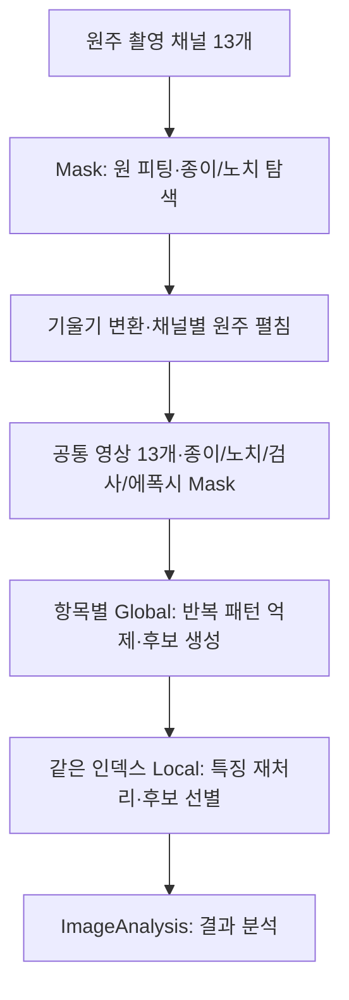
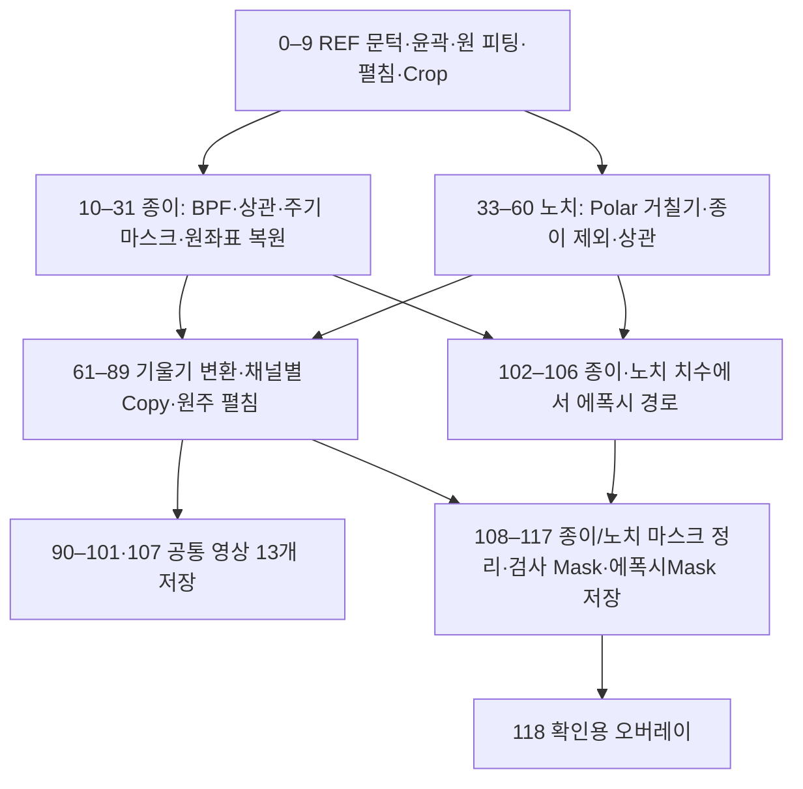
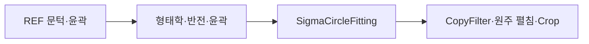
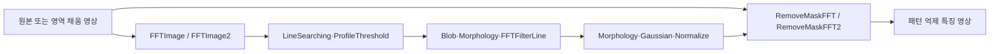
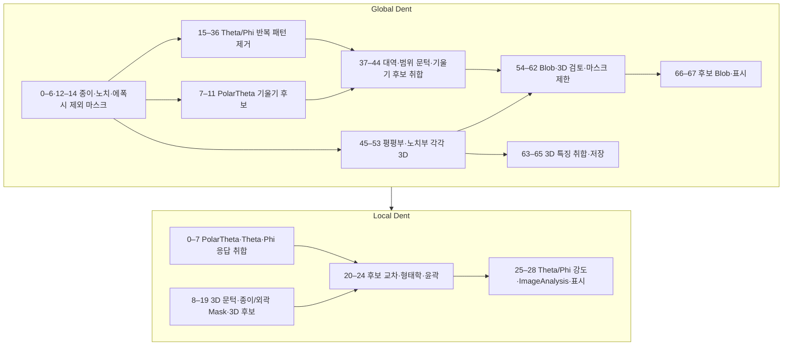
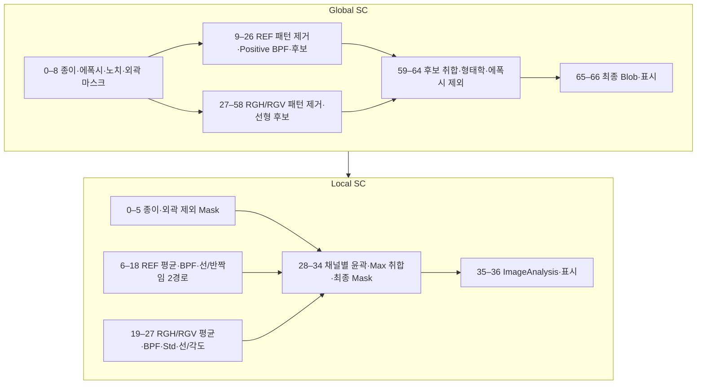
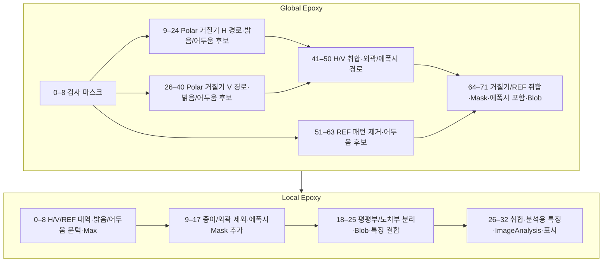
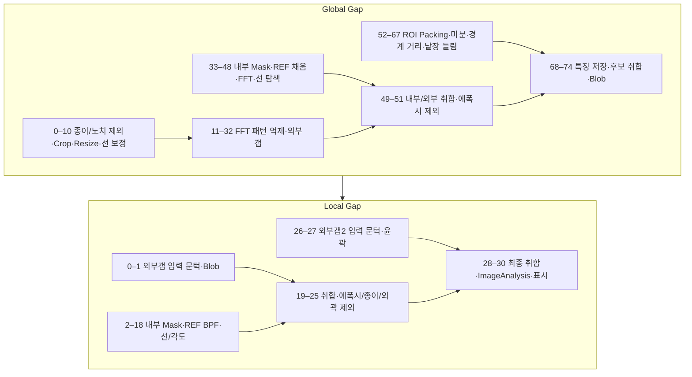
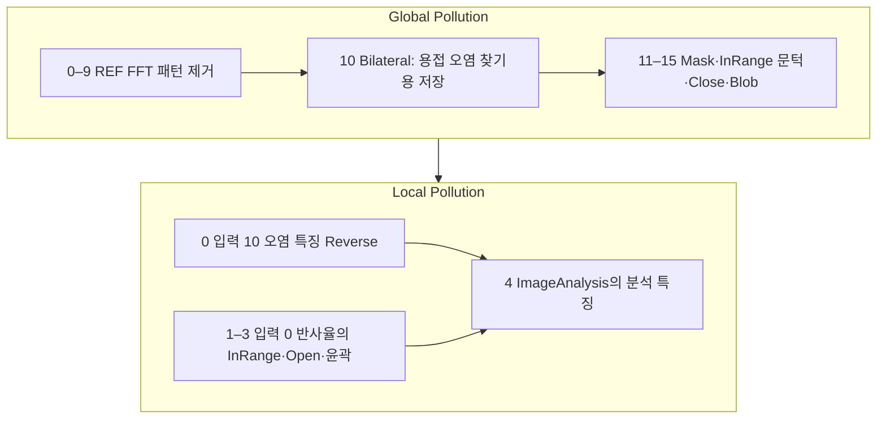

# 내경 검사 알고리즘

[측면 검사](측면.md) · [공통 영상처리 기법·분석 기준](영상처리기법.md)

원본: `D:\Setup\파비스(현대자동차) 2\알고리즘\내경`의 **13개 JSON, 562개 노드**. 검사 항목은 Dent(찍힘), SC(스크래치로 추정), Epoxy(에폭시), Gap(갭), Pollution(오염)입니다. 각 항목은 Global/Local 두 단계로 구성되며, 별도로 Mask 전처리가 있습니다.

> 흐름도는 도구와 결과명에 근거한 **처리 목적의 추정**입니다. 정확한 실행 목록·참조값은 각 펼침표를 참고하세요. [분석 기준과 이미지 슬롯 주의사항](영상처리기법.md#분석-기준과-읽는-법), [현재 앱의 실행 연결](영상처리기법.md#앱-실행과-json-의도는-구분)을 함께 읽어야 합니다.

## 목차

- [Mask 전처리](#mask-전처리) · [Mask 복사본](#mask-복사본)
- [Dent](#dent) · [SC](#sc) · [Epoxy](#epoxy) · [Gap](#gap) · [Pollution](#pollution)
- [Empty 템플릿](#empty-템플릿) · [확인 필요 사항](#확인-필요-사항)

## 전체 구조

Global의 정상 검사 파일 5개는 입력 목록이 같습니다. Local은 0–8 및 13–16이 공통이고 **9–12가 항목별 특징**입니다. Global 저장 노드와 Local 입력명의 대응은 아래에 기록하되 실제 반환 배열·다중 출력 슬롯 구성은 실행으로 확인하지 않았습니다.

## Mask 전처리

`Mask.json`: 입력 13개, 119개 노드. 원형 위치 기준을 찾은 뒤 종이·노치 마스크를 만들고 영상 채널을 펼치는 전처리입니다.

| 구간 | 해석과 핵심 기법 |
|---|---|
| 0–9 | Threshold → 윤곽·형태학 → [SigmaCircleFitting](영상처리기법.md#sigmacirclefitting) → CopyFilter → [UnwrapCircleToRect](영상처리기법.md#unwrapcircletorect) → Crop |
| 10–32 | BPF·Average·문턱·윤곽·Shift 후 `종이Blob` 구성. [MakePatternMask](영상처리기법.md#makepatternmask)·[Correlation1D](영상처리기법.md#correlation1d)·BlobThreshold·FFTFilterLine으로 반복 배열을 고르고 원좌표 마스크도 만듦 |
| 33–60 | PolarTheta 거칠기 입력을 같은 원 기준으로 펼쳐 종이 영역을 고려한 채움·BPF·상관 경로 수행. 결과명 `노치Mask` 저장 |
| 61–62 | [SlopeToThetaPhi](영상처리기법.md#slopetothetaphi)·[ThetaReference](영상처리기법.md#thetareference)로 2DTheta/Phi 및 PolarTheta 기준 경로 구성 |
| 63–89 | 거칠기·기울기·PolarTheta·RGB를 동일 원 기준으로 복사하고 각각 펼침·Crop·크기 조정 |
| 90–107 | 공통 영상 저장, 종이·노치 Blob의 [BlobDimension](영상처리기법.md#blobdimension) 결과로 `에폭시` 후보 경로 구성 |
| 108–118 | [BlobMaskRectifier](영상처리기법.md#blobmaskrectifier)로 종이·노치 마스크 정리, 검사 Mask 생성, 에폭시 경로 Close 후 저장 |

최종 공통 입력명에 대응하는 출력은 `반사율`, `거칠기(H)`, `거칠기(V)`, `거칠기(양방향)`, `기울기(2DTHETA)`, `기울기(2DPHI)`, `기울기(양방향)`, `반사율(PolarTheta)`, `거칠기(PolarTheta)`, `기울기(PolarTheta)`, `R`, `G`, `B`, `종이Mask`, `노치Mask`, `Mask`, `에폭시Mask`입니다.

그보다 앞선 `UnwrapRectToCircle_31=종이Mask`, `ClearFilter_60=노치Mask`, `SlopeToThetaPhi_61=ThetaPhi`, `ThetaReference_62=Theta`도 저장 표시가 있습니다. **저장 표시 총 21개를 단순 나열한 목록과 Global의 입력 17개가 같지는 않습니다.** 중간 저장·중복 결과명·복수 결과 반환 정책은 DLL 실행에서 확인해야 합니다.

Mask.json — 전체 119개 노드와 원문 설정

원본 SHA-256 앞 16자리: `d4710474b858d989`. 입력 13개. JSON 기록 시각: `2025.08.22 21:06`.

| 순번·도구 | 이미지 참조 1 / 2 / 3 / 4 | 선택 옵션 1 / 2 | I1 / I2; P1 / P2 / P3 | 결과명 · SaveUse |
|---|---|---|---|---|
| [Threshold_0](영상처리기법.md#threshold) | 0 / 0 / 0 / 0 | 2:InRange / 0:Manual | 50 / 50; 20 / 0 / 0 | 이름 없음 · `false` |
| [BlobContourCriteria_1](영상처리기법.md#blobcontourcriteria) | 13 / 0 / 0 / 0 | 0:And / 0:Lable Image | 0 / 0; 5 / 0.5 / 0.5 | 이름 없음 · `false` |
| [Morphology_2](영상처리기법.md#morphology) | 14 / 0 / 0 / 0 | 0:Rect / 3:Close(Dilate->Eroce) | 101 / 101; 3 / 0 / 0 | 이름 없음 · `false` |
| [Reverse_3](영상처리기법.md#reverse) | 15 / 0 / 0 / 0 | 0:Sub / 0:옵션 없음 | 0 / 0; 5 / 0.5 / 0.5 | 이름 없음 · `false` |
| [BlobContourCriteria_4](영상처리기법.md#blobcontourcriteria) | 16 / 0 / 0 / 0 | 0:And / 0:Lable Image | 0 / 0; 5 / 0.5 / 0.5 | 이름 없음 · `false` |
| [Morphology_5](영상처리기법.md#morphology) | 17 / 0 / 0 / 0 | 0:Rect / 4:Gradient(Close-Open) | 3 / 3; 3 / 0 / 0 | 이름 없음 · `false` |
| [SigmaCircleFitting_6](영상처리기법.md#sigmacirclefitting) | 18 / 0 / 0 / 0 | 0:Fill / 0:Max | 2300 / 2560; 0.5 / 30 / 1 | 이름 없음 · `false` |
| [CopyFilter_7](영상처리기법.md#copyfilter) | 0 / 19 / 0 / 0 | 0:옵션 없음 / 0:옵션 없음 | 0 / 0; 5 / 0.5 / 0.5 | REF_Copy · `false` |
| [UnwrapCircleToRect_8](영상처리기법.md#unwrapcircletorect) | 20 / 0 / 0 / 0 | 0:Auto / 0:Auto | 2000 / 0; 3624 / 22772 / 255 | 이름 없음 · `false` |
| [MakeCropImage_9](영상처리기법.md#makecropimage) | 21 / 21 / 0 / 0 | 1:Manual / 0:옵션 없음 | 0 / 0; 1 / 1 / 2 | 이름 없음 · `false` |
| [BPF_10](영상처리기법.md#bpf) | 22 / 0 / 0 / 0 | 3:Negative / -1:옵션 없음 | 0 / 0; 5 / 0.5 / 1 | 이름 없음 · `false` |
| [Average_11](영상처리기법.md#average) | 23 / 0 / 0 / 0 | -1:옵션 없음 / -1:옵션 없음 | 11 / 51; 3 / 0 / 0 | 이름 없음 · `false` |
| [Threshold_12](영상처리기법.md#threshold) | 24 / 0 / 0 / 0 | 0:Normal / 0:Manual | 50 / 50; 30 / 0 / 0 | 이름 없음 · `false` |
| [Morphology_13](영상처리기법.md#morphology) | 25 / 0 / 0 / 0 | 0:Rect / 2:Open(Erode->Dilate) | 3 / 3; 3 / 0 / 0 | 이름 없음 · `false` |
| [ContourCriteria_14](영상처리기법.md#contourcriteria) | 26 / 0 / 0 / 0 | 0:And / 0:Lable Image | 0 / 0; 5 / 0.5 / 0.5 | 이름 없음 · `false` |
| [CropImageOverlay_15](영상처리기법.md#cropimageoverlay) | 27 / 27 / 0 / 0 | 0:옵션 없음 / 0:옵션 없음 | 0 / 0; 5 / 0.5 / 0.5 | 이름 없음 · `false` |
| [ImageShift_16](영상처리기법.md#imageshift) | 28 / 0 / 0 / 0 | 0:옵션 없음 / 0:옵션 없음 | -200 / 0; 0 / 0 / 0 | 이름 없음 · `false` |
| [Morphology_17](영상처리기법.md#morphology) | 29 / 0 / 0 / 0 | 0:Rect / 3:Close(Dilate->Eroce) | 81 / 1; 3 / 0 / 0 | 이름 없음 · `false` |
| [ImageShift_18](영상처리기법.md#imageshift) | 30 / 0 / 0 / 0 | 0:옵션 없음 / 0:옵션 없음 | 200 / 0; 0 / 0 / 0 | 이름 없음 · `false` |
| [MakeCropImage_19](영상처리기법.md#makecropimage) | 31 / 31 / 0 / 0 | 1:Manual / 0:옵션 없음 | 0 / 0; 1 / 1 / 2 | 종이Thres · `false` |
| [BlobContourCriteria_20](영상처리기법.md#blobcontourcriteria) | 32 / 0 / 0 / 0 | 0:And / 0:Lable Image | 0 / 0; 5 / 0.5 / 0.5 | 종이Blob · `false` |
| [MakePatternMask_21](영상처리기법.md#makepatternmask) | 33 / 0 / 0 / 0 | 0:옵션 없음 / 0:옵션 없음 | 0 / 0; 10 / 10 / 0.5 | 이름 없음 · `false` |
| [Correlation1D_22](영상처리기법.md#correlation1d) | 33 / 34 / 0 / 0 | 0:옵션 없음 / 0:옵션 없음 | 80 / 70; 0.44999998807907104 / 0.8999999761581421 / 0.6000000238418579 | 이름 없음 · `false` |
| [Threshold_23](영상처리기법.md#threshold) | 35 / 0 / 0 / 0 | 0:Normal / 0:Manual | 50 / 50; 1 / 0 / 0 | 이름 없음 · `false` |
| [BlobContourCriteria_24](영상처리기법.md#blobcontourcriteria) | 36 / 0 / 0 / 0 | 0:And / 1:Blob Grop | 0 / 0; 5 / 0.5 / 0.5 | 이름 없음 · `false` |
| [BlobThreshold_25](영상처리기법.md#blobthreshold) | 35 / 37 / 0 / 0 | 0:개별Threshold / 1:옵션 없음 | 1 / 0; 0 / 100 / 255 | Mask_Threshold · `false` |
| [FFTFilterLine_26](영상처리기법.md#fftfilterline) | 33 / 0 / 0 / 0 | 1:X / 1:옵션 없음 | 1 / 3; 100 / 100 / 1650 | 종이Line · `false` |
| [FFTFilterLine_27](영상처리기법.md#fftfilterline) | 38 / 0 / 0 / 0 | 1:X / 1:옵션 없음 | 1 / 3; 100 / 100 / 1650 | 마스크Line · `false` |
| [Morphology_28](영상처리기법.md#morphology) | 40 / 0 / 0 / 0 | 0:Rect / 1:Dilate | 91 / 3; 3 / 0 / 0 | 종이Mask_Rect · `false` |
| [MakeCropImage_29](영상처리기법.md#makecropimage) | 41 / 41 / 0 / 0 | 1:Manual / 0:옵션 없음 | 0 / 0; 1 / 1 / 2 | 이름 없음 · `false` |
| [MakeCropImage_30](영상처리기법.md#makecropimage) | 22 / 22 / 0 / 0 | 1:Manual / 0:옵션 없음 | 0 / 0; 1 / 1 / 2 | 이름 없음 · `false` |
| [UnwrapRectToCircle_31](영상처리기법.md#unwraprecttocircle) | 42 / 0 / 0 / 0 | 0:Auto / 1:Manual | 3624 / 0; 100 / 100 / 255 | 종이Mask · `true` |
| [MaskColorOverlay_32](영상처리기법.md#maskcoloroverlay) | 43 / 42 / 0 / 0 | 0:Fill / 0:옵션 없음 | 0 / 0; 255 / 0 / 0 | 종이마스크확인용 · `false` |
| [CopyFilter_33](영상처리기법.md#copyfilter) | 8 / 19 / 0 / 0 | 0:옵션 없음 / 0:옵션 없음 | 0 / 0; 5 / 0.5 / 0.5 | 이름 없음 · `false` |
| [UnwrapCircleToRect_34](영상처리기법.md#unwrapcircletorect) | 46 / 0 / 0 / 0 | 0:Auto / 0:Auto | 2000 / 0; 3624 / 22772 / 255 | RGN_Rect · `false` |
| [MakeCropImage_35](영상처리기법.md#makecropimage) | 47 / 47 / 0 / 0 | 1:Manual / 0:옵션 없음 | 0 / 0; 1 / 1 / 2 | 이름 없음 · `false` |
| [Reverse_36](영상처리기법.md#reverse) | 41 / 0 / 0 / 0 | 0:Sub / 0:옵션 없음 | 0 / 0; 5 / 0.5 / 0.5 | 이름 없음 · `false` |
| [Morphology_37](영상처리기법.md#morphology) | 49 / 0 / 0 / 0 | 0:Rect / 0:Erode | 21 / 1; 3 / 0 / 0 | 이름 없음 · `false` |
| [RegionFilling_38](영상처리기법.md#regionfilling) | 48 / 50 / 0 / 0 | 0:Normal / 0:false | 0 / 0; 1 / 0.5 / 0.5 | 이름 없음 · `false` |
| [BPF_39](영상처리기법.md#bpf) | 51 / 0 / 0 / 0 | 3:Negative / -1:옵션 없음 | 0 / 0; 5 / 0.5 / 1 | 이름 없음 · `false` |
| [Average_40](영상처리기법.md#average) | 52 / 0 / 0 / 0 | -1:옵션 없음 / -1:옵션 없음 | 11 / 51; 3 / 0 / 0 | 이름 없음 · `false` |
| [Threshold_41](영상처리기법.md#threshold) | 53 / 0 / 0 / 0 | 0:Normal / 0:Manual | 50 / 50; 30 / 0 / 0 | 이름 없음 · `false` |
| [ContourCriteria_42](영상처리기법.md#contourcriteria) | 54 / 0 / 0 / 0 | 0:And / 0:Lable Image | 0 / 0; 5 / 0.5 / 0.5 | 이름 없음 · `false` |
| [CropImageOverlay_43](영상처리기법.md#cropimageoverlay) | 55 / 55 / 0 / 0 | 0:옵션 없음 / 0:옵션 없음 | 0 / 0; 5 / 0.5 / 0.5 | 이름 없음 · `false` |
| [ImageShift_44](영상처리기법.md#imageshift) | 56 / 0 / 0 / 0 | 0:옵션 없음 / 0:옵션 없음 | 100 / 0; 0 / 0 / 0 | 이름 없음 · `false` |
| [Morphology_45](영상처리기법.md#morphology) | 57 / 0 / 0 / 0 | 0:Rect / 3:Close(Dilate->Eroce) | 161 / 3; 3 / 0 / 0 | 이름 없음 · `false` |
| [ImageShift_46](영상처리기법.md#imageshift) | 58 / 0 / 0 / 0 | 0:옵션 없음 / 0:옵션 없음 | -100 / 0; 0 / 0 / 0 | 이름 없음 · `false` |
| [MakeCropImage_47](영상처리기법.md#makecropimage) | 59 / 59 / 0 / 0 | 1:Manual / 0:옵션 없음 | 0 / 0; 1 / 1 / 2 | 이름 없음 · `false` |
| [BlobContourCriteria_48](영상처리기법.md#blobcontourcriteria) | 60 / 0 / 0 / 0 | 0:And / 0:Lable Image | 0 / 0; 5 / 0.5 / 0.5 | 이름 없음 · `false` |
| [MakePatternMask_49](영상처리기법.md#makepatternmask) | 61 / 0 / 0 / 0 | 0:옵션 없음 / 0:옵션 없음 | 0 / 0; 10 / 10 / 0.5 | 이름 없음 · `false` |
| [Correlation1D_50](영상처리기법.md#correlation1d) | 61 / 62 / 0 / 0 | 0:옵션 없음 / 0:옵션 없음 | 80 / 70; 0.44999998807907104 / 0.8999999761581421 / 0.6000000238418579 | 이름 없음 · `false` |
| [Threshold_51](영상처리기법.md#threshold) | 63 / 0 / 0 / 0 | 0:Normal / 0:Manual | 50 / 50; 10 / 0 / 0 | 이름 없음 · `false` |
| [BlobContourCriteria_52](영상처리기법.md#blobcontourcriteria) | 64 / 0 / 0 / 0 | 0:And / 1:Blob Grop | 0 / 0; 5 / 0.5 / 0.5 | 이름 없음 · `false` |
| [BlobThreshold_53](영상처리기법.md#blobthreshold) | 63 / 65 / 0 / 0 | 0:개별Threshold / 1:옵션 없음 | 1 / 0; 0 / 100 / 255 | 이름 없음 · `false` |
| [FFTFilterLine_54](영상처리기법.md#fftfilterline) | 66 / 0 / 0 / 0 | 1:X / 1:옵션 없음 | 1 / 3; 100 / 100 / 1650 | 마스크Line · `false` |
| [Morphology_55](영상처리기법.md#morphology) | 67 / 0 / 0 / 0 | 0:Rect / 1:Dilate | 171 / 1; 3 / 0 / 0 | 이름 없음 · `false` |
| [MakeCropImage_56](영상처리기법.md#makecropimage) | 68 / 68 / 0 / 0 | 1:Manual / 0:옵션 없음 | 0 / 0; 1 / 1 / 2 | 이름 없음 · `false` |
| [MakeCropImage_57](영상처리기법.md#makecropimage) | 47 / 47 / 0 / 0 | 1:Manual / 0:옵션 없음 | 0 / 0; 1 / 1 / 2 | 이름 없음 · `false` |
| [UnwrapRectToCircle_58](영상처리기법.md#unwraprecttocircle) | 69 / 0 / 0 / 0 | 0:Auto / 1:Manual | 3624 / 0; 100 / 100 / 255 | 이름 없음 · `false` |
| [MaskColorOverlay_59](영상처리기법.md#maskcoloroverlay) | 70 / 69 / 0 / 0 | 0:Fill / 0:옵션 없음 | 0 / 0; 255 / 0 / 0 | 이름 없음 · `false` |
| [ClearFilter_60](영상처리기법.md#clearfilter) | 71 / 0 / 0 / 0 | 0:옵션 없음 / 0:옵션 없음 | 0 / 0; 5 / 0.5 / 0.5 | 노치Mask · `true` |
| [SlopeToThetaPhi_61](영상처리기법.md#slopetothetaphi) | 5 / 4 / 0 / 0 | 0:Clock(1) / 0:옵션 없음 | 0 / 0; 1.57 / 100 / 255 | ThetaPhi · `true` |
| [ThetaReference_62](영상처리기법.md#thetareference) | 9 / 0 / 0 / 0 | 1:ClockWise(-1) / 1:TwoPi | 0 / 0; -1.5 / 100 / 255 | Theta · `true` |
| [CopyFilter_63](영상처리기법.md#copyfilter) | 1 / 19 / 0 / 0 | 0:옵션 없음 / 0:옵션 없음 | 0 / 0; 5 / 0.5 / 0.5 | RGH_Copy · `false` |
| [CopyFilter_64](영상처리기법.md#copyfilter) | 2 / 19 / 0 / 0 | 0:옵션 없음 / 0:옵션 없음 | 0 / 0; 5 / 0.5 / 0.5 | RGV_Copy · `false` |
| [CopyFilter_65](영상처리기법.md#copyfilter) | 3 / 19 / 0 / 0 | 0:옵션 없음 / 0:옵션 없음 | 0 / 0; 5 / 0.5 / 0.5 | RG2_Copy · `false` |
| [CopyFilter_66](영상처리기법.md#copyfilter) | 74 / 19 / 0 / 0 | 0:옵션 없음 / 0:옵션 없음 | 0 / 0; 5 / 0.5 / 0.5 | 2DTheta_Copy · `false` |
| [CopyFilter_67](영상처리기법.md#copyfilter) | 75 / 19 / 0 / 0 | 0:옵션 없음 / 0:옵션 없음 | 0 / 0; 5 / 0.5 / 0.5 | 2DPhi_Copy · `false` |
| [CopyFilter_68](영상처리기법.md#copyfilter) | 6 / 19 / 0 / 0 | 0:옵션 없음 / 0:옵션 없음 | 0 / 0; 5 / 0.5 / 0.5 | IN2_Copy · `false` |
| [CopyFilter_69](영상처리기법.md#copyfilter) | 7 / 19 / 0 / 0 | 0:옵션 없음 / 0:옵션 없음 | 0 / 0; 5 / 0.5 / 0.5 | PolarTheta_REF_Copy · `false` |
| [CopyFilter_70](영상처리기법.md#copyfilter) | 8 / 19 / 0 / 0 | 0:옵션 없음 / 0:옵션 없음 | 0 / 0; 5 / 0.5 / 0.5 | PolarTheta_RGN_Copy · `false` |
| [CopyFilter_71](영상처리기법.md#copyfilter) | 76 / 19 / 0 / 0 | 0:옵션 없음 / 0:옵션 없음 | 0 / 0; 5 / 0.5 / 0.5 | PolarTheta_INC_Copy · `false` |
| [CopyFilter_72](영상처리기법.md#copyfilter) | 10 / 19 / 0 / 0 | 0:옵션 없음 / 0:옵션 없음 | 0 / 0; 5 / 0.5 / 0.5 | R_Copy · `false` |
| [CopyFilter_73](영상처리기법.md#copyfilter) | 11 / 19 / 0 / 0 | 0:옵션 없음 / 0:옵션 없음 | 0 / 0; 5 / 0.5 / 0.5 | G_Copy · `false` |
| [CopyFilter_74](영상처리기법.md#copyfilter) | 12 / 19 / 0 / 0 | 0:옵션 없음 / 0:옵션 없음 | 0 / 0; 5 / 0.5 / 0.5 | B_Copy · `false` |
| [UnwrapCircleToRect_75](영상처리기법.md#unwrapcircletorect) | 77 / 0 / 0 / 0 | 0:Auto / 0:Auto | 0 / 0; 3624 / 22772 / 255 | RGH_Rect · `false` |
| [UnwrapCircleToRect_76](영상처리기법.md#unwrapcircletorect) | 78 / 0 / 0 / 0 | 0:Auto / 0:Auto | 0 / 0; 3624 / 22772 / 255 | RGV_Rect · `false` |
| [UnwrapCircleToRect_77](영상처리기법.md#unwrapcircletorect) | 79 / 0 / 0 / 0 | 0:Auto / 0:Auto | 0 / 0; 3624 / 22772 / 255 | RG2_Rect · `false` |
| [UnwrapCircleToRect_78](영상처리기법.md#unwrapcircletorect) | 80 / 0 / 0 / 0 | 0:Auto / 0:Auto | 0 / 0; 3624 / 22772 / 255 | 2DTheta_Rect · `false` |
| [UnwrapCircleToRect_79](영상처리기법.md#unwrapcircletorect) | 81 / 0 / 0 / 0 | 0:Auto / 0:Auto | 0 / 0; 3624 / 22772 / 255 | 2DPhi_Rect · `false` |
| [UnwrapCircleToRect_80](영상처리기법.md#unwrapcircletorect) | 82 / 0 / 0 / 0 | 0:Auto / 0:Auto | 0 / 0; 3624 / 22772 / 255 | IN2_Rect · `false` |
| [UnwrapCircleToRect_81](영상처리기법.md#unwrapcircletorect) | 83 / 0 / 0 / 0 | 0:Auto / 0:Auto | 0 / 0; 3624 / 22772 / 255 | PolarTheta_REF_Rect · `false` |
| [UnwrapCircleToRect_82](영상처리기법.md#unwrapcircletorect) | 84 / 0 / 0 / 0 | 0:Auto / 0:Auto | 0 / 0; 3624 / 22772 / 255 | PolarTheta_RGN_Rect · `false` |
| [UnwrapCircleToRect_83](영상처리기법.md#unwrapcircletorect) | 85 / 0 / 0 / 0 | 0:Auto / 0:Auto | 0 / 0; 3624 / 22772 / 255 | PolarTheta_INC_Rect · `false` |
| [UnwrapCircleToRect_84](영상처리기법.md#unwrapcircletorect) | 86 / 0 / 0 / 0 | 0:Auto / 0:Auto | 0 / 0; 3624 / 22772 / 255 | R_Rect · `false` |
| [UnwrapCircleToRect_85](영상처리기법.md#unwrapcircletorect) | 87 / 0 / 0 / 0 | 0:Auto / 0:Auto | 0 / 0; 3624 / 22772 / 255 | G_Rect · `false` |
| [UnwrapCircleToRect_86](영상처리기법.md#unwrapcircletorect) | 88 / 0 / 0 / 0 | 0:Auto / 0:Auto | 0 / 0; 3624 / 22772 / 255 | B_Rect · `false` |
| [MakeCropImage_87](영상처리기법.md#makecropimage) | 89 / 100 / 0 / 0 | 1:Manual / 0:옵션 없음 | 0 / 0; 1 / 1 / 2 | 이름 없음 · `false` |
| [MakeResizeImage_88](영상처리기법.md#makeresizeimage) | 42 / 42 / 0 / 0 | 1:Manual / 0:옵션 없음 | 22768 / 448; 1 / 1 / 2 | 이름 없음 · `false` |
| [MakeCropImage_89](영상처리기법.md#makecropimage) | 21 / 21 / 0 / 0 | 1:Manual / 0:옵션 없음 | 0 / 0; 1 / 1 / 2 | REF · `false` |
| [OutputImage_90](영상처리기법.md#outputimage) | 114 / 0 / 0 / 0 | 0:옵션 없음 / 0:옵션 없음 | 0 / 0; 5 / 0.5 / 0.5 | 반사율 · `true` |
| [OutputImage_91](영상처리기법.md#outputimage) | 101 / 0 / 0 / 0 | 0:옵션 없음 / 0:옵션 없음 | 0 / 0; 5 / 0.5 / 0.5 | 거칠기(H) · `true` |
| [OutputImage_92](영상처리기법.md#outputimage) | 102 / 0 / 0 / 0 | 0:옵션 없음 / 0:옵션 없음 | 0 / 0; 5 / 0.5 / 0.5 | 거칠기(V) · `true` |
| [OutputImage_93](영상처리기법.md#outputimage) | 103 / 0 / 0 / 0 | 0:옵션 없음 / 0:옵션 없음 | 0 / 0; 5 / 0.5 / 0.5 | 거칠기(양방향) · `true` |
| [OutputImage_94](영상처리기법.md#outputimage) | 104 / 0 / 0 / 0 | 0:옵션 없음 / 0:옵션 없음 | 0 / 0; 5 / 0.5 / 0.5 | 기울기(2DTHETA) · `true` |
| [OutputImage_95](영상처리기법.md#outputimage) | 105 / 0 / 0 / 0 | 0:옵션 없음 / 0:옵션 없음 | 0 / 0; 5 / 0.5 / 0.5 | 기울기(2DPHI) · `true` |
| [OutputImage_96](영상처리기법.md#outputimage) | 106 / 0 / 0 / 0 | 0:옵션 없음 / 0:옵션 없음 | 0 / 0; 5 / 0.5 / 0.5 | 기울기(양방향) · `true` |
| [OutputImage_97](영상처리기법.md#outputimage) | 107 / 0 / 0 / 0 | 0:옵션 없음 / 0:옵션 없음 | 0 / 0; 5 / 0.5 / 0.5 | 반사율(PolarTheta) · `true` |
| [OutputImage_98](영상처리기법.md#outputimage) | 108 / 0 / 0 / 0 | 0:옵션 없음 / 0:옵션 없음 | 0 / 0; 5 / 0.5 / 0.5 | 거칠기(PolarTheta) · `true` |
| [OutputImage_99](영상처리기법.md#outputimage) | 109 / 0 / 0 / 0 | 0:옵션 없음 / 0:옵션 없음 | 0 / 0; 5 / 0.5 / 0.5 | 기울기(PolarTheta) · `true` |
| [OutputImage_100](영상처리기법.md#outputimage) | 110 / 0 / 0 / 0 | 0:옵션 없음 / 0:옵션 없음 | 0 / 0; 5 / 0.5 / 0.5 | R · `true` |
| [OutputImage_101](영상처리기법.md#outputimage) | 111 / 0 / 0 / 0 | 0:옵션 없음 / 0:옵션 없음 | 0 / 0; 5 / 0.5 / 0.5 | G · `true` |
| [BlobContourCriteria_102](영상처리기법.md#blobcontourcriteria) | 113 / 0 / 0 / 0 | 0:And / 1:Blob Grop | 0 / 0; 5 / 0.5 / 0.5 | 종이blob · `false` |
| [BlobContourCriteria_103](영상처리기법.md#blobcontourcriteria) | 69 / 0 / 0 / 0 | 0:And / 1:Blob Grop | 0 / 0; 5 / 0.5 / 0.5 | 노치Blob · `false` |
| [BlobDimension_104](영상처리기법.md#blobdimension) | 127 / 0 / 0 / 0 | 0:Search X / 1:Auto | 1 / 350; 5 / 0.5 / 0.5 | 이름 없음 · `false` |
| [BlobDimension_105](영상처리기법.md#blobdimension) | 128 / 0 / 0 / 0 | 0:Search X / 1:Auto | 1 / 250; 5 / 0.5 / 0.5 | 이름 없음 · `false` |
| [Arithmetic_106](영상처리기법.md#arithmetic) | 129 / 130 / 0 / 0 | 0:Add / 0:Not Use | 0 / 0; 1 / 0 / 0.5 | 에폭시 · `false` |
| [OutputImage_107](영상처리기법.md#outputimage) | 112 / 0 / 0 / 0 | 0:옵션 없음 / 0:옵션 없음 | 0 / 0; 5 / 0.5 / 0.5 | B · `true` |
| [Threshold_108](영상처리기법.md#threshold) | 113 / 0 / 0 / 0 | 0:Normal / 0:Manual | 50 / 50; 200 / 0 / 0 | 이름 없음 · `false` |
| [BlobContourCriteria_109](영상처리기법.md#blobcontourcriteria) | 133 / 0 / 0 / 0 | 0:And / 1:Blob Grop | 0 / 0; 5 / 0.5 / 0.5 | 이름 없음 · `false` |
| [BlobMaskRectifier_110](영상처리기법.md#blobmaskrectifier) | 133 / 134 / 0 / 0 | 0:옵션 없음 / 1:옵션 없음 | 1 / 0; 0 / 100 / 255 | 이름 없음 · `false` |
| [BlobContourCriteria_111](영상처리기법.md#blobcontourcriteria) | 69 / 0 / 0 / 0 | 0:And / 1:Blob Grop | 0 / 0; 5 / 0.5 / 0.5 | 이름 없음 · `false` |
| [BlobMaskRectifier_112](영상처리기법.md#blobmaskrectifier) | 136 / 136 / 0 / 0 | 0:옵션 없음 / 1:옵션 없음 | 1 / 0; 0 / 100 / 255 | 이름 없음 · `false` |
| [OutputImage_113](영상처리기법.md#outputimage) | 135 / 0 / 0 / 0 | 0:옵션 없음 / 0:옵션 없음 | 0 / 0; 5 / 0.5 / 0.5 | 종이Mask · `true` |
| [OutputImage_114](영상처리기법.md#outputimage) | 137 / 0 / 0 / 0 | 0:옵션 없음 / 0:옵션 없음 | 0 / 0; 5 / 0.5 / 0.5 | 노치Mask · `true` |
| [MakeMask_115](영상처리기법.md#makemask) | 109 / 0 / 0 / 0 | 0:옵션 없음 / 0:옵션 없음 | 0 / 2000; 22768 / 392 / 0.5 | Mask · `true` |
| [Morphology_116](영상처리기법.md#morphology) | 131 / 0 / 0 / 0 | 0:Rect / 3:Close(Dilate->Eroce) | 3 / 501; 3 / 0 / 0 | 이름 없음 · `false` |
| [OutputImage_117](영상처리기법.md#outputimage) | 141 / 0 / 0 / 0 | 0:옵션 없음 / 0:옵션 없음 | 0 / 0; 5 / 0.5 / 0.5 | 에폭시Mask · `true` |
| [MaskColorOverlay_118](영상처리기법.md#maskcoloroverlay) | 123 / 137 / 0 / 0 | 0:Fill / 0:옵션 없음 | 0 / 0; 255 / 0 / 0 | 이름 없음 · `false` |

## Mask 복사본

`Mask - 복사본.json`은 원본 Mask와 입력명·샘플 경로는 같지만 **119개가 아닌 첫 10개 노드만** 들어 있습니다.

`SaveUse=true` 노드가 없고 종이/노치/에폭시 마스크 생성·최종 채널 출력도 없습니다. 이름이 복사본이라고 해서 본 Mask의 대체 파일로 취급하면 안 됩니다.

Mask - 복사본.json — 전체 10개 노드와 원문 설정

원본 SHA-256 앞 16자리: `2e935c04436359fc`. 입력 13개. JSON 기록 시각: `2025.08.22 21:06`.

| 순번·도구 | 이미지 참조 1 / 2 / 3 / 4 | 선택 옵션 1 / 2 | I1 / I2; P1 / P2 / P3 | 결과명 · SaveUse |
|---|---|---|---|---|
| [Threshold_0](영상처리기법.md#threshold) | 0 / 0 / 0 / 0 | 2:InRange / 0:Manual | 50 / 50; 20 / 0 / 0 | 이름 없음 · `false` |
| [BlobContourCriteria_1](영상처리기법.md#blobcontourcriteria) | 13 / 0 / 0 / 0 | 0:And / 0:Lable Image | 0 / 0; 5 / 0.5 / 0.5 | 이름 없음 · `false` |
| [Morphology_2](영상처리기법.md#morphology) | 14 / 0 / 0 / 0 | 0:Rect / 3:Close(Dilate->Eroce) | 101 / 101; 3 / 0 / 0 | 이름 없음 · `false` |
| [Reverse_3](영상처리기법.md#reverse) | 15 / 0 / 0 / 0 | 0:Sub / 0:옵션 없음 | 0 / 0; 5 / 0.5 / 0.5 | 이름 없음 · `false` |
| [BlobContourCriteria_4](영상처리기법.md#blobcontourcriteria) | 16 / 0 / 0 / 0 | 0:And / 0:Lable Image | 0 / 0; 5 / 0.5 / 0.5 | 이름 없음 · `false` |
| [Morphology_5](영상처리기법.md#morphology) | 17 / 0 / 0 / 0 | 0:Rect / 4:Gradient(Close-Open) | 3 / 3; 3 / 0 / 0 | 이름 없음 · `false` |
| [SigmaCircleFitting_6](영상처리기법.md#sigmacirclefitting) | 18 / 0 / 0 / 0 | 0:Fill / 0:Max | 2300 / 2560; 0.5 / 30 / 1 | 이름 없음 · `false` |
| [CopyFilter_7](영상처리기법.md#copyfilter) | 0 / 19 / 0 / 0 | 0:옵션 없음 / 0:옵션 없음 | 0 / 0; 5 / 0.5 / 0.5 | REF_Copy · `false` |
| [UnwrapCircleToRect_8](영상처리기법.md#unwrapcircletorect) | 20 / 0 / 0 / 0 | 0:Auto / 0:Auto | 2000 / 0; 3624 / 22772 / 255 | 이름 없음 · `false` |
| [MakeCropImage_9](영상처리기법.md#makecropimage) | 21 / 21 / 0 / 0 | 1:Manual / 0:옵션 없음 | 0 / 0; 1 / 1 / 2 | 이름 없음 · `false` |

## 반복 패턴 제거 공통 구조

Dent의 Theta/Phi, SC의 REF/RGH/RGV, Epoxy의 거칠기/REF, Pollution의 REF 경로에 다음 계열이 반복됩니다. 항목별로 도구 버전·방향·마스크·Threshold 값은 다릅니다.

이는 정상 반복 무늬를 결함으로 오검출하지 않기 위한 전처리로 추정합니다. [FFT](영상처리기법.md#fftimage2), [주파수 마스크](영상처리기법.md#fftfilterline), [패턴 제거](영상처리기법.md#removemaskfft2)의 원리는 공통 사전을 참고하세요.

## Dent

**의도 추정:** Theta/Phi·PolarTheta 기울기에서 찍힘 후보를 만들고 평평부·노치부의 3D 계열 특징으로 선별합니다. 파일명은 원문 그대로 `Glabal_Dent.json`입니다. Global 68개, Local 29개 노드입니다.

| 단계 | JSON상 근거와 해석 |
|---|---|
| Global 0–14 | 종이·노치 Dilate, 외곽 Erode, 에폭시 제외. PolarTheta 영역 채움 → EdgeThreshold2 → Outline 마스크로 기울기 후보 |
| Global 15–36 | Theta와 Phi 각각 FFTImage2 1D-H → 프로파일·선·Blob·주파수 필터 마스크 → RemoveMaskFFT2 |
| Global 37–44 | SingleBPF·InRange Threshold 결과를 PolarTheta 후보와 취합하고 마스크 제한 |
| Global 45–65 | `평평Mask`, `노치Mask` 별도 채움·[Make3DImage](영상처리기법.md#make3dimage), BlobArithmetic으로 후보와 결합. 최종 에폭시 제외 및 평평/노치 3D 취합 |
| Local 0–24 | PolarTheta와 Theta/Phi 특징에서 후보 재검출. 별도 3D 문턱 후보에 Mask·팽창 적용 후 교차·Close·윤곽 정리 |
| Local 25–28 | Theta/Phi ABS SingleBPF를 분석용 강도로 생성, ImageAnalysis·오버레이 |

**전달 특징:** Local 9–12는 `PolarTheta_Region`, `Theta_패턴제거`, `Phi_패턴제거`, `3D결과`. 다만 Global의 실제 저장 결과명은 마지막 것이 **`3D데이터`**입니다. 이름 불일치를 문서에서 임의로 수정하지 않았습니다.

Glabal_Dent.json — 전체 68개 노드와 원문 설정

원본 SHA-256 앞 16자리: `cb7aa2ac6ea9a21d`. 입력 17개. JSON 기록 시각: `2025.08.23 00:54`.

| 순번·도구 | 이미지 참조 1 / 2 / 3 / 4 | 선택 옵션 1 / 2 | I1 / I2; P1 / P2 / P3 | 결과명 · SaveUse |
|---|---|---|---|---|
| [Morphology_0](영상처리기법.md#morphology) | 13 / 0 / 0 / 0 | 0:Rect / 1:Dilate | 11 / 3; 3 / 0 / 0 | 종이_Dilate_Mask · `false` |
| [Morphology_1](영상처리기법.md#morphology) | 14 / 0 / 0 / 0 | 0:Rect / 1:Dilate | 11 / 3; 3 / 0 / 0 | 노치_Dilate_Mask · `false` |
| [Arithmetic_2](영상처리기법.md#arithmetic) | 17 / 18 / 0 / 0 | 0:Add / 0:Not Use | 0 / 0; 1 / 0 / 0.5 | 이름 없음 · `false` |
| [Reverse_3](영상처리기법.md#reverse) | 19 / 0 / 0 / 0 | 0:Sub / 0:옵션 없음 | 0 / 0; 5 / 0.5 / 0.5 | 이름 없음 · `false` |
| [Morphology_4](영상처리기법.md#morphology) | 15 / 0 / 0 / 0 | 0:Rect / 0:Erode | 1 / 21; 3 / 0 / 0 | 이름 없음 · `false` |
| [Arithmetic_5](영상처리기법.md#arithmetic) | 20 / 21 / 0 / 0 | 4:And / 0:Not Use | 0 / 0; 1 / 0 / 0.5 | Mask_외각제거 · `false` |
| [Arithmetic_6](영상처리기법.md#arithmetic) | 22 / 16 / 0 / 0 | 1:Sub / 0:Not Use | 0 / 0; 1 / 0 / 0.5 | Mask_에폭시제거 · `false` |
| [RegionFilling_7](영상처리기법.md#regionfilling) | 9 / 23 / 0 / 0 | 0:Normal / 0:false | 0 / 0; 1 / 0.5 / 0.5 | PolarTheta_Region · `true` |
| [EdgeThreshold2_8](영상처리기법.md#edgethreshold2) | 24 / 0 / 0 / 0 | 0:Rect / 0:옵션 없음 | 5 / 50; 1 / 0 / 0 | 이름 없음 · `false` |
| [MakeCenterMask_9](영상처리기법.md#makecentermask) | 25 / 0 / 0 / 0 | 1:Outline / 0:옵션 없음 | 1 / 11; 50 / 1 / 0.5 | 이름 없음 · `false` |
| [Arithmetic_10](영상처리기법.md#arithmetic) | 25 / 26 / 0 / 0 | 4:And / 0:Not Use | 0 / 0; 1 / 0 / 0.5 | Polar기울기결과 · `false` |
| [MaskColorOverlay_11](영상처리기법.md#maskcoloroverlay) | 9 / 27 / 0 / 0 | 0:Fill / 0:옵션 없음 | 0 / 0; 255 / 0 / 0 | 이름 없음 · `false` |
| [Reverse_12](영상처리기법.md#reverse) | 21 / 0 / 0 / 0 | 0:Sub / 0:옵션 없음 | 0 / 0; 50 / 0.10000000149011612 / 0.5 | 이름 없음 · `false` |
| [Arithmetic_13](영상처리기법.md#arithmetic) | 17 / 29 / 0 / 0 | 0:Add / 0:Not Use | 0 / 0; 1 / 0 / 0.5 | 이름 없음 · `false` |
| [Reverse_14](영상처리기법.md#reverse) | 30 / 0 / 0 / 0 | 0:Sub / 0:옵션 없음 | 0 / 0; 50 / 0.10000000149011612 / 0.5 | Mask · `false` |
| [RegionFilling_15](영상처리기법.md#regionfilling) | 4 / 31 / 0 / 0 | 0:Normal / 0:false | 0 / 0; 0.25 / 0.5 / 0.5 | Theta_region · `false` |
| [RegionFilling_16](영상처리기법.md#regionfilling) | 5 / 31 / 0 / 0 | 0:Normal / 0:false | 0 / 0; 0.25 / 0.5 / 0.5 | Phi_region · `false` |
| [FFTImage2_17](영상처리기법.md#fftimage2) | 32 / 0 / 0 / 0 | 0:1D-H / 0:옵션 없음 | 1000 / 2; 50 / 1 / 0.5 | 이름 없음 · `false` |
| [FFTImage2_18](영상처리기법.md#fftimage2) | 33 / 0 / 0 / 0 | 0:1D-H / 0:옵션 없음 | 1000 / 2; 50 / 1 / 0.5 | 이름 없음 · `false` |
| [LineSearching_19](영상처리기법.md#linesearching) | 34 / 0 / 0 / 0 | 1:옵션 없음 / 0:옵션 없음 | 501 / 0; 1 / 90 / 1 | 이름 없음 · `false` |
| [LineSearching_20](영상처리기법.md#linesearching) | 35 / 0 / 0 / 0 | 1:옵션 없음 / 0:옵션 없음 | 501 / 0; 1 / 90 / 1 | 이름 없음 · `false` |
| [ProfileThreshold_21](영상처리기법.md#profilethreshold) | 36 / 0 / 0 / 0 | 1:Max / 1:Use | 30 / 50; 0.2 / 0 / 0 | 이름 없음 · `false` |
| [ProfileThreshold_22](영상처리기법.md#profilethreshold) | 37 / 0 / 0 / 0 | 1:Max / 1:Use | 30 / 50; 0.2 / 0 / 0 | 이름 없음 · `false` |
| [BlobContourCriteria_23](영상처리기법.md#blobcontourcriteria) | 38 / 0 / 0 / 0 | 0:And / 0:Lable Image | 0 / 0; 5 / 0.5 / 0.5 | 이름 없음 · `false` |
| [BlobContourCriteria_24](영상처리기법.md#blobcontourcriteria) | 39 / 0 / 0 / 0 | 0:And / 0:Lable Image | 0 / 0; 5 / 0.5 / 0.5 | 이름 없음 · `false` |
| [Morphology_25](영상처리기법.md#morphology) | 40 / 0 / 0 / 0 | 0:Rect / 1:Dilate | 5 / 1001; 3 / 0 / 0 | 이름 없음 · `false` |
| [Morphology_26](영상처리기법.md#morphology) | 41 / 0 / 0 / 0 | 0:Rect / 1:Dilate | 5 / 1001; 3 / 0 / 0 | 이름 없음 · `false` |
| [FFTFilterLine_27](영상처리기법.md#fftfilterline) | 42 / 0 / 0 / 0 | 1:X / 1:옵션 없음 | 1 / 3; 100 / 100 / 1650 | 이름 없음 · `false` |
| [FFTFilterLine_28](영상처리기법.md#fftfilterline) | 43 / 0 / 0 / 0 | 1:X / 1:옵션 없음 | 1 / 3; 100 / 100 / 1650 | 이름 없음 · `false` |
| [Morphology_29](영상처리기법.md#morphology) | 44 / 0 / 0 / 0 | 0:Rect / 1:Dilate | 11 / 1; 3 / 0 / 0 | 이름 없음 · `false` |
| [Morphology_30](영상처리기법.md#morphology) | 45 / 0 / 0 / 0 | 0:Rect / 1:Dilate | 11 / 1; 3 / 0 / 0 | 이름 없음 · `false` |
| [Gaussian_31](영상처리기법.md#gaussian) | 46 / 0 / 0 / 0 | 0:옵션 없음 / 0:옵션 없음 | 21 / 1; 3 / 0 / 0 | 이름 없음 · `false` |
| [Gaussian_32](영상처리기법.md#gaussian) | 47 / 0 / 0 / 0 | 0:옵션 없음 / 0:옵션 없음 | 21 / 1; 3 / 0 / 0 | 이름 없음 · `false` |
| [ImageNormalize_33](영상처리기법.md#imagenormalize) | 48 / 0 / 0 / 0 | 0:Manual / 0:옵션 없음 | 0 / 0; 5 / 0.5 / 0.5 | 이름 없음 · `false` |
| [ImageNormalize_34](영상처리기법.md#imagenormalize) | 49 / 0 / 0 / 0 | 0:Manual / 0:옵션 없음 | 0 / 0; 5 / 0.5 / 0.5 | 이름 없음 · `false` |
| [RemoveMaskFFT2_35](영상처리기법.md#removemaskfft2) | 32 / 50 / 0 / 0 | 0:1D-H / 0:Mask | 1000 / 2; 50 / 1 / 0.5 | Theta_패턴제거 · `true` |
| [RemoveMaskFFT2_36](영상처리기법.md#removemaskfft2) | 33 / 51 / 0 / 0 | 0:1D-H / 0:Mask | 1000 / 2; 50 / 1 / 0.5 | Phi_패턴제거 · `true` |
| [SingleBPF_37](영상처리기법.md#singlebpf) | 52 / 0 / 0 / 0 | 0:Basic / 1:Vertical | 0 / 0; 5 / 0.25 / 0.4 | 이름 없음 · `false` |
| [SingleBPF_38](영상처리기법.md#singlebpf) | 53 / 0 / 0 / 0 | 0:Basic / 1:Vertical | 0 / 0; 5 / 0.25 / 0.4 | 이름 없음 · `false` |
| [Threshold_39](영상처리기법.md#threshold) | 54 / 0 / 0 / 0 | 2:InRange / 0:Manual | 50 / 50; 90 / 0 / 0 | 이름 없음 · `false` |
| [Threshold_40](영상처리기법.md#threshold) | 55 / 0 / 0 / 0 | 2:InRange / 0:Manual | 50 / 50; 60 / 0 / 0 | 이름 없음 · `false` |
| [Arithmetic_41](영상처리기법.md#arithmetic) | 56 / 57 / 0 / 0 | 0:Add / 0:Not Use | 0 / 0; 1 / 0 / 0.5 | 이름 없음 · `false` |
| [Arithmetic_42](영상처리기법.md#arithmetic) | 58 / 27 / 0 / 0 | 0:Add / 0:Not Use | 0 / 0; 1 / 0 / 0.5 | 이름 없음 · `false` |
| [Arithmetic_43](영상처리기법.md#arithmetic) | 59 / 31 / 0 / 0 | 4:And / 0:Not Use | 0 / 0; 1 / 0 / 0.5 | 이름 없음 · `false` |
| [Arithmetic_44](영상처리기법.md#arithmetic) | 60 / 26 / 0 / 0 | 4:And / 0:Not Use | 0 / 0; 1 / 0 / 0.5 | 찍힘후보 · `false` |
| [Arithmetic_45](영상처리기법.md#arithmetic) | 31 / 18 / 0 / 0 | 1:Sub / 0:Not Use | 0 / 0; 1 / 0 / 0.5 | 평평Mask · `false` |
| [RegionFilling_46](영상처리기법.md#regionfilling) | 4 / 62 / 0 / 0 | 0:Normal / 0:false | 0 / 0; 0.25 / 0.5 / 0.5 | 이름 없음 · `false` |
| [RegionFilling_47](영상처리기법.md#regionfilling) | 5 / 62 / 0 / 0 | 0:Normal / 0:false | 0 / 0; 0.25 / 0.5 / 0.5 | 이름 없음 · `false` |
| [Make3DImage_48](영상처리기법.md#make3dimage) | 63 / 64 / 0 / 0 | 0:Basic / 0:Normal | 0 / 0; 5 / 0.35 / 1 | 3D결과 · `false` |
| [Morphology_49](영상처리기법.md#morphology) | 14 / 0 / 0 / 0 | 0:Rect / 0:Erode | 11 / 3; 3 / 0 / 0 | 이름 없음 · `false` |
| [Arithmetic_50](영상처리기법.md#arithmetic) | 66 / 21 / 0 / 0 | 4:And / 0:Not Use | 0 / 0; 1 / 0 / 0.5 | 노치Mask · `false` |
| [RegionFilling_51](영상처리기법.md#regionfilling) | 4 / 67 / 0 / 0 | 0:Normal / 0:false | 0 / 0; 0.25 / 0.5 / 0.5 | 이름 없음 · `false` |
| [RegionFilling_52](영상처리기법.md#regionfilling) | 5 / 67 / 0 / 0 | 0:Normal / 0:false | 0 / 0; 0.25 / 0.5 / 0.5 | 이름 없음 · `false` |
| [Make3DImage_53](영상처리기법.md#make3dimage) | 68 / 69 / 0 / 0 | 0:Basic / 0:Normal | 0 / 0; 5 / 0.45 / 1 | 3D결과_노치 · `false` |
| [ClearFilter_54](영상처리기법.md#clearfilter) | 61 / 0 / 0 / 0 | 0:옵션 없음 / 0:옵션 없음 | 0 / 0; 5 / 0.5 / 0.5 | 이름 없음 · `false` |
| [BlobContourCriteria_55](영상처리기법.md#blobcontourcriteria) | 71 / 0 / 0 / 0 | 0:And / 0:Lable Image | 0 / 0; 5 / 0.5 / 0.5 | 이름 없음 · `false` |
| [BlobArithmetic_56](영상처리기법.md#blobarithmetic) | 65 / 72 / 0 / 0 | 0:옵션 없음 / 0:옵션 없음 | 0 / 0; 0 / 255 / 0 | 이름 없음 · `false` |
| [BlobArithmetic_57](영상처리기법.md#blobarithmetic) | 70 / 72 / 0 / 0 | 0:옵션 없음 / 0:옵션 없음 | 0 / 0; 0 / 255 / 0 | 이름 없음 · `false` |
| [MakeCenterMask_58](영상처리기법.md#makecentermask) | 66 / 0 / 0 / 0 | 1:Outline / 0:옵션 없음 | 1 / 21; 50 / 1 / 0.5 | 이름 없음 · `false` |
| [Arithmetic_59](영상처리기법.md#arithmetic) | 62 / 75 / 0 / 0 | 4:And / 0:Not Use | 0 / 0; 1 / 0 / 0.5 | 평평최종마스크 · `false` |
| [Arithmetic_60](영상처리기법.md#arithmetic) | 73 / 74 / 0 / 0 | 4:And / 0:Not Use | 0 / 0; 1 / 0 / 0.5 | 찍힘결과 · `false` |
| [Arithmetic_61](영상처리기법.md#arithmetic) | 77 / 76 / 0 / 0 | 4:And / 0:Not Use | 0 / 0; 1 / 0 / 0.5 | 찍힘결과_마스킹 · `false` |
| [Arithmetic_62](영상처리기법.md#arithmetic) | 78 / 16 / 0 / 0 | 1:Sub / 0:Not Use | 0 / 0; 1 / 0 / 0.5 | 찍힘결과_에폭시제거 · `false` |
| [Arithmetic_63](영상처리기법.md#arithmetic) | 65 / 67 / 0 / 0 | 1:Sub / 0:Not Use | 0 / 0; 1 / 0 / 0.5 | 3D_평평 · `false` |
| [Arithmetic_64](영상처리기법.md#arithmetic) | 70 / 67 / 0 / 0 | 4:And / 0:Not Use | 0 / 0; 1 / 0 / 0.5 | 3D_노치 · `false` |
| [Arithmetic_65](영상처리기법.md#arithmetic) | 80 / 81 / 0 / 0 | 0:Add / 0:Not Use | 0 / 0; 1 / 0 / 0.5 | 3D데이터 · `true` |
| [BlobContourCriteria_66](영상처리기법.md#blobcontourcriteria) | 79 / 0 / 0 / 0 | 0:And / 0:Lable Image | 30 / 0; 5 / 0.5 / 0.5 | 이름 없음 · `true` |
| [MaskColorOverlay_67](영상처리기법.md#maskcoloroverlay) | 0 / 83 / 0 / 0 | 0:Fill / 0:옵션 없음 | 0 / 0; 255 / 0 / 0 | 이름 없음 · `false` |

Local_Dent.json — 전체 29개 노드와 원문 설정

원본 SHA-256 앞 16자리: `837832764e2970f6`. 입력 17개. JSON 기록 시각: `2025.08.22 11:09`.

| 순번·도구 | 이미지 참조 1 / 2 / 3 / 4 | 선택 옵션 1 / 2 | I1 / I2; P1 / P2 / P3 | 결과명 · SaveUse |
|---|---|---|---|---|
| [BPF2_0](영상처리기법.md#bpf2) | 9 / 0 / 0 / 0 | 1:ABS / -1:옵션 없음 | 0 / 0; 5 / 0.4 / 0.8 | 이름 없음 · `false` |
| [SingleBPF_1](영상처리기법.md#singlebpf) | 10 / 0 / 0 / 0 | 1:ABS / 1:Vertical | 0 / 0; 5 / 0.15 / 0.4 | 이름 없음 · `false` |
| [SingleBPF_2](영상처리기법.md#singlebpf) | 11 / 0 / 0 / 0 | 1:ABS / 1:Vertical | 0 / 0; 5 / 0.15 / 0.4 | 이름 없음 · `false` |
| [Threshold_3](영상처리기법.md#threshold) | 18 / 0 / 0 / 0 | 0:Normal / 0:Manual | 50 / 50; 60 / 0 / 0 | 이름 없음 · `false` |
| [Threshold_4](영상처리기법.md#threshold) | 19 / 0 / 0 / 0 | 0:Normal / 0:Manual | 50 / 50; 60 / 0 / 0 | 이름 없음 · `false` |
| [Arithmetic_5](영상처리기법.md#arithmetic) | 20 / 21 / 0 / 0 | 0:Add / 0:Not Use | 0 / 0; 1 / 0 / 0.5 | ThetaPhi_Sum · `false` |
| [Threshold_6](영상처리기법.md#threshold) | 17 / 0 / 0 / 0 | 0:Normal / 0:Manual | 50 / 50; 50 / 0 / 0 | Polar기울기Thres · `false` |
| [Arithmetic_7](영상처리기법.md#arithmetic) | 22 / 23 / 0 / 0 | 0:Add / 0:Not Use | 0 / 0; 1 / 0 / 0.5 | 찍힘후보 · `false` |
| [Threshold_8](영상처리기법.md#threshold) | 12 / 0 / 0 / 0 | 2:InRange / 0:Manual | 50 / 50; 60 / 0 / 0 | 3D_Thres · `false` |
| [Morphology_9](영상처리기법.md#morphology) | 13 / 0 / 0 / 0 | 0:Rect / 1:Dilate | 11 / 3; 3 / 0 / 0 | 종이_Dilate_Mask · `false` |
| [Morphology_10](영상처리기법.md#morphology) | 15 / 0 / 0 / 0 | 0:Rect / 0:Erode | 1 / 21; 3 / 0 / 0 | Mask_Erode_Mask · `false` |
| [Reverse_11](영상처리기법.md#reverse) | 27 / 0 / 0 / 0 | 0:Sub / 0:옵션 없음 | 0 / 0; 50 / 0.10000000149011612 / 0.5 | 이름 없음 · `false` |
| [Arithmetic_12](영상처리기법.md#arithmetic) | 26 / 28 / 0 / 0 | 0:Add / 0:Not Use | 0 / 0; 1 / 0 / 0.5 | 이름 없음 · `false` |
| [Reverse_13](영상처리기법.md#reverse) | 29 / 0 / 0 / 0 | 0:Sub / 0:옵션 없음 | 0 / 0; 50 / 0.10000000149011612 / 0.5 | Mask · `false` |
| [MakeCenterMask_14](영상처리기법.md#makecentermask) | 0 / 0 / 0 / 0 | 1:Outline / 0:옵션 없음 | 1 / 11; 50 / 1 / 0.5 | 이름 없음 · `false` |
| [Arithmetic_15](영상처리기법.md#arithmetic) | 30 / 31 / 0 / 0 | 4:And / 0:Not Use | 0 / 0; 1 / 0 / 0.5 | 최종마스크 · `false` |
| [Arithmetic_16](영상처리기법.md#arithmetic) | 25 / 32 / 0 / 0 | 4:And / 0:Not Use | 0 / 0; 1 / 0 / 0.5 | 이름 없음 · `false` |
| [BlobContourCriteria_17](영상처리기법.md#blobcontourcriteria) | 33 / 0 / 0 / 0 | 0:And / 0:Lable Image | 0 / 0; 5 / 0.5 / 0.5 | 3D_찍힘후보 · `false` |
| [Morphology_18](영상처리기법.md#morphology) | 34 / 0 / 0 / 0 | 0:Rect / 1:Dilate | 21 / 21; 3 / 0 / 0 | 이름 없음 · `false` |
| [Arithmetic_19](영상처리기법.md#arithmetic) | 35 / 32 / 0 / 0 | 4:And / 0:Not Use | 0 / 0; 1 / 0 / 0.5 | 이름 없음 · `false` |
| [Arithmetic_20](영상처리기법.md#arithmetic) | 24 / 36 / 0 / 0 | 4:And / 0:Not Use | 0 / 0; 1 / 0 / 0.5 | 이름 없음 · `false` |
| [BlobContourCriteria_21](영상처리기법.md#blobcontourcriteria) | 37 / 0 / 0 / 0 | 0:And / 0:Lable Image | 0 / 0; 5 / 0.5 / 0.5 | 이름 없음 · `false` |
| [Morphology_22](영상처리기법.md#morphology) | 38 / 0 / 0 / 0 | 2:Ellipse / 3:Close(Dilate->Eroce) | 21 / 21; 3 / 0 / 0 | 이름 없음 · `false` |
| [Arithmetic_23](영상처리기법.md#arithmetic) | 39 / 32 / 0 / 0 | 4:And / 0:Not Use | 0 / 0; 1 / 0 / 0.5 | 이름 없음 · `false` |
| [BlobContourCriteria_24](영상처리기법.md#blobcontourcriteria) | 40 / 0 / 0 / 0 | 0:And / 0:Lable Image | 0 / 0; 5 / 0.5 / 0.5 | 이름 없음 · `false` |
| [SingleBPF_25](영상처리기법.md#singlebpf) | 10 / 0 / 0 / 0 | 1:ABS / 1:Vertical | 0 / 0; 5 / 0.15 / 1 | Theta강도 · `false` |
| [SingleBPF_26](영상처리기법.md#singlebpf) | 11 / 0 / 0 / 0 | 1:ABS / 1:Vertical | 0 / 0; 5 / 0.2 / 1 | Phi강도 · `false` |
| [ImageAnalysis_27](영상처리기법.md#imageanalysis) | 41 / 42 / 43 / 17 | 0:Src 0 / 0:옵션 없음 | 11 / 100; 15 / 15 / 1.1 | 이름 없음 · `true` |
| [MaskColorOverlay_28](영상처리기법.md#maskcoloroverlay) | 0 / 41 / 0 / 0 | 0:Fill / 0:옵션 없음 | 0 / 0; 255 / 0 / 0 | 이름 없음 · `false` |

## SC

**의도 추정:** 반사율의 반짝임 선과 거칠기의 선형 특징을 취합하는 스크래치 검사입니다. 파일명은 `Glabal_SC.json`입니다. Global 67개, Local 37개 노드입니다.

| 단계 | JSON상 근거와 해석 |
|---|---|
| Global 0–26 | 종이·에폭시 취합과 외곽 마스크 준비 → REF FFT 패턴 제거 → Positive SingleBPF·문턱·마스크·Close → `반사율스크래치후보` |
| Global 27–58 | RGH/RGV 각각 FFTImage2 **1D-V** 패턴 제거 → Negative SingleBPF → Threshold·Mask·윤곽 → [LineExtraction_Basic_Filtering](영상처리기법.md#lineextraction_basic_filtering) |
| Global 59–66 | 거칠기 후보와 REF 후보를 취합하고 마스크·에폭시 제외 후 BlobLabelCriteria |
| Local 6–18 | REF 평균·Positive BPF2. 선 탐색 경로와 문턱·형태학·선형 선별 경로에서 각각 반짝임 후보를 만들고 각도 잡음 차감 |
| Local 19–27 | RGH/RGV 평균·Negative BPF2 후 Arithmetic **13 Std** → 선 탐색·EdgeThreshold·각도 잡음 차감 |
| Local 28–36 | REF 두 경로와 RG 결과 윤곽 선별 → AllArithmetic Max → 에폭시 제외·최종 Mask → 윤곽·ImageAnalysis |

**전달 특징:** `REF_패턴제거`, `RGH_패턴제거`, `RGV_패턴제거` ↔ Local 10–12. Local 9번 입력명은 `3D데이터`이나 이 Local의 네 이미지 참조 필드에는 **9가 나타나지 않습니다.** Global에도 그 이름의 저장 노드는 없습니다.

Glabal_SC.json — 전체 67개 노드와 원문 설정

원본 SHA-256 앞 16자리: `80c8928c04f3473b`. 입력 17개. JSON 기록 시각: `2025.08.22 13:50`.

| 순번·도구 | 이미지 참조 1 / 2 / 3 / 4 | 선택 옵션 1 / 2 | I1 / I2; P1 / P2 / P3 | 결과명 · SaveUse |
|---|---|---|---|---|
| [Arithmetic_0](영상처리기법.md#arithmetic) | 13 / 16 / 0 / 0 | 0:Add / 0:Not Use | 0 / 0; 1 / 0 / 0.5 | 종이+에폭시 · `false` |
| [Reverse_1](영상처리기법.md#reverse) | 15 / 0 / 0 / 0 | 0:Sub / 0:옵션 없음 | 0 / 0; 50 / 0.10000000149011612 / 0.5 | Mask_Reverse · `false` |
| [Arithmetic_2](영상처리기법.md#arithmetic) | 17 / 18 / 0 / 0 | 0:Add / 0:Not Use | 0 / 0; 1 / 0 / 0.5 | 이름 없음 · `false` |
| [Morphology_3](영상처리기법.md#morphology) | 19 / 0 / 0 / 0 | 0:Rect / 1:Dilate | 11 / 21; 3 / 0 / 0 | 종이+에폭시_Dilate · `false` |
| [Reverse_4](영상처리기법.md#reverse) | 20 / 0 / 0 / 0 | 0:Sub / 0:옵션 없음 | 0 / 0; 50 / 0.10000000149011612 / 0.5 | 종이제거 마스크 · `false` |
| [Morphology_5](영상처리기법.md#morphology) | 14 / 0 / 0 / 0 | 0:Rect / 1:Dilate | 41 / 1; 3 / 0 / 0 | 노치_Dilate · `false` |
| [Arithmetic_6](영상처리기법.md#arithmetic) | 21 / 22 / 0 / 0 | 1:Sub / 0:Not Use | 0 / 0; 1 / 0 / 0.5 | Plat_Mask(평평부) · `false` |
| [Morphology_7](영상처리기법.md#morphology) | 15 / 0 / 0 / 0 | 0:Rect / 0:Erode | 1 / 21; 3 / 0 / 0 | Mask_Erode · `false` |
| [Arithmetic_8](영상처리기법.md#arithmetic) | 21 / 24 / 0 / 0 | 4:And / 0:Not Use | 0 / 0; 1 / 0 / 0.5 | Plat_Mask(종이제거) · `false` |
| [RegionFilling_9](영상처리기법.md#regionfilling) | 0 / 25 / 0 / 0 | 0:Normal / 0:false | 0 / 0; 0.25 / 0.5 / 0.5 | 이름 없음 · `false` |
| [FFTImage2_10](영상처리기법.md#fftimage2) | 26 / 0 / 0 / 0 | 1:1D-V / 0:옵션 없음 | 50 / 2; 50 / 1 / 0.5 | 이름 없음 · `false` |
| [LineSearching_11](영상처리기법.md#linesearching) | 27 / 0 / 0 / 0 | 1:옵션 없음 / 0:옵션 없음 | 501 / 0; 1 / 0 / 1 | 이름 없음 · `false` |
| [ProfileThreshold_12](영상처리기법.md#profilethreshold) | 28 / 0 / 0 / 0 | 1:Max / 1:Use | 30 / 50; 0.9 / 0 / 0 | 이름 없음 · `false` |
| [BlobLabelCriteria_13](영상처리기법.md#bloblabelcriteria) | 29 / 0 / 0 / 0 | 0:And / 1:옵션 없음 | 0 / 0; 5 / 0.5 / 0.5 | 이름 없음 · `false` |
| [Morphology_14](영상처리기법.md#morphology) | 30 / 0 / 0 / 0 | 0:Rect / 1:Dilate | 2001 / 11; 3 / 0 / 0 | 이름 없음 · `false` |
| [FFTFilterLine_15](영상처리기법.md#fftfilterline) | 31 / 0 / 0 / 0 | 0:Y / 1:옵션 없음 | 1 / 3; 100 / 100 / 1650 | 이름 없음 · `false` |
| [Morphology_16](영상처리기법.md#morphology) | 32 / 0 / 0 / 0 | 0:Rect / 1:Dilate | 1 / 21; 3 / 0 / 0 | 이름 없음 · `false` |
| [Gaussian_17](영상처리기법.md#gaussian) | 33 / 0 / 0 / 0 | 0:옵션 없음 / 0:옵션 없음 | 1 / 41; 3 / 0 / 0 | 이름 없음 · `false` |
| [ImageNormalize_18](영상처리기법.md#imagenormalize) | 34 / 0 / 0 / 0 | 0:Manual / 0:옵션 없음 | 0 / 0; 5 / 0.5 / 0.5 | 이름 없음 · `false` |
| [RemoveMaskFFT2_19](영상처리기법.md#removemaskfft2) | 26 / 35 / 0 / 0 | 1:1D-V / 0:Mask | 1000 / 2; 50 / 1 / 0.5 | REF_패턴제거 · `true` |
| [SingleBPF_20](영상처리기법.md#singlebpf) | 36 / 0 / 0 / 0 | 2:Positive / 1:Vertical | 0 / 0; 5 / 0.15 / 0.3 | 이름 없음 · `false` |
| [Threshold_21](영상처리기법.md#threshold) | 37 / 0 / 0 / 0 | 0:Normal / 0:Manual | 50 / 50; 80 / 0 / 0 | REF_Thres · `false` |
| [MakeCenterMask_22](영상처리기법.md#makecentermask) | 38 / 0 / 0 / 0 | 1:Outline / 0:옵션 없음 | 1 / 25; 50 / 1 / 0.5 | 이름 없음 · `false` |
| [Arithmetic_23](영상처리기법.md#arithmetic) | 25 / 39 / 0 / 0 | 4:And / 0:Not Use | 0 / 0; 1 / 0 / 0.5 | 최종마스크 · `false` |
| [Arithmetic_24](영상처리기법.md#arithmetic) | 38 / 40 / 0 / 0 | 4:And / 0:Not Use | 0 / 0; 1 / 0 / 0.5 | 마스킹처리 · `false` |
| [Morphology_25](영상처리기법.md#morphology) | 41 / 0 / 0 / 0 | 2:Ellipse / 3:Close(Dilate->Eroce) | 11 / 11; 3 / 0 / 0 | 이름 없음 · `false` |
| [BlobLabelCriteria_26](영상처리기법.md#bloblabelcriteria) | 42 / 0 / 0 / 0 | 0:And / 1:옵션 없음 | 0 / 0; 5 / 0.5 / 0.5 | 반사율스크래치후보 · `false` |
| [RegionFilling_27](영상처리기법.md#regionfilling) | 1 / 25 / 0 / 0 | 0:Normal / 0:false | 0 / 0; 0.25 / 0.5 / 0.5 | 이름 없음 · `false` |
| [RegionFilling_28](영상처리기법.md#regionfilling) | 2 / 25 / 0 / 0 | 0:Normal / 0:false | 0 / 0; 0.25 / 0.5 / 0.5 | 이름 없음 · `false` |
| [FFTImage2_29](영상처리기법.md#fftimage2) | 44 / 0 / 0 / 0 | 1:1D-V / 0:옵션 없음 | 50 / 2; 50 / 1 / 0.5 | 이름 없음 · `false` |
| [FFTImage2_30](영상처리기법.md#fftimage2) | 45 / 0 / 0 / 0 | 1:1D-V / 0:옵션 없음 | 50 / 2; 50 / 1 / 0.5 | 이름 없음 · `false` |
| [LineSearching_31](영상처리기법.md#linesearching) | 46 / 0 / 0 / 0 | 1:옵션 없음 / 0:옵션 없음 | 501 / 0; 1 / 0 / 1 | 이름 없음 · `false` |
| [LineSearching_32](영상처리기법.md#linesearching) | 47 / 0 / 0 / 0 | 1:옵션 없음 / 0:옵션 없음 | 501 / 0; 1 / 0 / 1 | 이름 없음 · `false` |
| [ProfileThreshold_33](영상처리기법.md#profilethreshold) | 48 / 0 / 0 / 0 | 1:Max / 1:Use | 35 / 50; 0.9 / 0 / 0 | 이름 없음 · `false` |
| [ProfileThreshold_34](영상처리기법.md#profilethreshold) | 49 / 0 / 0 / 0 | 1:Max / 1:Use | 35 / 50; 0.9 / 0 / 0 | 이름 없음 · `false` |
| [BlobLabelCriteria_35](영상처리기법.md#bloblabelcriteria) | 50 / 0 / 0 / 0 | 0:And / 1:옵션 없음 | 0 / 0; 5 / 0.5 / 0.5 | 이름 없음 · `false` |
| [BlobLabelCriteria_36](영상처리기법.md#bloblabelcriteria) | 51 / 0 / 0 / 0 | 0:And / 1:옵션 없음 | 0 / 0; 5 / 0.5 / 0.5 | 이름 없음 · `false` |
| [Morphology_37](영상처리기법.md#morphology) | 52 / 0 / 0 / 0 | 0:Rect / 1:Dilate | 2001 / 11; 3 / 0 / 0 | 이름 없음 · `false` |
| [Morphology_38](영상처리기법.md#morphology) | 53 / 0 / 0 / 0 | 0:Rect / 1:Dilate | 2001 / 11; 3 / 0 / 0 | 이름 없음 · `false` |
| [FFTFilterLine_39](영상처리기법.md#fftfilterline) | 54 / 0 / 0 / 0 | 0:Y / 1:옵션 없음 | 1 / 3; 100 / 100 / 1650 | 이름 없음 · `false` |
| [FFTFilterLine_40](영상처리기법.md#fftfilterline) | 55 / 0 / 0 / 0 | 0:Y / 1:옵션 없음 | 1 / 3; 100 / 100 / 1650 | 이름 없음 · `false` |
| [Morphology_41](영상처리기법.md#morphology) | 56 / 0 / 0 / 0 | 0:Rect / 1:Dilate | 1 / 21; 3 / 0 / 0 | 이름 없음 · `false` |
| [Morphology_42](영상처리기법.md#morphology) | 57 / 0 / 0 / 0 | 0:Rect / 1:Dilate | 1 / 21; 3 / 0 / 0 | 이름 없음 · `false` |
| [Gaussian_43](영상처리기법.md#gaussian) | 58 / 0 / 0 / 0 | 0:옵션 없음 / 0:옵션 없음 | 1 / 41; 3 / 0 / 0 | 이름 없음 · `false` |
| [Gaussian_44](영상처리기법.md#gaussian) | 59 / 0 / 0 / 0 | 0:옵션 없음 / 0:옵션 없음 | 1 / 41; 3 / 0 / 0 | 이름 없음 · `false` |
| [ImageNormalize_45](영상처리기법.md#imagenormalize) | 60 / 0 / 0 / 0 | 0:Manual / 0:옵션 없음 | 0 / 0; 5 / 0.5 / 0.5 | 이름 없음 · `false` |
| [ImageNormalize_46](영상처리기법.md#imagenormalize) | 61 / 0 / 0 / 0 | 0:Manual / 0:옵션 없음 | 0 / 0; 5 / 0.5 / 0.5 | 이름 없음 · `false` |
| [RemoveMaskFFT2_47](영상처리기법.md#removemaskfft2) | 44 / 62 / 0 / 0 | 1:1D-V / 0:Mask | 1000 / 2; 50 / 1 / 0.5 | RGH_패턴제거 · `true` |
| [RemoveMaskFFT2_48](영상처리기법.md#removemaskfft2) | 45 / 63 / 0 / 0 | 1:1D-V / 0:Mask | 1000 / 2; 50 / 1 / 0.5 | RGV_패턴제거 · `true` |
| [SingleBPF_49](영상처리기법.md#singlebpf) | 64 / 0 / 0 / 0 | 3:Negative / 1:Vertical | 0 / 0; 5 / 0.2 / 0.6 | 이름 없음 · `false` |
| [SingleBPF_50](영상처리기법.md#singlebpf) | 65 / 0 / 0 / 0 | 3:Negative / 1:Vertical | 0 / 0; 5 / 0.2 / 0.6 | 이름 없음 · `false` |
| [Threshold_51](영상처리기법.md#threshold) | 66 / 0 / 0 / 0 | 0:Normal / 0:Manual | 50 / 50; 80 / 0 / 0 | 이름 없음 · `false` |
| [Threshold_52](영상처리기법.md#threshold) | 67 / 0 / 0 / 0 | 0:Normal / 0:Manual | 50 / 50; 80 / 0 / 0 | 이름 없음 · `false` |
| [Arithmetic_53](영상처리기법.md#arithmetic) | 68 / 40 / 0 / 0 | 4:And / 0:Not Use | 0 / 0; 1 / 0 / 0.5 | 이름 없음 · `false` |
| [Arithmetic_54](영상처리기법.md#arithmetic) | 69 / 40 / 0 / 0 | 4:And / 0:Not Use | 0 / 0; 1 / 0 / 0.5 | 이름 없음 · `false` |
| [BlobContourCriteria_55](영상처리기법.md#blobcontourcriteria) | 70 / 0 / 0 / 0 | 0:And / 0:Lable Image | 20 / 0; 5 / 0.5 / 0.5 | 이름 없음 · `false` |
| [BlobContourCriteria_56](영상처리기법.md#blobcontourcriteria) | 71 / 0 / 0 / 0 | 0:And / 0:Lable Image | 20 / 0; 5 / 0.5 / 0.5 | 이름 없음 · `false` |
| [LineExtraction_Basic_Filtering_57](영상처리기법.md#lineextraction_basic_filtering) | 72 / 66 / 0 / 0 | 2:옵션 없음 / 1:옵션 없음 | 21 / 21; 15 / 40 / 0.4 | 이름 없음 · `false` |
| [LineExtraction_Basic_Filtering_58](영상처리기법.md#lineextraction_basic_filtering) | 73 / 67 / 0 / 0 | 2:옵션 없음 / 1:옵션 없음 | 21 / 21; 15 / 40 / 0.4 | 이름 없음 · `false` |
| [Arithmetic_59](영상처리기법.md#arithmetic) | 74 / 75 / 0 / 0 | 0:Add / 0:Not Use | 0 / 0; 1 / 0 / 0.5 | 거칠기_스크래치후보 · `false` |
| [Threshold_60](영상처리기법.md#threshold) | 76 / 0 / 0 / 0 | 0:Normal / 0:Manual | 50 / 50; 100 / 0 / 0 | 이름 없음 · `false` |
| [Arithmetic_61](영상처리기법.md#arithmetic) | 77 / 43 / 0 / 0 | 0:Add / 0:Not Use | 0 / 0; 1 / 0 / 0.5 | 엣지처리 · `false` |
| [Morphology_62](영상처리기법.md#morphology) | 78 / 0 / 0 / 0 | 2:Ellipse / 3:Close(Dilate->Eroce) | 31 / 31; 3 / 0 / 0 | 이름 없음 · `false` |
| [Arithmetic_63](영상처리기법.md#arithmetic) | 79 / 40 / 0 / 0 | 4:And / 0:Not Use | 0 / 0; 1 / 0 / 0.5 | 마스킹처리 · `false` |
| [Arithmetic_64](영상처리기법.md#arithmetic) | 80 / 16 / 0 / 0 | 1:Sub / 0:Not Use | 0 / 0; 1 / 0 / 0.5 | 에폭시영역제거 · `false` |
| [BlobLabelCriteria_65](영상처리기법.md#bloblabelcriteria) | 81 / 0 / 0 / 0 | 0:And / 1:옵션 없음 | 50 / 0; 5 / 0.5 / 0.5 | 이름 없음 · `true` |
| [MaskColorOverlay_66](영상처리기법.md#maskcoloroverlay) | 0 / 82 / 0 / 0 | 0:Fill / 0:옵션 없음 | 0 / 0; 255 / 0 / 0 | 이름 없음 · `false` |

Local_SC.json — 전체 37개 노드와 원문 설정

원본 SHA-256 앞 16자리: `5707acfe1bf98011`. 입력 17개. JSON 기록 시각: `2025.09.12 13:28`.

| 순번·도구 | 이미지 참조 1 / 2 / 3 / 4 | 선택 옵션 1 / 2 | I1 / I2; P1 / P2 / P3 | 결과명 · SaveUse |
|---|---|---|---|---|
| [MakeCenterMask_0](영상처리기법.md#makecentermask) | 0 / 0 / 0 / 0 | 1:Outline / 0:옵션 없음 | 8 / 8; 50 / 1 / 0.5 | 이름 없음 · `false` |
| [Morphology_1](영상처리기법.md#morphology) | 13 / 0 / 0 / 0 | 0:Rect / 1:Dilate | 11 / 15; 3 / 0 / 0 | 종이_Dilate · `false` |
| [Morphology_2](영상처리기법.md#morphology) | 15 / 0 / 0 / 0 | 0:Rect / 0:Erode | 1 / 11; 3 / 0 / 0 | Mask_Erode · `false` |
| [Reverse_3](영상처리기법.md#reverse) | 18 / 0 / 0 / 0 | 0:Sub / 0:옵션 없음 | 0 / 0; 50 / 0.10000000149011612 / 0.5 | 종이_Reverse · `false` |
| [Arithmetic_4](영상처리기법.md#arithmetic) | 20 / 19 / 0 / 0 | 4:And / 0:Not Use | 0 / 0; 1 / 0 / 0.5 | 검사마스크 · `false` |
| [Arithmetic_5](영상처리기법.md#arithmetic) | 21 / 17 / 0 / 0 | 4:And / 0:Not Use | 0 / 0; 1 / 0 / 0.5 | 최종마스크 · `false` |
| [Average_6](영상처리기법.md#average) | 10 / 0 / 0 / 0 | -1:옵션 없음 / -1:옵션 없음 | 1 / 9; 3 / 0 / 0 | REF_AVG · `false` |
| [BPF2_7](영상처리기법.md#bpf2) | 23 / 0 / 0 / 0 | 2:Positive / -1:옵션 없음 | 0 / 0; 5 / 0.2 / 0.6 | 반사율BPF · `false` |
| [LineSearching_8](영상처리기법.md#linesearching) | 24 / 0 / 0 / 0 | 1:옵션 없음 / 0:옵션 없음 | 15 / 0; 1 / 90 / 90 | 반사율 선찾기 · `false` |
| [Threshold_9](영상처리기법.md#threshold) | 25 / 0 / 0 / 0 | 0:Normal / 0:Manual | 50 / 50; 80 / 0 / 0 | 이름 없음 · `false` |
| [AngleThresholdFilter_10](영상처리기법.md#anglethresholdfilter) | 26 / 26 / 0 / 0 | 0:UnUse / 0:기존 검사 결과 Image | 3 / 0; 1 / 90 / 90 | REF 수평 노이즈 · `false` |
| [Arithmetic_11](영상처리기법.md#arithmetic) | 26 / 27 / 0 / 0 | 1:Sub / 0:Not Use | 0 / 0; 1 / 0 / 0.5 | REF_반짝임SC · `false` |
| [Threshold_12](영상처리기법.md#threshold) | 24 / 0 / 0 / 0 | 0:Normal / 0:Manual | 50 / 50; 100 / 0 / 0 | REF_반짝임_Thres · `false` |
| [Morphology_13](영상처리기법.md#morphology) | 29 / 0 / 0 / 0 | 2:Ellipse / 3:Close(Dilate->Eroce) | 11 / 11; 3 / 0 / 0 | 이름 없음 · `false` |
| [BlobContourCriteria_14](영상처리기법.md#blobcontourcriteria) | 30 / 0 / 0 / 0 | 0:And / 1:Blob Grop | 10 / 0; 5 / 0.5 / 0.5 | 이름 없음 · `false` |
| [LineExtraction_Basic_Filtering_15](영상처리기법.md#lineextraction_basic_filtering) | 31 / 24 / 0 / 0 | 2:옵션 없음 / 1:옵션 없음 | 15 / 11; 15 / 40 / 0.4 | 이름 없음 · `false` |
| [Threshold_16](영상처리기법.md#threshold) | 32 / 0 / 0 / 0 | 0:Normal / 0:Manual | 50 / 50; 100 / 0 / 0 | REF_반짝임SC · `false` |
| [AngleThresholdFilter_17](영상처리기법.md#anglethresholdfilter) | 33 / 33 / 0 / 0 | 0:UnUse / 0:기존 검사 결과 Image | 3 / 0; 1 / 90 / 90 | REF 반짝임 수평 노이즈 · `false` |
| [Arithmetic_18](영상처리기법.md#arithmetic) | 33 / 34 / 0 / 0 | 1:Sub / 0:Not Use | 0 / 0; 1 / 0 / 0.5 | REF_반짝임SC2 · `false` |
| [Average_19](영상처리기법.md#average) | 11 / 0 / 0 / 0 | -1:옵션 없음 / -1:옵션 없음 | 1 / 9; 3 / 0 / 0 | RGH_AVG · `false` |
| [Average_20](영상처리기법.md#average) | 12 / 0 / 0 / 0 | -1:옵션 없음 / -1:옵션 없음 | 1 / 9; 3 / 0 / 0 | RGV_AVG · `false` |
| [BPF2_21](영상처리기법.md#bpf2) | 36 / 0 / 0 / 0 | 3:Negative / -1:옵션 없음 | 0 / 0; 5 / 0.2 / 0.6 | RGH BPF · `false` |
| [BPF2_22](영상처리기법.md#bpf2) | 37 / 0 / 0 / 0 | 3:Negative / -1:옵션 없음 | 0 / 0; 5 / 0.2 / 0.6 | RGV BPF · `false` |
| [Arithmetic_23](영상처리기법.md#arithmetic) | 38 / 39 / 0 / 0 | 13:Std / 0:Not Use | 0 / 0; 1 / 0 / 0.5 | RG STD · `false` |
| [LineSearching_24](영상처리기법.md#linesearching) | 40 / 0 / 0 / 0 | 1:옵션 없음 / 0:옵션 없음 | 15 / 0; 1 / 90 / 90 | 거칠기 선찾기 · `false` |
| [EdgeThreshold2_25](영상처리기법.md#edgethreshold2) | 41 / 0 / 0 / 0 | 0:Rect / 0:옵션 없음 | 11 / 20; 30 / 0 / 0 | 이름 없음 · `false` |
| [AngleThresholdFilter_26](영상처리기법.md#anglethresholdfilter) | 42 / 42 / 0 / 0 | 0:UnUse / 0:기존 검사 결과 Image | 3 / 0; 1 / 90 / 90 | RG 수평 노이즈 · `false` |
| [Arithmetic_27](영상처리기법.md#arithmetic) | 42 / 43 / 0 / 0 | 1:Sub / 0:Not Use | 0 / 0; 1 / 0 / 0.5 | RG_SC · `false` |
| [BlobContourCriteria2_28](영상처리기법.md#blobcontourcriteria2) | 28 / 0 / 0 / 0 | 0:And / 0:Lable Image | 0 / 0; 5 / 0.5 / 0.5 | REF 결과 · `false` |
| [BlobContourCriteria2_29](영상처리기법.md#blobcontourcriteria2) | 35 / 0 / 0 / 0 | 0:And / 0:Lable Image | 0 / 0; 5 / 0.5 / 0.5 | REF2 결과 · `false` |
| [BlobContourCriteria2_30](영상처리기법.md#blobcontourcriteria2) | 44 / 0 / 0 / 0 | 0:And / 0:Lable Image | 0 / 0; 5 / 0.5 / 0.5 | RG 결과 · `false` |
| [AllArithmetic_31](영상처리기법.md#allarithmetic) | 45 / 47 / 47 / 0 | 1:Max / 0:Manual | 0 / 0; 1 / 0 / 0.5 | SC Sum · `false` |
| [Arithmetic_32](영상처리기법.md#arithmetic) | 48 / 16 / 0 / 0 | 1:Sub / 0:Not Use | 0 / 0; 1 / 0 / 0.5 | 최종 SC · `false` |
| [Arithmetic_33](영상처리기법.md#arithmetic) | 49 / 22 / 0 / 0 | 4:And / 0:Not Use | 0 / 0; 1 / 0 / 0.5 | 최종 SC · `false` |
| [BlobContourCriteria2_34](영상처리기법.md#blobcontourcriteria2) | 50 / 0 / 0 / 0 | 0:And / 0:Lable Image | 0 / 0; 5 / 0.5 / 0.5 | 최종 SC 결과 · `false` |
| [ImageAnalysis_35](영상처리기법.md#imageanalysis) | 51 / 25 / 41 / 40 | 0:Src 0 / 0:옵션 없음 | 11 / 100; 15 / 15 / 1.1 | 이름 없음 · `true` |
| [MaskColorOverlay_36](영상처리기법.md#maskcoloroverlay) | 0 / 51 / 0 / 0 | 0:Fill / 0:옵션 없음 | 0 / 0; 255 / 0 / 0 | 이름 없음 · `false` |

## Epoxy

**의도 추정:** PolarTheta 거칠기의 밝고 어두운 응답 및 반사율 응답을 합쳐 에폭시 후보를 만들고 평평부·노치부로 나눠 처리합니다. Global 72개, Local 33개 노드입니다.

| 단계 | JSON상 근거와 해석 |
|---|---|
| Global 9–24 | Polar 거칠기 채움 → FFTImage 기반 제거 필터 구성 → RemoveMaskFFT → BPF2·Normal/InRange Threshold → `H결과` |
| Global 26–40 | 별도 채움 영상에서 FFTImage2 1D-V 기반 필터 → RemoveMaskFFT2 → SingleBPF·밝음/어두움 후보 |
| Global 41–50 | H/V 취합·Outline Mask·Blob·Close·에폭시Mask 추가. `사용X` 표시 노드도 실행 목록에 남아 있음 |
| Global 51–71 | REF FFT 패턴 제거·SingleBPF·InRange 후보를 H/V 후보와 취합 → Mask·Close·에폭시Mask 추가 → 최종 Blob |
| Local 0–17 | H/V/REF 특징에서 문턱 처리 후 AllArithmetic Max. 종이·외곽 제외 및 에폭시Mask 추가 |
| Local 18–32 | 노치Mask를 기준으로 평평부·노치부 분리 → BlobArithmetic에 9번 `3D데이터` 참조 → 취합·ImageAnalysis |

**전달 특징:** Global의 `Polar거칠기_패턴제거H`, `Polar거칠기_패턴제거V`, `REF_패턴제거` ↔ Local 10–12. **Local 9번 `3D데이터`는 실제로 참조되지만 Global에는 같은 결과명의 저장 노드가 없습니다.** 라이브러리가 추가로 반환하는 영상인지, 다른 Process와의 입력 계약인지 확인이 필요합니다.

`사용X`는 비활성화 플래그가 아닙니다. 예를 들어 Global `_45→46`의 결과를 `_47`, `_49`가 참조하므로 표시명만으로 제거하면 안 됩니다.

Global_Epoxy.json — 전체 72개 노드와 원문 설정

원본 SHA-256 앞 16자리: `aebf6c2b6ea7f2b8`. 입력 17개. JSON 기록 시각: `2025.08.23 02:24`.

| 순번·도구 | 이미지 참조 1 / 2 / 3 / 4 | 선택 옵션 1 / 2 | I1 / I2; P1 / P2 / P3 | 결과명 · SaveUse |
|---|---|---|---|---|
| [Arithmetic_0](영상처리기법.md#arithmetic) | 13 / 16 / 0 / 0 | 0:Add / 0:Not Use | 0 / 0; 1 / 0 / 0.5 | 종이+에폭시 · `false` |
| [Reverse_1](영상처리기법.md#reverse) | 15 / 0 / 0 / 0 | 0:Sub / 0:옵션 없음 | 0 / 0; 50 / 0.10000000149011612 / 0.5 | Mask_Reverse · `false` |
| [Arithmetic_2](영상처리기법.md#arithmetic) | 17 / 18 / 0 / 0 | 0:Add / 0:Not Use | 0 / 0; 1 / 0 / 0.5 | 이름 없음 · `false` |
| [Morphology_3](영상처리기법.md#morphology) | 19 / 0 / 0 / 0 | 0:Rect / 1:Dilate | 11 / 21; 3 / 0 / 0 | 종이+에폭시_Dilate · `false` |
| [Reverse_4](영상처리기법.md#reverse) | 20 / 0 / 0 / 0 | 0:Sub / 0:옵션 없음 | 0 / 0; 50 / 0.10000000149011612 / 0.5 | 종이제거 마스크 · `false` |
| [Morphology_5](영상처리기법.md#morphology) | 14 / 0 / 0 / 0 | 0:Rect / 1:Dilate | 41 / 1; 3 / 0 / 0 | 노치_Dilate · `false` |
| [Arithmetic_6](영상처리기법.md#arithmetic) | 21 / 22 / 0 / 0 | 1:Sub / 0:Not Use | 0 / 0; 1 / 0 / 0.5 | Plat_Mask(평평부) · `false` |
| [Morphology_7](영상처리기법.md#morphology) | 15 / 0 / 0 / 0 | 0:Rect / 0:Erode | 1 / 21; 3 / 0 / 0 | Mask_Erode · `false` |
| [Arithmetic_8](영상처리기법.md#arithmetic) | 21 / 24 / 0 / 0 | 4:And / 0:Not Use | 0 / 0; 1 / 0 / 0.5 | Plat_Mask(종이제거) · `false` |
| [RegionFilling_9](영상처리기법.md#regionfilling) | 8 / 23 / 0 / 0 | 0:Normal / 0:false | 0 / 0; 0.25 / 0.5 / 0.5 | Plat · `false` |
| [FFTImage_10](영상처리기법.md#fftimage) | 0 / 0 / 0 / 0 | 0:1D / 0:옵션 없음 | 100 / 2; 50 / 1 / 0.5 | 이름 없음 · `false` |
| [LineSearching_11](영상처리기법.md#linesearching) | 27 / 0 / 0 / 0 | 1:옵션 없음 / 0:옵션 없음 | 501 / 0; 1 / 90 / 1 | 이름 없음 · `false` |
| [ProfileThreshold_12](영상처리기법.md#profilethreshold) | 28 / 0 / 0 / 0 | 1:Max / 1:Use | 30 / 50; 0.4 / 0 / 0 | 이름 없음 · `false` |
| [BlobContourCriteria_13](영상처리기법.md#blobcontourcriteria) | 29 / 0 / 0 / 0 | 0:And / 0:Lable Image | 0 / 0; 5 / 0.5 / 0.5 | 이름 없음 · `false` |
| [Morphology_14](영상처리기법.md#morphology) | 30 / 0 / 0 / 0 | 0:Rect / 1:Dilate | 5 / 1001; 3 / 0 / 0 | 이름 없음 · `false` |
| [FFTFilterLine_15](영상처리기법.md#fftfilterline) | 31 / 0 / 0 / 0 | 1:X / 1:옵션 없음 | 1 / 3; 100 / 100 / 1650 | 이름 없음 · `false` |
| [Morphology_16](영상처리기법.md#morphology) | 32 / 0 / 0 / 0 | 0:Rect / 1:Dilate | 21 / 1; 3 / 0 / 0 | 이름 없음 · `false` |
| [Gaussian_17](영상처리기법.md#gaussian) | 33 / 0 / 0 / 0 | 0:옵션 없음 / 0:옵션 없음 | 41 / 1; 3 / 0 / 0 | 이름 없음 · `false` |
| [ImageNormalize_18](영상처리기법.md#imagenormalize) | 34 / 0 / 0 / 0 | 0:Manual / 0:옵션 없음 | 0 / 0; 5 / 0.5 / 0.5 | 이름 없음 · `false` |
| [RemoveMaskFFT_19](영상처리기법.md#removemaskfft) | 26 / 35 / 0 / 0 | 0:1D / 1:Multi | 1000 / 2; 50 / 1 / 0.5 | Polar거칠기_패턴제거H · `true` |
| [RegionFilling_20](영상처리기법.md#regionfilling) | 36 / 23 / 0 / 0 | 0:Normal / 0:false | 0 / 0; 0.25 / 0.5 / 0.5 | 이름 없음 · `false` |
| [BPF2_21](영상처리기법.md#bpf2) | 37 / 0 / 0 / 0 | 0:Basic / -1:옵션 없음 | 0 / 0; 5 / 0.4 / 0.55 | 이름 없음 · `false` |
| [Threshold_22](영상처리기법.md#threshold) | 38 / 0 / 0 / 0 | 0:Normal / 0:Manual | 50 / 50; 140 / 0 / 0 | 밝은H_Thres · `false` |
| [Threshold_23](영상처리기법.md#threshold) | 38 / 0 / 0 / 0 | 2:InRange / 0:Manual | 50 / 50; 80 / 0 / 0 | 어두움H_Thres · `false` |
| [Arithmetic_24](영상처리기법.md#arithmetic) | 39 / 40 / 0 / 0 | 0:Add / 0:Not Use | 0 / 0; 1 / 0 / 0.5 | H결과 · `false` |
| [MaskColorOverlay_25](영상처리기법.md#maskcoloroverlay) | 8 / 41 / 0 / 0 | 0:Fill / 0:옵션 없음 | 0 / 0; 255 / 0 / 0 | 이름 없음 · `false` |
| [RegionFilling_26](영상처리기법.md#regionfilling) | 8 / 25 / 0 / 0 | 0:Normal / 0:false | 0 / 0; 0.25 / 0.5 / 0.5 | 이름 없음 · `false` |
| [FFTImage2_27](영상처리기법.md#fftimage2) | 43 / 0 / 0 / 0 | 1:1D-V / 0:옵션 없음 | 50 / 2; 50 / 1 / 0.5 | 이름 없음 · `false` |
| [LineSearching_28](영상처리기법.md#linesearching) | 44 / 0 / 0 / 0 | 1:옵션 없음 / 0:옵션 없음 | 501 / 0; 1 / 0 / 1 | 이름 없음 · `false` |
| [ProfileThreshold_29](영상처리기법.md#profilethreshold) | 45 / 0 / 0 / 0 | 1:Max / 1:Use | 30 / 50; 0.85 / 0 / 0 | 이름 없음 · `false` |
| [BlobLabelCriteria_30](영상처리기법.md#bloblabelcriteria) | 46 / 0 / 0 / 0 | 0:And / 1:옵션 없음 | 0 / 0; 5 / 0.5 / 0.5 | 이름 없음 · `false` |
| [Morphology_31](영상처리기법.md#morphology) | 47 / 0 / 0 / 0 | 0:Rect / 1:Dilate | 5001 / 5; 3 / 0 / 0 | 이름 없음 · `false` |
| [FFTFilterLine_32](영상처리기법.md#fftfilterline) | 48 / 0 / 0 / 0 | 0:Y / 1:옵션 없음 | 1 / 3; 100 / 100 / 1650 | 이름 없음 · `false` |
| [Morphology_33](영상처리기법.md#morphology) | 49 / 0 / 0 / 0 | 0:Rect / 1:Dilate | 1 / 15; 3 / 0 / 0 | 이름 없음 · `false` |
| [Gaussian_34](영상처리기법.md#gaussian) | 50 / 0 / 0 / 0 | 0:옵션 없음 / 0:옵션 없음 | 1 / 31; 3 / 0 / 0 | 이름 없음 · `false` |
| [ImageNormalize_35](영상처리기법.md#imagenormalize) | 51 / 0 / 0 / 0 | 0:Manual / 0:옵션 없음 | 0 / 0; 5 / 0.5 / 0.5 | 이름 없음 · `false` |
| [RemoveMaskFFT2_36](영상처리기법.md#removemaskfft2) | 43 / 52 / 0 / 0 | 1:1D-V / 0:Mask | 1000 / 2; 50 / 1 / 0.5 | Polar거칠기_패턴제거V · `true` |
| [SingleBPF_37](영상처리기법.md#singlebpf) | 53 / 0 / 0 / 0 | 0:Basic / 1:Vertical | 0 / 0; 5 / 0.2 / 0.35 | 이름 없음 · `false` |
| [Threshold_38](영상처리기법.md#threshold) | 54 / 0 / 0 / 0 | 0:Normal / 0:Manual | 50 / 50; 160 / 0 / 0 | 밝은영역V_Thres · `false` |
| [Threshold_39](영상처리기법.md#threshold) | 54 / 0 / 0 / 0 | 2:InRange / 0:Manual | 50 / 50; 50 / 0 / 0 | 어두운영역V_Thres · `false` |
| [Arithmetic_40](영상처리기법.md#arithmetic) | 55 / 56 / 0 / 0 | 0:Add / 0:Not Use | 0 / 0; 1 / 0 / 0.5 | 이름 없음 · `false` |
| [Arithmetic_41](영상처리기법.md#arithmetic) | 41 / 57 / 0 / 0 | 0:Add / 0:Not Use | 0 / 0; 1 / 0 / 0.5 | 거칠기HV_Sum · `false` |
| [MakeCenterMask_42](영상처리기법.md#makecentermask) | 58 / 0 / 0 / 0 | 1:Outline / 0:옵션 없음 | 5 / 11; 50 / 1 / 0.5 | 이름 없음 · `false` |
| [Arithmetic_43](영상처리기법.md#arithmetic) | 58 / 25 / 0 / 0 | 4:And / 0:Not Use | 0 / 0; 1 / 0 / 0.5 | 마스크처리 · `false` |
| [Arithmetic_44](영상처리기법.md#arithmetic) | 60 / 59 / 0 / 0 | 4:And / 0:Not Use | 0 / 0; 1 / 0 / 0.5 | 외각처리 · `false` |
| [BlobLabelCriteria_45](영상처리기법.md#bloblabelcriteria) | 61 / 0 / 0 / 0 | 0:And / 1:옵션 없음 | 0 / 0; 5 / 0.5 / 0.5 | 사용X · `false` |
| [Morphology_46](영상처리기법.md#morphology) | 62 / 0 / 0 / 0 | 0:Rect / 3:Close(Dilate->Eroce) | 1 / 1; 3 / 0 / 0 | 사용X · `false` |
| [BlobLabelCriteria_47](영상처리기법.md#bloblabelcriteria) | 63 / 0 / 0 / 0 | 0:And / 1:옵션 없음 | 0 / 0; 5 / 0.5 / 0.5 | 이름 없음 · `false` |
| [MaskColorOverlay_48](영상처리기법.md#maskcoloroverlay) | 8 / 64 / 0 / 0 | 0:Fill / 0:옵션 없음 | 0 / 0; 255 / 0 / 0 | 이름 없음 · `false` |
| [Arithmetic_49](영상처리기법.md#arithmetic) | 63 / 16 / 0 / 0 | 0:Add / 0:Not Use | 0 / 0; 1 / 0 / 0.5 | 에폭시처리 · `false` |
| [BlobContourCriteria_50](영상처리기법.md#blobcontourcriteria) | 66 / 0 / 0 / 0 | 0:And / 0:Lable Image | 50 / 0; 5 / 0.5 / 0.5 | 사용X · `false` |
| [RegionFilling_51](영상처리기법.md#regionfilling) | 0 / 25 / 0 / 0 | 0:Normal / 0:false | 0 / 0; 0.25 / 0.5 / 0.5 | 이름 없음 · `false` |
| [FFTImage2_52](영상처리기법.md#fftimage2) | 68 / 0 / 0 / 0 | 1:1D-V / 0:옵션 없음 | 50 / 2; 50 / 1 / 0.5 | 이름 없음 · `false` |
| [LineSearching_53](영상처리기법.md#linesearching) | 69 / 0 / 0 / 0 | 1:옵션 없음 / 0:옵션 없음 | 501 / 0; 1 / 0 / 1 | 이름 없음 · `false` |
| [ProfileThreshold_54](영상처리기법.md#profilethreshold) | 70 / 0 / 0 / 0 | 1:Max / 1:Use | 30 / 50; 0.9 / 0 / 0 | 이름 없음 · `false` |
| [BlobLabelCriteria_55](영상처리기법.md#bloblabelcriteria) | 71 / 0 / 0 / 0 | 0:And / 1:옵션 없음 | 0 / 0; 5 / 0.5 / 0.5 | 이름 없음 · `false` |
| [Morphology_56](영상처리기법.md#morphology) | 72 / 0 / 0 / 0 | 0:Rect / 1:Dilate | 2001 / 11; 3 / 0 / 0 | 이름 없음 · `false` |
| [FFTFilterLine_57](영상처리기법.md#fftfilterline) | 73 / 0 / 0 / 0 | 0:Y / 1:옵션 없음 | 1 / 3; 100 / 100 / 1650 | 이름 없음 · `false` |
| [Morphology_58](영상처리기법.md#morphology) | 74 / 0 / 0 / 0 | 0:Rect / 1:Dilate | 1 / 21; 3 / 0 / 0 | 이름 없음 · `false` |
| [Gaussian_59](영상처리기법.md#gaussian) | 75 / 0 / 0 / 0 | 0:옵션 없음 / 0:옵션 없음 | 1 / 41; 3 / 0 / 0 | 이름 없음 · `false` |
| [ImageNormalize_60](영상처리기법.md#imagenormalize) | 76 / 0 / 0 / 0 | 0:Manual / 0:옵션 없음 | 0 / 0; 5 / 0.5 / 0.5 | 이름 없음 · `false` |
| [RemoveMaskFFT2_61](영상처리기법.md#removemaskfft2) | 68 / 77 / 0 / 0 | 1:1D-V / 0:Mask | 1000 / 2; 50 / 1 / 0.5 | REF_패턴제거 · `true` |
| [SingleBPF_62](영상처리기법.md#singlebpf) | 78 / 0 / 0 / 0 | 0:Basic / 1:Vertical | 0 / 0; 5 / 0.2 / 0.25 | 이름 없음 · `false` |
| [Threshold_63](영상처리기법.md#threshold) | 79 / 0 / 0 / 0 | 2:InRange / 0:Manual | 50 / 50; 100 / 0 / 0 | 이름 없음 · `false` |
| [Arithmetic_64](영상처리기법.md#arithmetic) | 58 / 80 / 0 / 0 | 0:Add / 0:Not Use | 0 / 0; 1 / 0 / 0.5 | 거칠기_반사율_Sum · `false` |
| [Arithmetic_65](영상처리기법.md#arithmetic) | 81 / 25 / 0 / 0 | 4:And / 0:Not Use | 0 / 0; 1 / 0 / 0.5 | 마스킹처리 · `false` |
| [Arithmetic_66](영상처리기법.md#arithmetic) | 82 / 59 / 0 / 0 | 4:And / 0:Not Use | 0 / 0; 1 / 0 / 0.5 | 엣지처리 · `false` |
| [BlobLabelCriteria_67](영상처리기법.md#bloblabelcriteria) | 83 / 0 / 0 / 0 | 0:And / 1:옵션 없음 | 0 / 0; 5 / 0.5 / 0.5 | 이름 없음 · `false` |
| [Morphology_68](영상처리기법.md#morphology) | 84 / 0 / 0 / 0 | 0:Rect / 3:Close(Dilate->Eroce) | 71 / 11; 3 / 0 / 0 | 이름 없음 · `false` |
| [Arithmetic_69](영상처리기법.md#arithmetic) | 85 / 16 / 0 / 0 | 0:Add / 0:Not Use | 0 / 0; 1 / 0 / 0.5 | 에폭시처리 · `false` |
| [BlobLabelCriteria_70](영상처리기법.md#bloblabelcriteria) | 86 / 0 / 0 / 0 | 0:And / 1:옵션 없음 | 50 / 0; 5 / 0.5 / 0.5 | 이름 없음 · `true` |
| [MaskColorOverlay_71](영상처리기법.md#maskcoloroverlay) | 8 / 87 / 0 / 0 | 0:Fill / 0:옵션 없음 | 0 / 0; 255 / 0 / 0 | 이름 없음 · `false` |

Local_Epoxy.json — 전체 33개 노드와 원문 설정

원본 SHA-256 앞 16자리: `02c69f8d4db475f4`. 입력 17개. JSON 기록 시각: `2025.08.23 02:20`.

| 순번·도구 | 이미지 참조 1 / 2 / 3 / 4 | 선택 옵션 1 / 2 | I1 / I2; P1 / P2 / P3 | 결과명 · SaveUse |
|---|---|---|---|---|
| [BPF2_0](영상처리기법.md#bpf2) | 10 / 0 / 0 / 0 | 0:Basic / -1:옵션 없음 | 0 / 0; 5 / 0.25 / 0.6 | 거칠기H · `false` |
| [SingleBPF_1](영상처리기법.md#singlebpf) | 11 / 0 / 0 / 0 | 0:Basic / 1:Vertical | 0 / 0; 5 / 0.22 / 0.5 | 거칠기V · `false` |
| [SingleBPF_2](영상처리기법.md#singlebpf) | 12 / 0 / 0 / 0 | 0:Basic / 1:Vertical | 0 / 0; 5 / 0.2 / 0.5 | 반사율 · `false` |
| [Threshold_3](영상처리기법.md#threshold) | 17 / 0 / 0 / 0 | 0:Normal / 0:Manual | 50 / 50; 160 / 0 / 0 | H밝음 · `false` |
| [Threshold_4](영상처리기법.md#threshold) | 17 / 0 / 0 / 0 | 2:InRange / 0:Manual | 50 / 50; 50 / 0 / 0 | H어두움 · `false` |
| [Threshold_5](영상처리기법.md#threshold) | 18 / 0 / 0 / 0 | 0:Normal / 0:Manual | 50 / 50; 160 / 0 / 0 | V밝음 · `false` |
| [Threshold_6](영상처리기법.md#threshold) | 18 / 0 / 0 / 0 | 2:InRange / 0:Manual | 50 / 50; 80 / 0 / 0 | V어두움 · `false` |
| [Threshold_7](영상처리기법.md#threshold) | 19 / 0 / 0 / 0 | 2:InRange / 0:Manual | 50 / 50; 80 / 0 / 0 | 반사율어두움 · `false` |
| [AllArithmetic_8](영상처리기법.md#allarithmetic) | 20 / 24 / 24 / 0 | 1:Max / 0:Manual | 0 / 0; 1 / 0 / 0.5 | 이름 없음 · `false` |
| [MakeCenterMask_9](영상처리기법.md#makecentermask) | 25 / 0 / 0 / 0 | 1:Outline / 0:옵션 없음 | 25 / 25; 50 / 1 / 0.5 | 이름 없음 · `false` |
| [Morphology_10](영상처리기법.md#morphology) | 15 / 0 / 0 / 0 | 0:Rect / 0:Erode | 1 / 21; 3 / 0 / 0 | 이름 없음 · `false` |
| [Reverse_11](영상처리기법.md#reverse) | 13 / 0 / 0 / 0 | 0:Sub / 0:옵션 없음 | 0 / 0; 50 / 0.10000000149011612 / 0.5 | 이름 없음 · `false` |
| [Arithmetic_12](영상처리기법.md#arithmetic) | 28 / 27 / 0 / 0 | 4:And / 0:Not Use | 0 / 0; 1 / 0 / 0.5 | Mask(종이,외각) · `false` |
| [Arithmetic_13](영상처리기법.md#arithmetic) | 25 / 26 / 0 / 0 | 4:And / 0:Not Use | 0 / 0; 1 / 0 / 0.5 | 외각제거결과 · `false` |
| [Arithmetic_14](영상처리기법.md#arithmetic) | 30 / 29 / 0 / 0 | 4:And / 0:Not Use | 0 / 0; 1 / 0 / 0.5 | Mask제거 결과 · `false` |
| [Arithmetic_15](영상처리기법.md#arithmetic) | 31 / 16 / 0 / 0 | 0:Add / 0:Not Use | 0 / 0; 1 / 0 / 0.5 | 에폭시Mask추가결과 · `false` |
| [BlobContourCriteria_16](영상처리기법.md#blobcontourcriteria) | 32 / 0 / 0 / 0 | 0:And / 0:Lable Image | 0 / 0; 5 / 0.5 / 0.5 | 이름 없음 · `false` |
| [Morphology_17](영상처리기법.md#morphology) | 33 / 0 / 0 / 0 | 0:Rect / 3:Close(Dilate->Eroce) | 21 / 21; 3 / 0 / 0 | 이름 없음 · `false` |
| [Arithmetic_18](영상처리기법.md#arithmetic) | 34 / 14 / 0 / 0 | 1:Sub / 0:Not Use | 0 / 0; 1 / 0 / 0.5 | 평평부에폭시후보 · `false` |
| [Arithmetic_19](영상처리기법.md#arithmetic) | 34 / 14 / 0 / 0 | 4:And / 0:Not Use | 0 / 0; 1 / 0 / 0.5 | 노치부에폭시후보 · `false` |
| [ClearFilter_20](영상처리기법.md#clearfilter) | 35 / 0 / 0 / 0 | 0:옵션 없음 / 0:옵션 없음 | 0 / 0; 5 / 0.5 / 0.5 | 이름 없음 · `false` |
| [ClearFilter_21](영상처리기법.md#clearfilter) | 36 / 0 / 0 / 0 | 0:옵션 없음 / 0:옵션 없음 | 0 / 0; 5 / 0.5 / 0.5 | 이름 없음 · `false` |
| [BlobContourCriteria_22](영상처리기법.md#blobcontourcriteria) | 35 / 0 / 0 / 0 | 0:And / 0:Lable Image | 0 / 0; 5 / 0.5 / 0.5 | 평평에폭시결과 · `false` |
| [BlobContourCriteria_23](영상처리기법.md#blobcontourcriteria) | 36 / 0 / 0 / 0 | 0:And / 0:Lable Image | 0 / 0; 5 / 0.5 / 0.5 | 노치에폭시결과 · `false` |
| [BlobArithmetic_24](영상처리기법.md#blobarithmetic) | 9 / 39 / 0 / 0 | 0:옵션 없음 / 0:옵션 없음 | 0 / 0; 0 / 255 / 0 | 이름 없음 · `false` |
| [BlobArithmetic_25](영상처리기법.md#blobarithmetic) | 9 / 40 / 0 / 0 | 0:옵션 없음 / 0:옵션 없음 | 0 / 0; 0 / 255 / 0 | 이름 없음 · `false` |
| [Arithmetic_26](영상처리기법.md#arithmetic) | 41 / 42 / 0 / 0 | 0:Add / 0:Not Use | 0 / 0; 1 / 0 / 0.5 | 에폭시결과 · `false` |
| [Reverse_27](영상처리기법.md#reverse) | 12 / 0 / 0 / 0 | 0:Sub / 0:옵션 없음 | 0 / 0; 50 / 0.10000000149011612 / 0.5 | REF_Data · `false` |
| [BPF2_28](영상처리기법.md#bpf2) | 10 / 0 / 0 / 0 | 1:ABS / -1:옵션 없음 | 0 / 0; 5 / 0.25 / 0.6 | 거칠기H_data · `false` |
| [SingleBPF_29](영상처리기법.md#singlebpf) | 11 / 0 / 0 / 0 | 1:ABS / 1:Vertical | 0 / 0; 5 / 0.22 / 0.5 | 거칠기V_Data · `false` |
| [Arithmetic_30](영상처리기법.md#arithmetic) | 44 / 16 / 0 / 0 | 0:Add / 0:Not Use | 0 / 0; 1 / 0 / 0.5 | REF_Data_에폭시추가 · `false` |
| [ImageAnalysis_31](영상처리기법.md#imageanalysis) | 43 / 45 / 46 / 47 | 0:Src 0 / 0:옵션 없음 | 11 / 100; 15 / 15 / 1.1 | 이름 없음 · `true` |
| [MaskColorOverlay_32](영상처리기법.md#maskcoloroverlay) | 8 / 35 / 0 / 0 | 0:Fill / 0:옵션 없음 | 0 / 0; 255 / 0 / 0 | 이름 없음 · `false` |

## Gap

**의도 추정:** 외부 갭·내부 갭·추가 낱장 들림 경로를 각각 만들고 취합합니다. Global 75개, Local 31개 노드입니다.

| 단계 | JSON상 근거와 해석 |
|---|---|
| Global 0–32 | 종이/노치 마스크, Crop·Resize·선 보정 → FFT 제거 경로 2개 → 후보 문턱·Close·크기 복원 → `외부최종결과` |
| Global 33–51 | 종이/노치·외곽 제외 Mask → REF 채움·FFT 패턴 제거 → LineSearching·Threshold·Contour/각도 선별 → 외부 후보와 취합 |
| Global 52–67 | [BlobROIPacking](영상처리기법.md#blobroipacking) → Bilateral·Average·Differential → Blob·방향 형태학 → Unpacking → 경계 찾기·거리 조건. `추가 외부 낱장들림 갭`이 목적 근거 |
| Global 68–74 | 추가 후보 취합, 외부갭·내부갭·외부갭2 특징 저장, 최종 Blob·오버레이 |
| Local 0–25 | 입력 10 `외부갭` 선별. 내부 갭은 입력 11을 직접 쓰지 않고 **0번 반사율에서 다시 채움·SingleBPF·선 탐색**. 취합 후 에폭시·종이·외곽 제거 |
| Local 26–30 | 입력 12 `외부갭2` 문턱·윤곽 선별 후 추가, ImageAnalysis. 마지막 오버레이는 추가 경로 취합 전 슬롯을 참조하므로 분석 결과와 표시 후보가 같다고 단정하지 않음 |

**전달 특징:** `외부갭`, `내부갭`, `외부갭2` ↔ Local 10–12. Global `내부갭` 저장 노드가 있더라도 **Local 참조값 11은 네 입력 필드 어디에도 나타나지 않습니다.** 입력 이름 목록과 실제 사용 목록은 다릅니다.

Global_Gap.json — 전체 75개 노드와 원문 설정

원본 SHA-256 앞 16자리: `977978e6b9f42053`. 입력 17개. JSON 기록 시각: `2025.10.01 11:01`.

| 순번·도구 | 이미지 참조 1 / 2 / 3 / 4 | 선택 옵션 1 / 2 | I1 / I2; P1 / P2 / P3 | 결과명 · SaveUse |
|---|---|---|---|---|
| [Morphology_0](영상처리기법.md#morphology) | 13 / 0 / 0 / 0 | 0:Rect / 1:Dilate | 1 / 1; 3 / 0 / 0 | 종이 · `false` |
| [Morphology_1](영상처리기법.md#morphology) | 14 / 0 / 0 / 0 | 0:Rect / 1:Dilate | 1 / 1; 3 / 0 / 0 | 노치 · `false` |
| [Arithmetic_2](영상처리기법.md#arithmetic) | 17 / 18 / 0 / 0 | 0:Add / 0:Not Use | 0 / 0; 1 / 0 / 0.5 | Mask · `false` |
| [Arithmetic_3](영상처리기법.md#arithmetic) | 0 / 19 / 0 / 0 | 1:Sub / 0:Not Use | 0 / 0; 1 / 0 / 0.5 | 이름 없음 · `false` |
| [CropImageOverlay_4](영상처리기법.md#cropimageoverlay) | 0 / 0 / 0 / 0 | 0:옵션 없음 / 0:옵션 없음 | 0 / 0; 5 / 0.5 / 0.5 | 이름 없음 · `false` |
| [MakeCropImage_5](영상처리기법.md#makecropimage) | 21 / 21 / 0 / 0 | 1:Manual / 0:옵션 없음 | 0 / 0; 1 / 1 / 2 | 이름 없음 · `false` |
| [MakeResizeImage_6](영상처리기법.md#makeresizeimage) | 0 / 0 / 0 / 0 | 1:Manual / 0:옵션 없음 | 16000 / 448; 1 / 1 / 2 | 이름 없음 · `false` |
| [SingleArithmetic_7](영상처리기법.md#singlearithmetic) | 23 / 0 / 0 / 0 | 0:Multi First / 0:none | 0 / 0; 1 / 0 / 0.5 | 이름 없음 · `false` |
| [LineSearching_8](영상처리기법.md#linesearching) | 23 / 0 / 0 / 0 | 1:옵션 없음 / 0:옵션 없음 | 11 / 0; 1 / 0 / 1 | 선찾기결과 · `false` |
| [BPF_9](영상처리기법.md#bpf) | 25 / 0 / 0 / 0 | 0:Basic / -1:옵션 없음 | 0 / 0; 5 / 0.25 / 1 | 이름 없음 · `false` |
| [LineSearching_10](영상처리기법.md#linesearching) | 26 / 0 / 0 / 0 | 1:옵션 없음 / 0:옵션 없음 | 51 / 0; 1 / 0 / 60 | 보정_REF · `false` |
| [FFTImage_11](영상처리기법.md#fftimage) | 27 / 0 / 0 / 0 | 0:1D / 0:옵션 없음 | 500 / 2; 50 / 1 / 0.5 | 이름 없음 · `false` |
| [LineSearching_12](영상처리기법.md#linesearching) | 28 / 0 / 0 / 0 | 1:옵션 없음 / 0:옵션 없음 | 501 / 0; 1 / 90 / 1 | 이름 없음 · `false` |
| [Gaussian_13](영상처리기법.md#gaussian) | 29 / 0 / 0 / 0 | 0:옵션 없음 / 0:옵션 없음 | 91 / 91; 3 / 0 / 0 | 이름 없음 · `false` |
| [Arithmetic_14](영상처리기법.md#arithmetic) | 29 / 30 / 0 / 0 | 3:Divide / 1:Multi First | 0 / 0; 0.5 / 0 / 0.5 | 이름 없음 · `false` |
| [Threshold_15](영상처리기법.md#threshold) | 31 / 0 / 0 / 0 | 0:Normal / 0:Manual | 50 / 50; 150 / 0 / 0 | 이름 없음 · `false` |
| [BlobContourCriteria_16](영상처리기법.md#blobcontourcriteria) | 32 / 0 / 0 / 0 | 0:And / 0:Lable Image | 0 / 0; 5 / 0.5 / 0.5 | 이름 없음 · `false` |
| [Morphology_17](영상처리기법.md#morphology) | 33 / 0 / 0 / 0 | 0:Rect / 1:Dilate | 5 / 1001; 3 / 0 / 0 | CenterMask · `false` |
| [FFTFilterLine_18](영상처리기법.md#fftfilterline) | 34 / 0 / 0 / 0 | 1:X / 1:옵션 없음 | 1 / 3; 100 / 100 / 1650 | 이름 없음 · `false` |
| [Morphology_19](영상처리기법.md#morphology) | 35 / 0 / 0 / 0 | 0:Rect / 1:Dilate | 5 / 1; 3 / 0 / 0 | 이름 없음 · `false` |
| [Gaussian_20](영상처리기법.md#gaussian) | 36 / 0 / 0 / 0 | 0:옵션 없음 / 0:옵션 없음 | 7 / 1; 3 / 0 / 0 | 이름 없음 · `false` |
| [RemoveMaskFFT_21](영상처리기법.md#removemaskfft) | 27 / 37 / 0 / 0 | 0:1D / 1:Multi | 1000 / 2; 50 / 1 / 0.5 | GAP후보 · `false` |
| [FFTImage_22](영상처리기법.md#fftimage) | 27 / 0 / 0 / 0 | 1:2D / 0:옵션 없음 | 50 / 2; 50 / 1 / 0.5 | 이름 없음 · `false` |
| [Threshold_23](영상처리기법.md#threshold) | 39 / 0 / 0 / 0 | 0:Normal / 0:Manual | 50 / 50; 50 / 0 / 0 | 이름 없음 · `false` |
| [RemoveMaskFFT_24](영상처리기법.md#removemaskfft) | 27 / 40 / 0 / 0 | 1:2D / 1:Multi | 1000 / 2; 255 / 1 / 0.5 | 이름 없음 · `false` |
| [Threshold_25](영상처리기법.md#threshold) | 41 / 0 / 0 / 0 | 0:Normal / 0:Manual | 50 / 50; 80 / 0 / 0 | 이름 없음 · `false` |
| [Morphology_26](영상처리기법.md#morphology) | 42 / 0 / 0 / 0 | 0:Rect / 1:Dilate | 11 / 1; 3 / 0 / 0 | 이름 없음 · `false` |
| [Arithmetic_27](영상처리기법.md#arithmetic) | 38 / 43 / 0 / 0 | 1:Sub / 0:Not Use | 0 / 0; 1 / 0 / 0.5 | 이름 없음 · `false` |
| [Threshold_28](영상처리기법.md#threshold) | 44 / 0 / 0 / 0 | 0:Normal / 0:Manual | 50 / 50; 70 / 0 / 0 | 이름 없음 · `false` |
| [Morphology_29](영상처리기법.md#morphology) | 45 / 0 / 0 / 0 | 0:Rect / 3:Close(Dilate->Eroce) | 101 / 5; 3 / 0 / 0 | 이름 없음 · `false` |
| [MakeResizeImage_30](영상처리기법.md#makeresizeimage) | 46 / 46 / 0 / 0 | 1:Manual / 0:옵션 없음 | 22768 / 448; 1 / 1 / 2 | 이름 없음 · `false` |
| [Threshold_31](영상처리기법.md#threshold) | 47 / 0 / 0 / 0 | 0:Normal / 0:Manual | 50 / 50; 200 / 0 / 0 | 이름 없음 · `false` |
| [BlobLabelCriteria_32](영상처리기법.md#bloblabelcriteria) | 48 / 0 / 0 / 0 | 0:And / 1:옵션 없음 | 0 / 0; 5 / 0.5 / 0.5 | 외부최종결과 · `false` |
| [Reverse_33](영상처리기법.md#reverse) | 19 / 0 / 0 / 0 | 0:Sub / 0:옵션 없음 | 0 / 0; 50 / 0.10000000149011612 / 0.5 | 이름 없음 · `false` |
| [Morphology_34](영상처리기법.md#morphology) | 15 / 0 / 0 / 0 | 0:Rect / 0:Erode | 1 / 15; 3 / 0 / 0 | 이름 없음 · `false` |
| [Arithmetic_35](영상처리기법.md#arithmetic) | 50 / 51 / 0 / 0 | 4:And / 0:Not Use | 0 / 0; 1 / 0 / 0.5 | 이름 없음 · `false` |
| [Morphology_36](영상처리기법.md#morphology) | 52 / 0 / 0 / 0 | 0:Rect / 0:Erode | 7 / 1; 3 / 0 / 0 | 이름 없음 · `false` |
| [RegionFilling_37](영상처리기법.md#regionfilling) | 0 / 53 / 0 / 0 | 0:Normal / 0:false | 0 / 0; 1 / 0.5 / 0.5 | 이름 없음 · `false` |
| [FFTImage_38](영상처리기법.md#fftimage) | 54 / 0 / 0 / 0 | 0:1D / 0:옵션 없음 | 50 / 2; 50 / 1 / 0.5 | 이름 없음 · `false` |
| [Threshold_39](영상처리기법.md#threshold) | 55 / 0 / 0 / 0 | 0:Normal / 0:Manual | 50 / 50; 50 / 0 / 0 | 이름 없음 · `false` |
| [RemoveMaskFFT_40](영상처리기법.md#removemaskfft) | 54 / 56 / 0 / 0 | 0:1D / 1:Multi | 1000 / 2; 50 / 1 / 0.5 | 이름 없음 · `false` |
| [Arithmetic_41](영상처리기법.md#arithmetic) | 57 / 53 / 0 / 0 | 4:And / 0:Not Use | 0 / 0; 1 / 0 / 0.5 | 이름 없음 · `false` |
| [LineSearching_42](영상처리기법.md#linesearching) | 58 / 0 / 0 / 0 | 1:옵션 없음 / 0:옵션 없음 | 501 / 0; 1 / 0 / 5 | 이름 없음 · `false` |
| [Threshold_43](영상처리기법.md#threshold) | 59 / 0 / 0 / 0 | 0:Normal / 0:Manual | 50 / 50; 120 / 0 / 0 | 내부최종결과 · `false` |
| [Arithmetic_44](영상처리기법.md#arithmetic) | 60 / 51 / 0 / 0 | 4:And / 0:Not Use | 0 / 0; 1 / 0 / 0.5 | 이름 없음 · `false` |
| [Morphology_45](영상처리기법.md#morphology) | 61 / 0 / 0 / 0 | 0:Rect / 3:Close(Dilate->Eroce) | 11 / 11; 3 / 0 / 0 | 이름 없음 · `false` |
| [ContourCriteria_46](영상처리기법.md#contourcriteria) | 62 / 0 / 0 / 0 | 0:And / 0:Lable Image | 0 / 0; 5 / 0.5 / 0.5 | 이름 없음 · `false` |
| [AngleThresholdFilter_47](영상처리기법.md#anglethresholdfilter) | 63 / 63 / 0 / 0 | 0:UnUse / 0:기존 검사 결과 Image | 3 / 0; 1 / 90 / 90 | 내부최종결과2 · `false` |
| [Arithmetic_48](영상처리기법.md#arithmetic) | 63 / 51 / 0 / 0 | 4:And / 0:Not Use | 0 / 0; 1 / 0 / 0.5 | 외각제거 · `false` |
| [BlobContourCriteria2_49](영상처리기법.md#blobcontourcriteria2) | 49 / 0 / 0 / 0 | 0:And / 0:Lable Image | 0 / 0; 5 / 0.5 / 0.5 | 외부노이즈제거[최종] · `false` |
| [Arithmetic_50](영상처리기법.md#arithmetic) | 65 / 66 / 0 / 0 | 0:Add / 0:Not Use | 0 / 0; 1 / 0 / 0.5 | 외부내부 · `false` |
| [Arithmetic_51](영상처리기법.md#arithmetic) | 67 / 16 / 0 / 0 | 1:Sub / 0:Not Use | 0 / 0; 1 / 0 / 0.5 | 에폭시제거 · `false` |
| [Reverse_52](영상처리기법.md#reverse) | 19 / 0 / 0 / 0 | 0:Sub / 0:옵션 없음 | 0 / 0; 50 / 0.10000000149011612 / 0.5 | 이름 없음 · `false` |
| [Morphology_53](영상처리기법.md#morphology) | 69 / 0 / 0 / 0 | 0:Rect / 0:Erode | 21 / 1; 3 / 0 / 0 | 추가 Mask · `false` |
| [BlobROIPacking_54](영상처리기법.md#blobroipacking) | 0 / 70 / 0 / 0 | 0:Packing / 0:옵션 없음 | 11 / 2000; 5 / 0.5 / 0.5 | 이름 없음 · `false` |
| [Bilateral_55](영상처리기법.md#bilateral) | 71 / 0 / 0 / 0 | 0:옵션 없음 / 0:옵션 없음 | -1 / 3; 55 / 5 / 0 | 이름 없음 · `false` |
| [Average_56](영상처리기법.md#average) | 72 / 0 / 0 / 0 | -1:옵션 없음 / -1:옵션 없음 | 91 / 1; 3 / 0 / 0 | 이름 없음 · `false` |
| [Differential_57](영상처리기법.md#differential) | 73 / 0 / 0 / 0 | 1:Y_T2B / 0:Normal | 5 / 3; 0 / 0 / 0 | 이름 없음 · `false` |
| [Threshold_58](영상처리기법.md#threshold) | 74 / 0 / 0 / 0 | 0:Normal / 0:Manual | 50 / 50; 30 / 0 / 0 | 이름 없음 · `false` |
| [Morphology_59](영상처리기법.md#morphology) | 75 / 0 / 0 / 0 | 0:Rect / 3:Close(Dilate->Eroce) | 151 / 1; 3 / 0 / 0 | 이름 없음 · `false` |
| [BlobContourCriteria_60](영상처리기법.md#blobcontourcriteria) | 76 / 0 / 0 / 0 | 0:And / 0:Lable Image | 0 / 0; 5 / 0.5 / 0.5 | 이름 없음 · `false` |
| [DirectionalMorphology_61](영상처리기법.md#directionalmorphology) | 77 / 0 / 0 / 0 | 3:Bottom / 1:Dilate | 21 / 10; 50 / 0 / 0 | 이름 없음 · `false` |
| [BlobROIPacking_62](영상처리기법.md#blobroipacking) | 78 / 70 / 0 / 0 | 1:Unpacking / 0:옵션 없음 | 11 / 2000; 5 / 0.5 / 0.5 | 이름 없음 · `false` |
| [BlobContourCriteria_63](영상처리기법.md#blobcontourcriteria) | 79 / 0 / 0 / 0 | 0:And / 0:Lable Image | 0 / 0; 5 / 0.5 / 0.5 | 선 위치 · `false` |
| [Differential_64](영상처리기법.md#differential) | 0 / 0 / 0 / 0 | 1:Y_T2B / 0:Normal | 3 / 3; 0 / 0 / 0 | 이름 없음 · `false` |
| [BlobROIFindEdge_65](영상처리기법.md#blobroifindedge) | 81 / 80 / 0 / 0 | 0:옵션 없음 / 0:옵션 없음 | 11 / 2000; 1 / 0.5 / 0.5 | 이름 없음 · `false` |
| [BlobROIFindEdgeThreshold_66](영상처리기법.md#blobroifindedgethreshold) | 82 / 80 / 0 / 0 | 0:Threshold / 0:옵션 없음 | 10 / 2000; 15 / 0.5 / 0.5 | 이름 없음 · `false` |
| [Morphology_67](영상처리기법.md#morphology) | 83 / 0 / 0 / 0 | 0:Rect / 1:Dilate | 51 / 31; 3 / 0 / 0 | 추가 외부 낱장들림 갭 · `false` |
| [Arithmetic_68](영상처리기법.md#arithmetic) | 47 / 84 / 0 / 0 | 0:Add / 0:Not Use | 0 / 0; 1 / 0 / 0.5 | 외부 갭 더하기 · `false` |
| [OutputImage_69](영상처리기법.md#outputimage) | 47 / 0 / 0 / 0 | 0:옵션 없음 / 0:옵션 없음 | 0 / 0; 5 / 0.5 / 0.5 | 외부갭 · `true` |
| [OutputImage_70](영상처리기법.md#outputimage) | 58 / 0 / 0 / 0 | 0:옵션 없음 / 0:옵션 없음 | 0 / 0; 5 / 0.5 / 0.5 | 내부갭 · `true` |
| [BlobROIFindEdgeThreshold_71](영상처리기법.md#blobroifindedgethreshold) | 82 / 80 / 0 / 0 | 1:Value / 0:옵션 없음 | 10 / 2000; 15 / 0.5 / 0.5 | 외부갭2 · `true` |
| [Arithmetic_72](영상처리기법.md#arithmetic) | 68 / 84 / 0 / 0 | 0:Add / 0:Not Use | 0 / 0; 1 / 0 / 0.5 | 결과 · `false` |
| [BlobContourCriteria_73](영상처리기법.md#blobcontourcriteria) | 89 / 0 / 0 / 0 | 0:And / 1:Blob Grop | 30 / 0; 5 / 0.5 / 0.5 | 최종결과 · `true` |
| [MaskColorOverlay_74](영상처리기법.md#maskcoloroverlay) | 0 / 89 / 0 / 0 | 0:Fill / 0:옵션 없음 | 0 / 0; 255 / 0 / 0 | 이름 없음 · `false` |

Local_Gap.json — 전체 31개 노드와 원문 설정

원본 SHA-256 앞 16자리: `844046191ce28069`. 입력 17개. JSON 기록 시각: `2025.09.04 08:55`.

| 순번·도구 | 이미지 참조 1 / 2 / 3 / 4 | 선택 옵션 1 / 2 | I1 / I2; P1 / P2 / P3 | 결과명 · SaveUse |
|---|---|---|---|---|
| [Threshold_0](영상처리기법.md#threshold) | 10 / 0 / 0 / 0 | 0:Normal / 0:Manual | 50 / 50; 200 / 0 / 0 | 이름 없음 · `false` |
| [BlobLabelCriteria_1](영상처리기법.md#bloblabelcriteria) | 17 / 0 / 0 / 0 | 0:And / 1:옵션 없음 | 0 / 0; 5 / 0.5 / 0.5 | 외부최종결과 · `false` |
| [Reverse_2](영상처리기법.md#reverse) | 14 / 0 / 0 / 0 | 0:Sub / 0:옵션 없음 | 0 / 0; 50 / 0.10000000149011612 / 0.5 | 이름 없음 · `false` |
| [Arithmetic_3](영상처리기법.md#arithmetic) | 19 / 15 / 0 / 0 | 4:And / 0:Not Use | 0 / 0; 1 / 0 / 0.5 | 이름 없음 · `false` |
| [Arithmetic_4](영상처리기법.md#arithmetic) | 20 / 13 / 0 / 0 | 1:Sub / 0:Not Use | 0 / 0; 1 / 0 / 0.5 | 종이제거Mask · `false` |
| [Threshold_5](영상처리기법.md#threshold) | 0 / 0 / 0 / 0 | 0:Normal / 0:Manual | 50 / 50; 50 / 0 / 0 | 이름 없음 · `false` |
| [Morphology_6](영상처리기법.md#morphology) | 22 / 0 / 0 / 0 | 0:Rect / 3:Close(Dilate->Eroce) | 11 / 11; 3 / 0 / 0 | 이름 없음 · `false` |
| [Arithmetic_7](영상처리기법.md#arithmetic) | 21 / 23 / 0 / 0 | 4:And / 0:Not Use | 0 / 0; 1 / 0 / 0.5 | 이름 없음 · `false` |
| [Morphology_8](영상처리기법.md#morphology) | 24 / 0 / 0 / 0 | 0:Rect / 0:Erode | 3 / 7; 3 / 0 / 0 | 최종Mask · `false` |
| [RegionFilling_9](영상처리기법.md#regionfilling) | 0 / 25 / 0 / 0 | 0:Normal / 0:false | 0 / 0; 1 / 0.5 / 0.5 | 이름 없음 · `false` |
| [SingleBPF_10](영상처리기법.md#singlebpf) | 26 / 0 / 0 / 0 | 3:Negative / 1:Vertical | 0 / 0; 5 / 0.2 / 1 | 이름 없음 · `false` |
| [MakeCenterMask_11](영상처리기법.md#makecentermask) | 27 / 0 / 0 / 0 | 1:Outline / 0:옵션 없음 | 7 / 7; 50 / 1 / 0.5 | 이름 없음 · `false` |
| [Arithmetic_12](영상처리기법.md#arithmetic) | 27 / 28 / 0 / 0 | 4:And / 0:Not Use | 0 / 0; 1 / 0 / 0.5 | 이름 없음 · `false` |
| [LineSearching_13](영상처리기법.md#linesearching) | 29 / 0 / 0 / 0 | 1:옵션 없음 / 0:옵션 없음 | 151 / 0; 1 / 0 / 10 | 내부갭선찾기 · `false` |
| [Threshold_14](영상처리기법.md#threshold) | 30 / 0 / 0 / 0 | 0:Normal / 0:Manual | 50 / 50; 120 / 0 / 0 | 이름 없음 · `false` |
| [Arithmetic_15](영상처리기법.md#arithmetic) | 31 / 13 / 0 / 0 | 1:Sub / 0:Not Use | 0 / 0; 1 / 0 / 0.5 | 종이부제외 · `false` |
| [ContourCriteria_16](영상처리기법.md#contourcriteria) | 32 / 0 / 0 / 0 | 0:And / 0:Lable Image | 0 / 0; 5 / 0.5 / 0.5 | 이름 없음 · `false` |
| [AngleThresholdFilter_17](영상처리기법.md#anglethresholdfilter) | 33 / 33 / 0 / 0 | 0:UnUse / 0:기존 검사 결과 Image | 3 / 0; 1 / 90 / 90 | 이름 없음 · `false` |
| [Arithmetic_18](영상처리기법.md#arithmetic) | 34 / 15 / 0 / 0 | 4:And / 0:Not Use | 0 / 0; 1 / 0 / 0.5 | 내부갭결과 · `false` |
| [Arithmetic_19](영상처리기법.md#arithmetic) | 35 / 18 / 0 / 0 | 0:Add / 0:Not Use | 0 / 0; 1 / 0 / 0.5 | 내부+외부 · `false` |
| [Arithmetic_20](영상처리기법.md#arithmetic) | 36 / 16 / 0 / 0 | 1:Sub / 0:Not Use | 0 / 0; 1 / 0 / 0.5 | 에폭시제거 · `false` |
| [MakeCenterMask_21](영상처리기법.md#makecentermask) | 37 / 0 / 0 / 0 | 1:Outline / 0:옵션 없음 | 5 / 5; 50 / 1 / 0.5 | 이름 없음 · `false` |
| [Arithmetic_22](영상처리기법.md#arithmetic) | 37 / 38 / 0 / 0 | 4:And / 0:Not Use | 0 / 0; 1 / 0 / 0.5 | 외각부제거 · `false` |
| [Arithmetic_23](영상처리기법.md#arithmetic) | 39 / 13 / 0 / 0 | 1:Sub / 0:Not Use | 0 / 0; 1 / 0 / 0.5 | 종이마스킹처리 · `false` |
| [Morphology_24](영상처리기법.md#morphology) | 40 / 0 / 0 / 0 | 0:Rect / 3:Close(Dilate->Eroce) | 7 / 7; 3 / 0 / 0 | 이름 없음 · `false` |
| [BlobContourCriteria_25](영상처리기법.md#blobcontourcriteria) | 41 / 0 / 0 / 0 | 0:And / 0:Lable Image | 0 / 0; 5 / 0.5 / 0.5 | 이름 없음 · `false` |
| [Threshold_26](영상처리기법.md#threshold) | 12 / 0 / 0 / 0 | 0:Normal / 0:Manual | 50 / 50; 15 / 0 / 0 | 이름 없음 · `false` |
| [BlobContourCriteria2_27](영상처리기법.md#blobcontourcriteria2) | 43 / 0 / 0 / 0 | 0:And / 0:Lable Image | 0 / 0; 5 / 0.5 / 0.5 | 외부 갭2 결과 · `false` |
| [Arithmetic_28](영상처리기법.md#arithmetic) | 42 / 44 / 0 / 0 | 0:Add / 0:Not Use | 0 / 0; 1 / 0 / 0.5 | 이름 없음 · `false` |
| [ImageAnalysis_29](영상처리기법.md#imageanalysis) | 45 / 10 / 30 / 12 | 0:Src 0 / 0:옵션 없음 | 11 / 100; 15 / 0 / 1.1 | 이름 없음 · `true` |
| [MaskColorOverlay_30](영상처리기법.md#maskcoloroverlay) | 0 / 42 / 0 / 0 | 0:Fill / 0:옵션 없음 | 0 / 0; 255 / 0 / 0 | 이름 없음 · `false` |

## Pollution

**의도 추정:** REF의 주기 패턴을 줄인 오염 특징을 준비하고 어두운 영역 후보와 함께 분석합니다. Local 파일명은 원문 `Local_Pollutioin.json`입니다. Global 16개, Local 5개 노드입니다.

| 단계 | JSON상 근거와 해석 |
|---|---|
| Global 0–10 | FFTImage2 1D-V → LineSearching·ProfileThreshold·Blob·주파수 필터 마스크 → RemoveMaskFFT2 → Bilateral |
| Global 11–15 | Mask Erode, InRange Threshold, And, Close, BlobContourCriteria |
| Local 0–4 | `Reverse_0`은 입력 10 `용접 오염 찾기용`을 참조하지만, **Threshold_1은 Reverse 결과가 아닌 입력 0 반사율**을 참조. 그 후 Open·BlobContourCriteria2를 거쳐 ImageAnalysis에서 오염 특징과 함께 분석 |

**전달 특징:** `용접 오염 찾기용` ↔ Local 10. Local 11·12는 G/B지만 네 참조 필드에서 11·12가 사용되지 않으므로 이 JSON을 RGB 기반 오염 검사라고 설명하지 않았습니다.

Global_Pollution.json — 전체 16개 노드와 원문 설정

원본 SHA-256 앞 16자리: `fd83f6b7c6c41d5e`. 입력 17개. JSON 기록 시각: `2025.09.03 20:53`.

| 순번·도구 | 이미지 참조 1 / 2 / 3 / 4 | 선택 옵션 1 / 2 | I1 / I2; P1 / P2 / P3 | 결과명 · SaveUse |
|---|---|---|---|---|
| [FFTImage2_0](영상처리기법.md#fftimage2) | 0 / 0 / 0 / 0 | 1:1D-V / 0:옵션 없음 | 50 / 2; 50 / 1 / 0.5 | 이름 없음 · `false` |
| [LineSearching_1](영상처리기법.md#linesearching) | 17 / 0 / 0 / 0 | 1:옵션 없음 / 0:옵션 없음 | 501 / 0; 1 / 0 / 1 | 이름 없음 · `false` |
| [ProfileThreshold_2](영상처리기법.md#profilethreshold) | 18 / 0 / 0 / 0 | 1:Max / 1:Use | 30 / 50; 0.9 / 0 / 0 | 이름 없음 · `false` |
| [BlobContourCriteria2_3](영상처리기법.md#blobcontourcriteria2) | 19 / 0 / 0 / 0 | 0:And / 0:Lable Image | 0 / 0; 5 / 0.5 / 0.5 | 이름 없음 · `false` |
| [Morphology_4](영상처리기법.md#morphology) | 20 / 0 / 0 / 0 | 0:Rect / 1:Dilate | 2001 / 11; 3 / 0 / 0 | 이름 없음 · `false` |
| [FFTFilterLine_5](영상처리기법.md#fftfilterline) | 21 / 0 / 0 / 0 | 0:Y / 1:옵션 없음 | 1 / 3; 100 / 100 / 1650 | 이름 없음 · `false` |
| [Morphology_6](영상처리기법.md#morphology) | 22 / 0 / 0 / 0 | 0:Rect / 1:Dilate | 1 / 21; 3 / 0 / 0 | 이름 없음 · `false` |
| [Gaussian_7](영상처리기법.md#gaussian) | 23 / 0 / 0 / 0 | 0:옵션 없음 / 0:옵션 없음 | 1 / 41; 3 / 0 / 0 | 이름 없음 · `false` |
| [ImageNormalize_8](영상처리기법.md#imagenormalize) | 24 / 0 / 0 / 0 | 0:Manual / 0:옵션 없음 | 0 / 0; 5 / 0.5 / 0.5 | 이름 없음 · `false` |
| [RemoveMaskFFT2_9](영상처리기법.md#removemaskfft2) | 0 / 25 / 0 / 0 | 1:1D-V / 0:Mask | 1000 / 2; 50 / 1 / 0.5 | REF 패턴 제거 · `false` |
| [Bilateral_10](영상처리기법.md#bilateral) | 26 / 0 / 0 / 0 | 0:옵션 없음 / 0:옵션 없음 | -1 / 3; 25 / 15 / 0 | 용접 오염 찾기용 · `true` |
| [Morphology_11](영상처리기법.md#morphology) | 15 / 0 / 0 / 0 | 0:Rect / 0:Erode | 1 / 11; 3 / 0 / 0 | 이름 없음 · `false` |
| [Threshold_12](영상처리기법.md#threshold) | 27 / 0 / 0 / 0 | 2:InRange / 0:Manual | 50 / 50; 20 / 0 / 0 | 이름 없음 · `false` |
| [Arithmetic_13](영상처리기법.md#arithmetic) | 29 / 28 / 0 / 0 | 4:And / 0:Not Use | 0 / 0; 1 / 0 / 0.5 | 이름 없음 · `false` |
| [Morphology_14](영상처리기법.md#morphology) | 30 / 0 / 0 / 0 | 0:Rect / 3:Close(Dilate->Eroce) | 11 / 11; 3 / 0 / 0 | 이름 없음 · `false` |
| [BlobContourCriteria_15](영상처리기법.md#blobcontourcriteria) | 31 / 0 / 0 / 0 | 0:And / 1:Blob Grop | 20 / 0; 5 / 0.5 / 0.5 | 이름 없음 · `true` |

Local_Pollutioin.json — 전체 5개 노드와 원문 설정

원본 SHA-256 앞 16자리: `117617a05efa7b8b`. 입력 17개. JSON 기록 시각: `2025.09.03 20:53`.

| 순번·도구 | 이미지 참조 1 / 2 / 3 / 4 | 선택 옵션 1 / 2 | I1 / I2; P1 / P2 / P3 | 결과명 · SaveUse |
|---|---|---|---|---|
| [Reverse_0](영상처리기법.md#reverse) | 10 / 0 / 0 / 0 | 0:Sub / 0:옵션 없음 | 0 / 0; 50 / 0.10000000149011612 / 0.5 | Reverse 용접 · `false` |
| [Threshold_1](영상처리기법.md#threshold) | 0 / 0 / 0 / 0 | 2:InRange / 0:Manual | 50 / 50; 10 / 0 / 0 | 이름 없음 · `false` |
| [Morphology_2](영상처리기법.md#morphology) | 18 / 0 / 0 / 0 | 0:Rect / 2:Open(Erode->Dilate) | 3 / 3; 3 / 0 / 0 | 이름 없음 · `false` |
| [BlobContourCriteria2_3](영상처리기법.md#blobcontourcriteria2) | 19 / 0 / 0 / 0 | 0:And / 0:Lable Image | 0 / 0; 5 / 0.5 / 0.5 | 이름 없음 · `false` |
| [ImageAnalysis_4](영상처리기법.md#imageanalysis) | 20 / 17 / 10 / 0 | 0:Src 0 / 0:옵션 없음 | 11 / 100; 15 / 15 / 1.1 | 이름 없음 · `true` |

## Empty 템플릿

`Global Empty.json`은 `Empty0`–`Empty16` 입력명만 있고 처리 노드는 0개입니다.

Global Empty.json — 전체 0개 노드와 원문 설정

원본 SHA-256 앞 16자리: `525ea78f39dc0e02`. 입력 17개. JSON 기록 시각: `2026.07.10 09:59`.

| 순번·도구 | 이미지 참조 1 / 2 / 3 / 4 | 선택 옵션 1 / 2 | I1 / I2; P1 / P2 / P3 | 결과명 · SaveUse |
|---|---|---|---|---|
| — | — | — | — | 처리 노드 없음 |

## 확인 필요 사항

| 항목 | 확인 내용 |
|---|---|
| Mask 원본·복사본 차이 | 입력명·경로만 동일. 원본 119개, 복사본 10개 노드이며 대체 가능하지 않음 |
| 저장 결과와 입력 17개 | Mask 저장 표시 21개에는 중간 Theta/Phi·중복 이름이 있음. Global용 최종 17개 구성은 반환 정책 확인 필요 |
| Dent 3D 이름 | Global 저장 `3D데이터`와 Local 입력 `3D결과`가 다름. 이름으로 자동 연결된다고 보장 못 함 |
| SC 3D 슬롯 | Local 9번 이름은 `3D데이터`지만 참조하지 않음 |
| Epoxy 3D 슬롯 | Local 9번 `3D데이터`를 BlobArithmetic에서 사용하지만 Global의 명시적 저장 결과명에는 없음 |
| 미사용 입력 | Gap의 Local 11 `내부갭`, Pollution의 Local G/B 등은 입력 목록에 있어도 참조되지 않음 |
| 원본 파일명 | `Glabal_Dent.json`, `Glabal_SC.json`, `Local_Pollutioin.json` 오타는 원문 유지 |
| 샘플 경로 | Mask 두 파일의 InputPathList는 모두 `E:\Sample\현대자동차\20250709_에폭시\250709-4.내경바니시\내경\1\...`를 가리킴. 실행 시 경로 사용 여부는 별도 확인 필요 |
| 검증 한계 | 이미지 실행·판정 성능·물리량 보정은 미검증. 흐름도는 구현 수식이나 정상 작동을 보증하는 문서가 아님 |
