# 측면 검사 알고리즘

[내경 검사](내경.md) · [공통 영상처리 기법·분석 기준](영상처리기법.md)

원본: `D:\Setup\파비스(현대자동차) 2\알고리즘\측면`의 **19개 JSON, 584개 노드**. 검사 항목은 갭·귀 갭·녹·바니시·스크래치·에폭시·찍힘·Edge찍힘입니다. 흐름도는 목적별 요약이며, 각 절의 펼침표에 **모든 노드의 실제 나열 순서와 도구별 설명 링크**를 제공합니다.

> **추정의 범위:** 실행 순서·수치·결과명은 JSON에서 확인했습니다. 검출 목적은 도구·결과명에 따른 해석이며 실제 이미지 성능은 검증하지 않았습니다. 특히 Crop의 다중 출력 이후 이미지 번호를 노드 번호로 단순 환산하지 않았습니다. [공통 분석 기준](영상처리기법.md#분석-기준과-읽는-법)을 먼저 참고하세요.

## 목차

- [전처리: Mask·Hole](#전처리)
- [갭](#갭) · [귀 갭](#귀-갭) · [녹](#녹) · [바니시](#바니시)
- [스크래치](#스크래치) · [에폭시](#에폭시) · [찍힘](#찍힘) · [Edge찍힘](#edge찍힘)
- [Empty 템플릿](#empty-템플릿) · [확인 필요 사항](#확인-필요-사항)

## 전체 구조

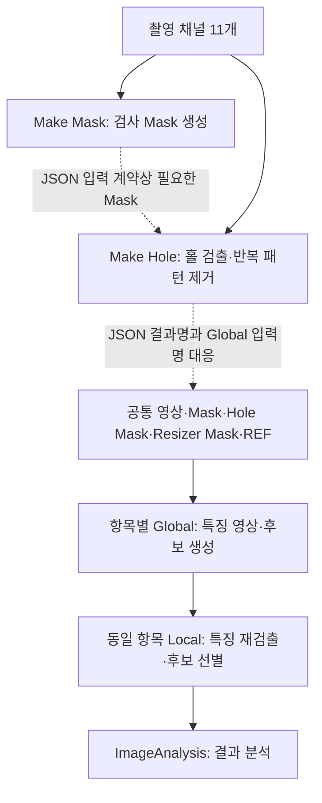

점선은 **JSON이 의도한 전처리 연결**입니다. 현재 앱은 Hole에 원본을 전달하고 Global에는 Mask 결과를 전달하므로 위 연결이 자동 성립하지 않습니다. [앱 실행과 JSON 의도의 차이](영상처리기법.md#앱-실행과-json-의도는-구분)를 참고하세요. Global/Local은 설정 목록의 같은 인덱스로 짝지어야 합니다.

일반 Global 8개의 입력명은 동일합니다. Local은 0–9번만 공통이고 10번부터 결함별 특징 영상이 다릅니다. 아래 `전달 특징`은 저장 노드와 Local 입력명의 대응이며 DLL의 실제 반환 배열 순서까지 확인한 것은 아닙니다.

## 전처리

### Make Mask — 왕관·종이·어두운 영역을 고려한 검사 영역

`Make Mask.json`: 입력 11개, 35개 노드. `왕관`, `종이`는 JSON의 결과명입니다.

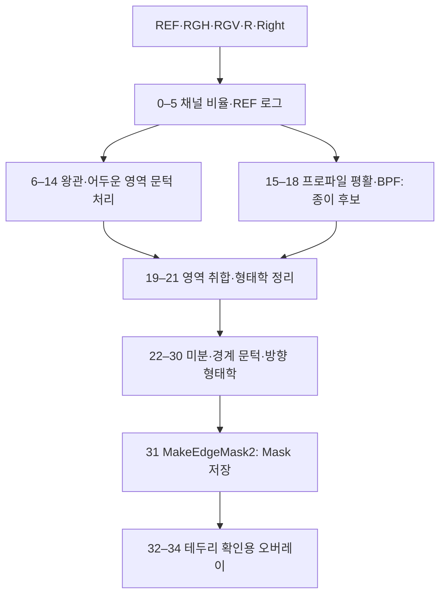

| 구간 | 해석과 핵심 기법 |
|---|---|
| 0–5 | `Right/Ref`, `R/REF`, `RGH/RGV` 비율로 채널 대비를 만들고 REF에 [Log](영상처리기법.md#log) 적용 |
| 6–14 | [Threshold](영상처리기법.md#threshold)와 [Morphology](영상처리기법.md#morphology)로 왕관·어두운 영역 후보 정리. `SoftPlus_10`도 있으나 다음 Threshold는 앞선 Reverse 출력을 참조 |
| 15–21 | [ProfileSmoothing](영상처리기법.md#profilesmoothing) → [BPF](영상처리기법.md#bpf) → 종이 후보 선별 후 왕관 영역과 취합 |
| 22–31 | [Differential](영상처리기법.md#differential), [EdgeThreshold2](영상처리기법.md#edgethreshold2), 방향 형태학으로 경계를 찾고 [MakeEdgeMask2](영상처리기법.md#makeedgemask2)로 최종 Mask 생성 |
| 32–34 | 저장 Mask의 테두리를 만들고 [MaskColorOverlay](영상처리기법.md#maskcoloroverlay)로 확인 |

저장 표시: `MakeEdgeMask2_31`, 결과명 `Mask`.

Make Mask.json — 전체 35개 노드와 원문 설정

원본 SHA-256 앞 16자리: `d51bce753526d01a`. 입력 11개. JSON 기록 시각: `2025.07.11 16:54`.

| 순번·도구 | 이미지 참조 1 / 2 / 3 / 4 | 선택 옵션 1 / 2 | I1 / I2; P1 / P2 / P3 | 결과명 · SaveUse |
|---|---|---|---|---|
| [Arithmetic_0](영상처리기법.md#arithmetic) | 10 / 0 / 0 / 0 | 3:Divide / 1:Multi First | 0 / 0; 0.9 / 0 / 0.5 | Right/Ref · `false` |
| [Arithmetic_1](영상처리기법.md#arithmetic) | 7 / 0 / 0 / 0 | 3:Divide / 1:Multi First | 0 / 0; 0.5 / 0 / 0.5 | R/REF(왕관) · `false` |
| [Arithmetic_2](영상처리기법.md#arithmetic) | 1 / 2 / 0 / 0 | 3:Divide / 1:Multi First | 0 / 0; 0.5 / 0 / 0.5 | RGH/RGV(종이) · `false` |
| [Arithmetic_3](영상처리기법.md#arithmetic) | 13 / 12 / 0 / 0 | 3:Divide / 1:Multi First | 0 / 0; 0.5 / 0 / 0.5 | RGHV/RedREF · `false` |
| [Arithmetic_4](영상처리기법.md#arithmetic) | 7 / 0 / 0 / 0 | 3:Divide / 1:Multi First | 0 / 0; 0.3 / 0 / 0.5 | R/REF(왕관)_밝기조절 · `false` |
| [Log_5](영상처리기법.md#log) | 0 / 0 / 0 / 0 | 0:옵션 없음 / 0:옵션 없음 | 0 / 0; 5 / 0.5 / 0.5 | REF_Log · `false` |
| [Threshold_6](영상처리기법.md#threshold) | 15 / 0 / 0 / 0 | 0:Normal / 0:Manual | 50 / 50; 200 / 0 / 0 | 왕관Threshold · `false` |
| [Morphology_7](영상처리기법.md#morphology) | 17 / 0 / 0 / 0 | 0:Rect / 2:Open(Erode->Dilate) | 3 / 3; 3 / 0 / 0 | 이름 없음 · `false` |
| [Morphology_8](영상처리기법.md#morphology) | 18 / 0 / 0 / 0 | 0:Rect / 3:Close(Dilate->Eroce) | 51 / 51; 3 / 0 / 0 | 왕관_Morph · `false` |
| [Reverse_9](영상처리기법.md#reverse) | 16 / 0 / 0 / 0 | 0:Sub / 0:옵션 없음 | 0 / 0; 50 / 0.10000000149011612 / 0.5 | 이름 없음 · `false` |
| [SoftPlus_10](영상처리기법.md#softplus) | 20 / 0 / 0 / 0 | 0:Lower / 0:Multi First | -1 / 127; 0.5 / 1 / 0 | 이름 없음 · `false` |
| [Threshold_11](영상처리기법.md#threshold) | 20 / 0 / 0 / 0 | 0:Normal / 0:Manual | 50 / 50; 160 / 0 / 0 | 이름 없음 · `false` |
| [Morphology_12](영상처리기법.md#morphology) | 22 / 0 / 0 / 0 | 0:Rect / 2:Open(Erode->Dilate) | 3 / 3; 3 / 0 / 0 | 이름 없음 · `false` |
| [Morphology_13](영상처리기법.md#morphology) | 23 / 0 / 0 / 0 | 2:Ellipse / 3:Close(Dilate->Eroce) | 81 / 81; 3 / 0 / 0 | 어두운지역_Mor · `false` |
| [Arithmetic_14](영상처리기법.md#arithmetic) | 19 / 24 / 0 / 0 | 0:Add / 0:Not Use | 0 / 0; 1 / 0 / 0.5 | 이름 없음 · `false` |
| [ProfileSmoothing_15](영상처리기법.md#profilesmoothing) | 14 / 0 / 0 / 0 | 0:Average / 0:NotUse | 0 / 50; 3 / 1 / 0 | 종이검출활용이미지 · `false` |
| [BPF_16](영상처리기법.md#bpf) | 26 / 0 / 0 / 0 | 2:Positive / -1:옵션 없음 | 0 / 0; 5 / 0.3 / 0.7 | 이름 없음 · `false` |
| [Threshold_17](영상처리기법.md#threshold) | 27 / 0 / 0 / 0 | 0:Normal / 0:Manual | 50 / 50; 50 / 0 / 0 | 종이_Threshold · `false` |
| [BlobLabelCriteria_18](영상처리기법.md#bloblabelcriteria) | 28 / 0 / 0 / 0 | 0:And / 1:옵션 없음 | 0 / 0; 5 / 0.5 / 0.5 | 종이_blob · `false` |
| [Arithmetic_19](영상처리기법.md#arithmetic) | 25 / 29 / 0 / 0 | 0:Add / 0:Not Use | 0 / 0; 1 / 0 / 0.5 | 종이+왕관 Mask · `false` |
| [Morphology_20](영상처리기법.md#morphology) | 30 / 0 / 0 / 0 | 2:Ellipse / 3:Close(Dilate->Eroce) | 151 / 151; 3 / 0 / 0 | 이름 없음 · `false` |
| [DirectionalMorphology_21](영상처리기법.md#directionalmorphology) | 31 / 0 / 0 / 0 | 2:Right / 1:Dilate | 1501 / 10; 50 / 0 / 0 | 이름 없음 · `false` |
| [Arithmetic_22](영상처리기법.md#arithmetic) | 16 / 32 / 0 / 0 | 1:Sub / 0:Not Use | 0 / 0; 1 / 0 / 0.5 | 이름 없음 · `false` |
| [Differential_23](영상처리기법.md#differential) | 33 / 0 / 0 / 0 | 0:X_L2R / 0:Normal | 3 / 3; 0 / 0 / 0 | 이름 없음 · `false` |
| [EdgeThreshold2_24](영상처리기법.md#edgethreshold2) | 34 / 0 / 0 / 0 | 0:Rect / 0:옵션 없음 | 3 / 10; 20 / 0 / 0 | 이름 없음 · `false` |
| [Morphology_25](영상처리기법.md#morphology) | 35 / 0 / 0 / 0 | 0:Rect / 3:Close(Dilate->Eroce) | 5 / 31; 3 / 0 / 0 | 이름 없음 · `false` |
| [DirectionalMorphology_26](영상처리기법.md#directionalmorphology) | 36 / 0 / 0 / 0 | 0:Left / 1:Dilate | 10001 / 10; 50 / 0 / 0 | 이름 없음 · `false` |
| [Morphology_27](영상처리기법.md#morphology) | 37 / 0 / 0 / 0 | 2:Ellipse / 2:Open(Erode->Dilate) | 11 / 201; 3 / 0 / 0 | 이름 없음 · `false` |
| [Differential_28](영상처리기법.md#differential) | 38 / 0 / 0 / 0 | 0:X_L2R / 0:Normal | 1 / 3; 0 / 0 / 0 | 이름 없음 · `false` |
| [MakeMask_29](영상처리기법.md#makemask) | 38 / 0 / 0 / 0 | 0:옵션 없음 / 0:옵션 없음 | 596 / 0; 10 / 2048 / 0.5 | 이름 없음 · `false` |
| [Arithmetic_30](영상처리기법.md#arithmetic) | 39 / 40 / 0 / 0 | 0:Add / 0:Not Use | 0 / 0; 1 / 0 / 0.5 | 이름 없음 · `false` |
| [MakeEdgeMask2_31](영상처리기법.md#makeedgemask2) | 41 / 0 / 0 / 0 | 0:Max Point / 1:Calc | 91 / 3; 400 / 560 / 1488 | Mask · `true` |
| [Morphology_32](영상처리기법.md#morphology) | 42 / 0 / 0 / 0 | 0:Rect / 0:Erode | 3 / 3; 3 / 0 / 0 | 이름 없음 · `false` |
| [Arithmetic_33](영상처리기법.md#arithmetic) | 42 / 43 / 0 / 0 | 1:Sub / 0:Not Use | 0 / 0; 1 / 0 / 0.5 | 이름 없음 · `false` |
| [MaskColorOverlay_34](영상처리기법.md#maskcoloroverlay) | 0 / 44 / 0 / 0 | 0:Fill / 0:옵션 없음 | 0 / 0; 255 / 0 / 0 | 이름 없음 · `false` |

### Make Hole — 홀·제외 영역과 패턴 제거 영상 준비

`Make Hole.json`: 입력 11개, 67개 노드. 마지막 입력은 `Right`가 아닌 **Mask**입니다.

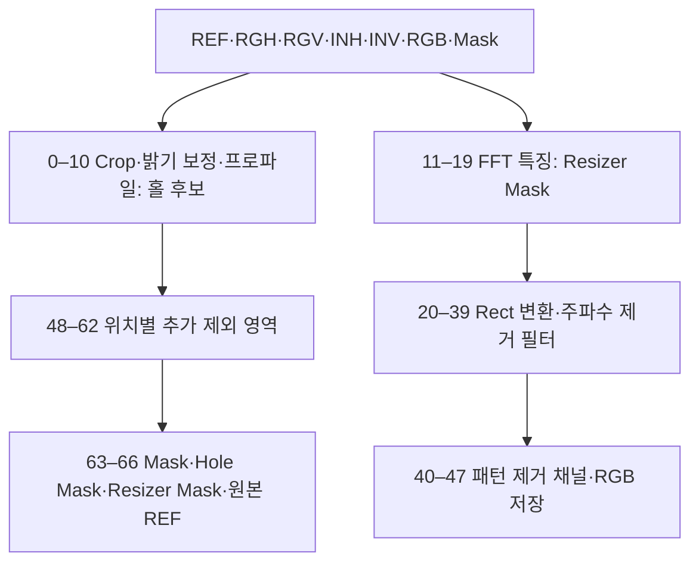

| 구간 | 해석과 핵심 기법 |
|---|---|
| 0–10 | [MakeCropImage](영상처리기법.md#makecropimage) → 영역 채움·Gaussian 기준 보정 → 프로파일 합산·문턱 처리로 홀 후보 추출 |
| 11–19 | [FFTImage](영상처리기법.md#fftimage), [ProfileThreshold](영상처리기법.md#profilethreshold), Blob 선별, [FFTFilterLine](영상처리기법.md#fftfilterline)으로 변환 기준 `Resizer Mask` 구성 |
| 20–39 | [Maske2RectResizer3](영상처리기법.md#maske2rectresizer3)로 펼친 좌표에서 주파수 필터를 만들고 반복 패턴 제거 |
| 40–47 | 보정 반사율·거칠기(H/V)·기울기(H/V)와 RGB 저장 |
| 48–66 | 반전 REF의 프로파일, 고정 위치 마스크, 겹침 선별로 제외 영역 보정. Crop 결과를 복원해 Mask·Hole Mask 등을 저장 |

저장 결과명 순서는 `반사율`, `거칠기(H)`, `거칠기(V)`, `기울기(H)`, `기울기(V)`, `Red`, `Green`, `Blue`, `Mask`, `Hole Mask`, `Resizer Mask`, `REF`입니다. 일반 Global의 0–11번 입력명과 대응됩니다.

Make Hole.json — 전체 67개 노드와 원문 설정

원본 SHA-256 앞 16자리: `61082583ecbff93e`. 입력 11개. JSON 기록 시각: `2025.09.25 16:01`.

| 순번·도구 | 이미지 참조 1 / 2 / 3 / 4 | 선택 옵션 1 / 2 | I1 / I2; P1 / P2 / P3 | 결과명 · SaveUse |
|---|---|---|---|---|
| [MakeCropImage_0](영상처리기법.md#makecropimage) | 0 / 10 / 0 / 0 | 1:Manual / 0:옵션 없음 | 0 / 0; 1 / 1 / 2 | 이름 없음 · `false` |
| [Morphology_1](영상처리기법.md#morphology) | 21 / 0 / 0 / 0 | 0:Rect / 0:Erode | 21 / 21; 3 / 0 / 0 | 이름 없음 · `false` |
| [RegionFilling_2](영상처리기법.md#regionfilling) | 11 / 22 / 0 / 0 | 0:Normal / 0:false | 0 / 0; 0.25 / 0.5 / 0.5 | 이름 없음 · `false` |
| [Gaussian_3](영상처리기법.md#gaussian) | 23 / 0 / 0 / 0 | 0:옵션 없음 / 0:옵션 없음 | 51 / 51; 3 / 0 / 0 | 이름 없음 · `false` |
| [Arithmetic_4](영상처리기법.md#arithmetic) | 23 / 24 / 0 / 0 | 3:Divide / 1:Multi First | 0 / 0; 0.5 / 0 / 0.5 | 이름 없음 · `false` |
| [Threshold_5](영상처리기법.md#threshold) | 25 / 0 / 0 / 0 | 2:InRange / 0:Manual | 50 / 50; 50 / 0 / 0 | 이름 없음 · `false` |
| [MakeProfileLineSumImage_6](영상처리기법.md#makeprofilelinesumimage) | 26 / 22 / 0 / 0 | 0:X Sum / 0:옵션 없음 | 11 / 100; 1 / 1 / 0 | 이름 없음 · `false` |
| [Threshold_7](영상처리기법.md#threshold) | 27 / 0 / 0 / 0 | 0:Normal / 0:Manual | 50 / 50; 15 / 0 / 0 | 이름 없음 · `false` |
| [Morphology_8](영상처리기법.md#morphology) | 28 / 0 / 0 / 0 | 0:Rect / 3:Close(Dilate->Eroce) | 1 / 51; 3 / 0 / 0 | 이름 없음 · `false` |
| [BlobContourCriteria_9](영상처리기법.md#blobcontourcriteria) | 29 / 0 / 0 / 0 | 0:And / 0:Lable Image | 0 / 0; 5 / 0.5 / 0.5 | 홀 영역 · `false` |
| [Morphology_10](영상처리기법.md#morphology) | 30 / 0 / 0 / 0 | 0:Rect / 1:Dilate | 1 / 31; 3 / 0 / 0 | Hole · `false` |
| [FFTImage_11](영상처리기법.md#fftimage) | 0 / 0 / 0 / 0 | 0:1D / 0:옵션 없음 | 20 / 2; 50 / 1 / 0.5 | 이름 없음 · `false` |
| [ProfileThreshold_12](영상처리기법.md#profilethreshold) | 32 / 0 / 0 / 0 | 1:Max / 1:Use | 800 / 50; 0.5 / 0 / 0 | 이름 없음 · `false` |
| [BlobLabelCriteria_13](영상처리기법.md#bloblabelcriteria) | 33 / 0 / 0 / 0 | 0:And / 1:옵션 없음 | 0 / 0; 5 / 0.5 / 0.5 | 이름 없음 · `false` |
| [Morphology_14](영상처리기법.md#morphology) | 34 / 0 / 0 / 0 | 0:Rect / 1:Dilate | 3 / 21; 3 / 0 / 0 | 이름 없음 · `false` |
| [BlobLabelCriteria_15](영상처리기법.md#bloblabelcriteria) | 35 / 0 / 0 / 0 | 0:And / 1:옵션 없음 | 0 / 0; 5 / 0.5 / 0.5 | 이름 없음 · `false` |
| [MakeMask_16](영상처리기법.md#makemask) | 0 / 0 / 0 / 0 | 0:옵션 없음 / 0:옵션 없음 | 1296 / 0; 1296 / 2048 / 0.5 | 이름 없음 · `false` |
| [Arithmetic_17](영상처리기법.md#arithmetic) | 36 / 37 / 0 / 0 | 4:And / 0:Not Use | 0 / 0; 1 / 0 / 0.5 | 이름 없음 · `false` |
| [FFTFilterLine_18](영상처리기법.md#fftfilterline) | 38 / 0 / 0 / 0 | 1:X / 1:옵션 없음 | 1 / 3; 100 / 100 / 1650 | 이름 없음 · `false` |
| [Morphology_19](영상처리기법.md#morphology) | 39 / 0 / 0 / 0 | 2:Ellipse / 1:Dilate | 7 / 5; 3 / 0 / 0 | Resizer Mask · `false` |
| [Maske2RectResizer3_20](영상처리기법.md#maske2rectresizer3) | 0 / 40 / 0 / 0 | 0:UnWrap / 0:옵션 없음 | 11 / 700; 5 / 0.5 / 0.5 | 이름 없음 · `false` |
| [MakeMask_21](영상처리기법.md#makemask) | 0 / 0 / 0 / 0 | 0:옵션 없음 / 0:옵션 없음 | 0 / 0; 2015 / 2048 / 0.5 | 이름 없음 · `false` |
| [RegionFilling_22](영상처리기법.md#regionfilling) | 41 / 42 / 0 / 0 | 0:Normal / 0:false | 0 / 0; 0.25 / 0.5 / 0.5 | 이름 없음 · `false` |
| [FFTImage_23](영상처리기법.md#fftimage) | 43 / 0 / 0 / 0 | 0:1D / 0:옵션 없음 | 50 / 2; 50 / 1 / 0.5 | 이름 없음 · `false` |
| [LineSearching_24](영상처리기법.md#linesearching) | 44 / 0 / 0 / 0 | 1:옵션 없음 / 0:옵션 없음 | 501 / 0; 1 / 90 / 0 | 이름 없음 · `false` |
| [SingleBPF_25](영상처리기법.md#singlebpf) | 45 / 0 / 0 / 0 | 2:Positive / 0:Horizontal | 0 / 0; 5 / 0.35 / 1 | 이름 없음 · `false` |
| [ProfileThreshold_26](영상처리기법.md#profilethreshold) | 46 / 0 / 0 / 0 | 0:Average / 0:NotUse | 50 / 50; 0.9 / 0 / 0 | 이름 없음 · `false` |
| [MakeCenterMask_27](영상처리기법.md#makecentermask) | 47 / 0 / 0 / 0 | 0:Center / 0:옵션 없음 | 70 / 2048; 50 / 1 / 0.5 | 이름 없음 · `false` |
| [ContourCriteria_28](영상처리기법.md#contourcriteria) | 47 / 0 / 0 / 0 | 0:And / 0:Lable Image | 0 / 0; 5 / 0.5 / 0.5 | 이름 없음 · `false` |
| [Morphology_29](영상처리기법.md#morphology) | 49 / 0 / 0 / 0 | 0:Rect / 3:Close(Dilate->Eroce) | 3 / 5001; 3 / 0 / 0 | 이름 없음 · `false` |
| [FFTFilterLine_30](영상처리기법.md#fftfilterline) | 50 / 0 / 0 / 0 | 1:X / 1:옵션 없음 | 1 / 3; 100 / 100 / 1650 | 이름 없음 · `false` |
| [Morphology_31](영상처리기법.md#morphology) | 51 / 0 / 0 / 0 | 0:Rect / 1:Dilate | 21 / 1; 3 / 0 / 0 | 이름 없음 · `false` |
| [Gaussian_32](영상처리기법.md#gaussian) | 52 / 0 / 0 / 0 | 0:옵션 없음 / 0:옵션 없음 | 51 / 1; 3 / 0 / 0 | 이름 없음 · `false` |
| [ImageNormalize_33](영상처리기법.md#imagenormalize) | 53 / 0 / 0 / 0 | 0:Manual / 0:옵션 없음 | 0 / 0; 5 / 0.5 / 0.5 | Edge용 Filter · `false` |
| [Arithmetic_34](영상처리기법.md#arithmetic) | 54 / 48 / 0 / 0 | 1:Sub / 0:Not Use | 0 / 0; 1 / 0 / 0.5 | 패턴 제거용 Filter · `false` |
| [RemoveMaskFFT_35](영상처리기법.md#removemaskfft) | 41 / 54 / 0 / 0 | 0:1D / 1:Multi | 1000 / 2; 50 / 1 / 0.5 | 이름 없음 · `false` |
| [Arithmetic_36](영상처리기법.md#arithmetic) | 56 / 42 / 0 / 0 | 1:Sub / 0:Not Use | 0 / 0; 1 / 0 / 0.5 | 이름 없음 · `false` |
| [Arithmetic_37](영상처리기법.md#arithmetic) | 41 / 57 / 0 / 0 | 11:Attach / 0:Not Use | 0 / 0; 1 / 0 / 0.5 | 이름 없음 · `false` |
| [RemoveMaskFFT_38](영상처리기법.md#removemaskfft) | 58 / 55 / 0 / 0 | 0:1D / 1:Multi | 1000 / 2; 50 / 1 / 0.5 | 이름 없음 · `false` |
| [Maske2RectResizer3_39](영상처리기법.md#maske2rectresizer3) | 55 / 40 / 0 / 0 | 0:UnWrap / 0:옵션 없음 | 11 / 700; 5 / 0.5 / 0.5 | Remove FFT Filter · `false` |
| [Maske2RectResizer3_40](영상처리기법.md#maske2rectresizer3) | 59 / 40 / 0 / 0 | 1:ReWrap / 0:옵션 없음 | 11 / 700; 5 / 0.5 / 0.5 | 반사율 · `true` |
| [RemoveMaskFFT_41](영상처리기법.md#removemaskfft) | 1 / 60 / 0 / 0 | 0:1D / 1:Multi | 1000 / 2; 50 / 1 / 0.5 | 거칠기(H) · `true` |
| [RemoveMaskFFT_42](영상처리기법.md#removemaskfft) | 2 / 60 / 0 / 0 | 0:1D / 1:Multi | 1000 / 2; 50 / 1 / 0.5 | 거칠기(V) · `true` |
| [RemoveMaskFFT_43](영상처리기법.md#removemaskfft) | 4 / 60 / 0 / 0 | 0:1D / 1:Multi | 1000 / 2; 50 / 1 / 0.5 | 기울기(H) · `true` |
| [RemoveMaskFFT_44](영상처리기법.md#removemaskfft) | 5 / 60 / 0 / 0 | 0:1D / 1:Multi | 1000 / 2; 50 / 1 / 0.5 | 기울기(V) · `true` |
| [OutputImage_45](영상처리기법.md#outputimage) | 7 / 0 / 0 / 0 | 0:옵션 없음 / 0:옵션 없음 | 0 / 0; 5 / 0.5 / 0.5 | Red · `true` |
| [OutputImage_46](영상처리기법.md#outputimage) | 8 / 0 / 0 / 0 | 0:옵션 없음 / 0:옵션 없음 | 0 / 0; 5 / 0.5 / 0.5 | Green · `true` |
| [OutputImage_47](영상처리기법.md#outputimage) | 9 / 0 / 0 / 0 | 0:옵션 없음 / 0:옵션 없음 | 0 / 0; 5 / 0.5 / 0.5 | Blue · `true` |
| [Reverse_48](영상처리기법.md#reverse) | 11 / 0 / 0 / 0 | 0:Sub / 0:옵션 없음 | 0 / 0; 50 / 0.10000000149011612 / 0.5 | 이름 없음 · `false` |
| [MakeProfileLineSumImage_49](영상처리기법.md#makeprofilelinesumimage) | 69 / 21 / 0 / 0 | 0:X Sum / 0:옵션 없음 | 11 / 100; 1 / 1 / 0 | 이름 없음 · `false` |
| [Threshold_50](영상처리기법.md#threshold) | 70 / 0 / 0 / 0 | 0:Normal / 0:Manual | 50 / 50; 190 / 0 / 0 | 이름 없음 · `false` |
| [MakeMask_51](영상처리기법.md#makemask) | 11 / 0 / 0 / 0 | 0:옵션 없음 / 0:옵션 없음 | 0 / 750; 1408 / 200 / 0.5 | 이름 없음 · `false` |
| [MakeMask_52](영상처리기법.md#makemask) | 11 / 0 / 0 / 0 | 0:옵션 없음 / 0:옵션 없음 | 0 / 1098; 1408 / 200 / 0.5 | 이름 없음 · `false` |
| [Arithmetic_53](영상처리기법.md#arithmetic) | 72 / 73 / 0 / 0 | 0:Add / 0:Not Use | 0 / 0; 1 / 0 / 0.5 | 이름 없음 · `false` |
| [OverlapBlobCriteria2_54](영상처리기법.md#overlapblobcriteria2) | 71 / 74 / 0 / 0 | 0:And / 1:옵션 없음 | 0 / 0; 5 / 0.5 / 0.5 | 이름 없음 · `false` |
| [Morphology_55](영상처리기법.md#morphology) | 75 / 0 / 0 / 0 | 0:Rect / 1:Dilate | 1 / 31; 3 / 0 / 0 | 이름 없음 · `false` |
| [Arithmetic_56](영상처리기법.md#arithmetic) | 21 / 76 / 0 / 0 | 1:Sub / 0:Not Use | 0 / 0; 1 / 0 / 0.5 | 이름 없음 · `false` |
| [MakeMask_57](영상처리기법.md#makemask) | 69 / 0 / 0 / 0 | 0:옵션 없음 / 0:옵션 없음 | 0 / 340; 1408 / 200 / 0.5 | 이름 없음 · `false` |
| [MakeMask_58](영상처리기법.md#makemask) | 69 / 0 / 0 / 0 | 0:옵션 없음 / 0:옵션 없음 | 0 / 1508; 1408 / 200 / 0.5 | 이름 없음 · `false` |
| [Arithmetic_59](영상처리기법.md#arithmetic) | 78 / 79 / 0 / 0 | 0:Add / 0:Not Use | 0 / 0; 1 / 0 / 0.5 | 이름 없음 · `false` |
| [OverlapBlobCriteria2_60](영상처리기법.md#overlapblobcriteria2) | 71 / 80 / 0 / 0 | 0:And / 1:옵션 없음 | 0 / 0; 5 / 0.5 / 0.5 | 이름 없음 · `false` |
| [Morphology_61](영상처리기법.md#morphology) | 81 / 0 / 0 / 0 | 0:Rect / 1:Dilate | 1 / 3; 3 / 0 / 0 | 이름 없음 · `false` |
| [Arithmetic_62](영상처리기법.md#arithmetic) | 77 / 82 / 0 / 0 | 1:Sub / 0:Not Use | 0 / 0; 1 / 0 / 0.5 | 이름 없음 · `false` |
| [CropImageOverlay_63](영상처리기법.md#cropimageoverlay) | 0 / 83 / 0 / 0 | 0:옵션 없음 / 0:옵션 없음 | 0 / 0; 5 / 0.5 / 0.5 | Mask · `true` |
| [CropImageOverlay_64](영상처리기법.md#cropimageoverlay) | 0 / 31 / 0 / 0 | 0:옵션 없음 / 0:옵션 없음 | 0 / 0; 5 / 0.5 / 0.5 | Hole Mask · `true` |
| [OutputImage_65](영상처리기법.md#outputimage) | 40 / 0 / 0 / 0 | 0:옵션 없음 / 0:옵션 없음 | 0 / 0; 5 / 0.5 / 0.5 | Resizer Mask · `true` |
| [OutputImage_66](영상처리기법.md#outputimage) | 0 / 0 / 0 / 0 | 0:옵션 없음 / 0:옵션 없음 | 0 / 0; 5 / 0.5 / 0.5 | REF · `true` |

## 갭

**의도 추정:** 표면 내부의 갭과 외곽/상면 부근의 선형 갭을 별도 경로로 검출합니다. Global 73개, Local 18개 노드입니다.

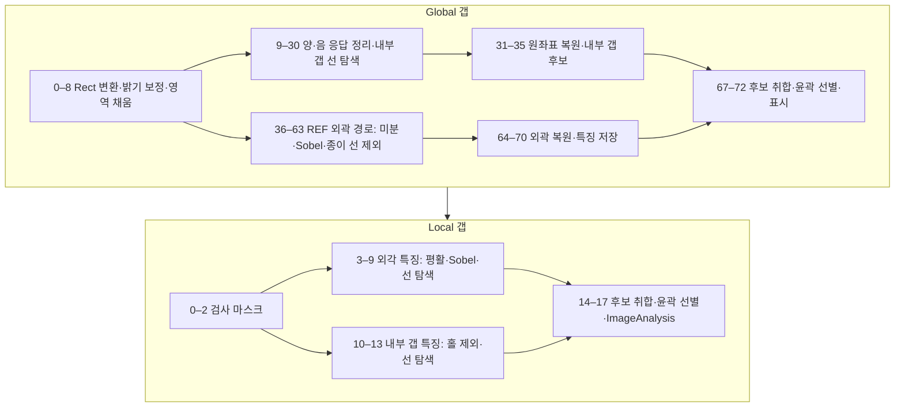

| 단계 | JSON상 근거와 해석 |
|---|---|
| Global 0–30 | [UnWrap/ReWrap 도구](영상처리기법.md#maske2rectresizer3), Bilateral, 양·음 SingleBPF 응답을 이용한 밝기/노이즈 보정 후 90° 중심 선 탐색 |
| Global 31–35 | REF 밝기 보정·갭 전처리 특징을 복원해 저장하고 `내부갭결과` 구성 |
| Global 36–63 | 원본 REF 경로에서 [Differential](영상처리기법.md#differential), 종이부 LineSearching, 방향 형태학, [Sobel](영상처리기법.md#sobel)로 외곽 후보를 구성 |
| Global 64–72 | Crop 복원·Mask 연산·후보 취합, `ContourCriteria_71` 저장, 오버레이 |
| Local 0–17 | 외각 찾기 전(12번 입력)과 내부 갭 찾기 전(11번 입력)을 각각 선 탐색하고 [OverlapBlobCriteria](영상처리기법.md#overlapblobcriteria)·윤곽 조건으로 정리. 최종 [ImageAnalysis](영상처리기법.md#imageanalysis) |

**전달 특징:** Global 저장 `REF 밝기 펴기`, `갭 찾기 전`, `외각 찾기 전` ↔ Local 입력 10·11·12. Local 결과명 `상면 갭`, `내부 갭`, `최종 갭`이 해석 근거입니다.

Global 갭.json — 전체 73개 노드와 원문 설정

원본 SHA-256 앞 16자리: `edaf3e7eb4dce0a7`. 입력 17개. JSON 기록 시각: `2025.09.08 16:23`.

| 순번·도구 | 이미지 참조 1 / 2 / 3 / 4 | 선택 옵션 1 / 2 | I1 / I2; P1 / P2 / P3 | 결과명 · SaveUse |
|---|---|---|---|---|
| [Maske2RectResizer3_0](영상처리기법.md#maske2rectresizer3) | 0 / 10 / 0 / 0 | 0:UnWrap / 0:옵션 없음 | 11 / 700; 5 / 0.5 / 0.5 | 이름 없음 · `false` |
| [Bilateral_1](영상처리기법.md#bilateral) | 17 / 0 / 0 / 0 | 0:옵션 없음 / 0:옵션 없음 | -1 / 3; 100 / 5 / 0 | 이름 없음 · `false` |
| [Arithmetic_2](영상처리기법.md#arithmetic) | 17 / 18 / 0 / 0 | 3:Divide / 1:Multi First | 0 / 0; 0.5 / 0 / 0.5 | 이름 없음 · `false` |
| [Bilateral_3](영상처리기법.md#bilateral) | 19 / 0 / 0 / 0 | 0:옵션 없음 / 0:옵션 없음 | -1 / 3; 15 / 15 / 0 | 이름 없음 · `false` |
| [MakeMask_4](영상처리기법.md#makemask) | 17 / 0 / 0 / 0 | 0:옵션 없음 / 0:옵션 없음 | 0 / 0; 2000 / 2048 / 0.5 | 이름 없음 · `false` |
| [Threshold_5](영상처리기법.md#threshold) | 20 / 0 / 0 / 0 | 2:InRange / 0:Manual | 50 / 50; 1 / 0 / 0 | 이름 없음 · `false` |
| [Morphology_6](영상처리기법.md#morphology) | 22 / 0 / 0 / 0 | 0:Rect / 1:Dilate | 1 / 21; 3 / 0 / 0 | 이름 없음 · `false` |
| [Arithmetic_7](영상처리기법.md#arithmetic) | 21 / 23 / 0 / 0 | 1:Sub / 0:Not Use | 0 / 0; 1 / 0 / 0.5 | 이름 없음 · `false` |
| [RegionFilling_8](영상처리기법.md#regionfilling) | 20 / 24 / 0 / 0 | 0:Normal / 0:false | 0 / 0; 0.25 / 0.5 / 0.5 | 검사 이미지 · `false` |
| [SingleBPF_9](영상처리기법.md#singlebpf) | 25 / 0 / 0 / 0 | 2:Positive / 1:Vertical | 0 / 0; 5 / 0.3 / 0.7 | 노이즈 제거용 Positive · `false` |
| [SingleBPF_10](영상처리기법.md#singlebpf) | 25 / 0 / 0 / 0 | 3:Negative / 1:Vertical | 0 / 0; 5 / 0.5 / 0.7 | 노이즈 제거용 Negative · `false` |
| [SingleBPF_11](영상처리기법.md#singlebpf) | 25 / 0 / 0 / 0 | 3:Negative / 1:Vertical | 0 / 0; 5 / 0.55 / 0.7 | 노이즈 제거용 Negative2 · `false` |
| [SingleArithmetic_12](영상처리기법.md#singlearithmetic) | 26 / 0 / 0 / 0 | 0:Multi First / 0:none | 0 / 0; 1.2 / 0 / 0.5 | Single 노이즈 제거용 Positive · `false` |
| [SingleArithmetic_13](영상처리기법.md#singlearithmetic) | 27 / 0 / 0 / 0 | 0:Multi First / 0:none | 0 / 0; 1.2 / 0 / 0.5 | Single 노이즈 제거용 Negative · `false` |
| [Arithmetic_14](영상처리기법.md#arithmetic) | 25 / 29 / 0 / 0 | 1:Sub / 0:Not Use | 0 / 0; 1 / 0 / 0.5 | 이름 없음 · `false` |
| [Arithmetic_15](영상처리기법.md#arithmetic) | 31 / 28 / 0 / 0 | 0:Add / 0:Not Use | 0 / 0; 1 / 0 / 0.5 | 이름 없음 · `false` |
| [Arithmetic_16](영상처리기법.md#arithmetic) | 32 / 30 / 0 / 0 | 0:Add / 0:Not Use | 0 / 0; 1 / 0 / 0.5 | 노이즈 제거 이미지 · `false` |
| [Maske2RectResizer3_17](영상처리기법.md#maske2rectresizer3) | 8 / 10 / 0 / 0 | 0:UnWrap / 0:옵션 없음 | 11 / 700; 5 / 0.5 / 0.5 | 이름 없음 · `false` |
| [Threshold_18](영상처리기법.md#threshold) | 34 / 0 / 0 / 0 | 0:Normal / 0:Manual | 50 / 50; 50 / 0 / 0 | Mask_Rect · `false` |
| [RegionFilling_19](영상처리기법.md#regionfilling) | 33 / 35 / 0 / 0 | 0:Normal / 0:false | 0 / 0; 1 / 0.5 / 0.5 | 이름 없음 · `false` |
| [BlobContourCriteria_20](영상처리기법.md#blobcontourcriteria) | 34 / 0 / 0 / 0 | 0:And / 0:Lable Image | 0 / 0; 5 / 0.5 / 0.5 | 이름 없음 · `false` |
| [MakeCenterMask_21](영상처리기법.md#makecentermask) | 37 / 0 / 0 / 0 | 0:Center / 0:옵션 없음 | 2000 / 200; 50 / 1 / 0.5 | 이름 없음 · `false` |
| [Arithmetic_22](영상처리기법.md#arithmetic) | 37 / 38 / 0 / 0 | 4:And / 0:Not Use | 0 / 0; 1 / 0 / 0.5 | 이름 없음 · `false` |
| [Reverse_23](영상처리기법.md#reverse) | 39 / 0 / 0 / 0 | 0:Sub / 0:옵션 없음 | 0 / 0; 50 / 0.10000000149011612 / 0.5 | 이름 없음 · `false` |
| [SingleArithmetic_24](영상처리기법.md#singlearithmetic) | 39 / 0 / 0 / 0 | 0:Multi First / 0:none | 0 / 0; 0.7 / 0 / 0.5 | 이름 없음 · `false` |
| [Arithmetic_25](영상처리기법.md#arithmetic) | 40 / 41 / 0 / 0 | 11:Attach / 0:Not Use | 0 / 0; 1 / 0 / 0.5 | 이름 없음 · `false` |
| [SingleBPF_26](영상처리기법.md#singlebpf) | 36 / 0 / 0 / 0 | 3:Negative / 0:Horizontal | 0 / 0; 5 / 0.45 / 0.8 | 갭 찾기 전 · `false` |
| [Arithmetic_27](영상처리기법.md#arithmetic) | 43 / 42 / 0 / 0 | 2:Multi / 0:Not Use | 0 / 0; 1 / 0 / 0.5 | 이름 없음 · `false` |
| [LineSearching_28](영상처리기법.md#linesearching) | 43 / 0 / 0 / 0 | 1:옵션 없음 / 0:옵션 없음 | 201 / 0; 1 / 90 / 10 | 이름 없음 · `false` |
| [Threshold_29](영상처리기법.md#threshold) | 45 / 0 / 0 / 0 | 0:Normal / 0:Manual | 50 / 50; 50 / 0 / 0 | 이름 없음 · `false` |
| [ContourCriteria_30](영상처리기법.md#contourcriteria) | 46 / 0 / 0 / 0 | 0:And / 0:Lable Image | 0 / 0; 5 / 0.5 / 0.5 | 이름 없음 · `false` |
| [Maske2RectResizer3_31](영상처리기법.md#maske2rectresizer3) | 20 / 10 / 0 / 0 | 1:ReWrap / 0:옵션 없음 | 11 / 700; 5 / 0.5 / 0.5 | REF 밝기 펴기 · `true` |
| [Maske2RectResizer3_32](영상처리기법.md#maske2rectresizer3) | 43 / 10 / 0 / 0 | 1:ReWrap / 0:옵션 없음 | 11 / 700; 5 / 0.5 / 0.5 | 갭 찾기 전 · `true` |
| [Maske2RectResizer3_33](영상처리기법.md#maske2rectresizer3) | 47 / 10 / 0 / 0 | 1:ReWrap / 0:옵션 없음 | 11 / 700; 5 / 0.5 / 0.5 | 이름 없음 · `false` |
| [Threshold_34](영상처리기법.md#threshold) | 50 / 0 / 0 / 0 | 0:Normal / 0:Manual | 50 / 50; 50 / 0 / 0 | 이름 없음 · `false` |
| [Arithmetic_35](영상처리기법.md#arithmetic) | 51 / 8 / 0 / 0 | 4:And / 0:Not Use | 0 / 0; 1 / 0 / 0.5 | 내부갭결과 · `false` |
| [Morphology_36](영상처리기법.md#morphology) | 35 / 0 / 0 / 0 | 0:Rect / 1:Dilate | 2001 / 1; 3 / 0 / 0 | 이름 없음 · `false` |
| [Arithmetic_37](영상처리기법.md#arithmetic) | 17 / 53 / 0 / 0 | 4:And / 0:Not Use | 0 / 0; 1 / 0 / 0.5 | 이름 없음 · `false` |
| [Maske2RectResizer3_38](영상처리기법.md#maske2rectresizer3) | 11 / 10 / 0 / 0 | 0:UnWrap / 0:옵션 없음 | 11 / 700; 5 / 0.5 / 0.5 | 이름 없음 · `false` |
| [Arithmetic_39](영상처리기법.md#arithmetic) | 55 / 53 / 0 / 0 | 4:And / 0:Not Use | 0 / 0; 1 / 0 / 0.5 | 이름 없음 · `false` |
| [MakeCropImage_40](영상처리기법.md#makecropimage) | 56 / 56 / 0 / 0 | 1:Manual / 0:옵션 없음 | 0 / 0; 1 / 1 / 2 | 이름 없음 · `false` |
| [Differential_41](영상처리기법.md#differential) | 57 / 0 / 0 / 0 | 1:Y_T2B / 1:Abs | 3 / 3; 0 / 0 / 0 | 이름 없음 · `false` |
| [Threshold_42](영상처리기법.md#threshold) | 58 / 0 / 0 / 0 | 0:Normal / 0:Manual | 50 / 50; 20 / 0 / 0 | 이름 없음 · `false` |
| [BlobContourCriteria_43](영상처리기법.md#blobcontourcriteria) | 59 / 0 / 0 / 0 | 0:And / 0:Lable Image | 0 / 0; 5 / 0.5 / 0.5 | 이름 없음 · `false` |
| [Morphology_44](영상처리기법.md#morphology) | 60 / 0 / 0 / 0 | 0:Rect / 3:Close(Dilate->Eroce) | 1 / 51; 3 / 0 / 0 | 이름 없음 · `false` |
| [Arithmetic_45](영상처리기법.md#arithmetic) | 57 / 61 / 0 / 0 | 2:Multi / 0:Not Use | 0 / 0; 1 / 0 / 0.5 | 이름 없음 · `false` |
| [LineSearching_46](영상처리기법.md#linesearching) | 62 / 0 / 0 / 0 | 1:옵션 없음 / 0:옵션 없음 | 501 / 0; 1 / 90 / 1 | 종이부Line · `false` |
| [Arithmetic_47](영상처리기법.md#arithmetic) | 62 / 63 / 0 / 0 | 2:Multi / 0:Not Use | 0 / 0; 1 / 0 / 0.5 | 이름 없음 · `false` |
| [Threshold_48](영상처리기법.md#threshold) | 64 / 0 / 0 / 0 | 0:Normal / 0:Manual | 50 / 50; 50 / 0 / 0 | 이름 없음 · `false` |
| [DirectionalMorphology_49](영상처리기법.md#directionalmorphology) | 65 / 0 / 0 / 0 | 2:Right / 1:Dilate | 10001 / 10; 50 / 0 / 0 | 이름 없음 · `false` |
| [Morphology_50](영상처리기법.md#morphology) | 66 / 0 / 0 / 0 | 0:Rect / 1:Dilate | 7 / 1; 3 / 0 / 0 | 이름 없음 · `false` |
| [Arithmetic_51](영상처리기법.md#arithmetic) | 57 / 67 / 0 / 0 | 1:Sub / 0:Not Use | 0 / 0; 1 / 0 / 0.5 | 이름 없음 · `false` |
| [Sobel_52](영상처리기법.md#sobel) | 68 / 0 / 0 / 0 | 0:X / 0:Use | 3 / 100; 3 / 0 / 0 | 이름 없음 · `false` |
| [MakeCropImage_53](영상처리기법.md#makecropimage) | 35 / 35 / 0 / 0 | 1:Manual / 0:옵션 없음 | 0 / 0; 1 / 1 / 2 | 이름 없음 · `false` |
| [Morphology_54](영상처리기법.md#morphology) | 70 / 0 / 0 / 0 | 0:Rect / 1:Dilate | 9 / 3; 3 / 0 / 0 | 이름 없음 · `false` |
| [Arithmetic_55](영상처리기법.md#arithmetic) | 69 / 71 / 0 / 0 | 1:Sub / 0:Not Use | 0 / 0; 1 / 0 / 0.5 | 이름 없음 · `false` |
| [BlobContourCriteria_56](영상처리기법.md#blobcontourcriteria) | 72 / 0 / 0 / 0 | 0:And / 0:Lable Image | 0 / 0; 5 / 0.5 / 0.5 | 이름 없음 · `false` |
| [LineSearching_57](영상처리기법.md#linesearching) | 73 / 0 / 0 / 0 | 1:옵션 없음 / 0:옵션 없음 | 101 / 0; 1 / 90 / 3 | 이름 없음 · `false` |
| [ImageShift_58](영상처리기법.md#imageshift) | 63 / 0 / 0 / 0 | 0:옵션 없음 / 0:옵션 없음 | -40 / 1; 0 / 0 / 0 | 이름 없음 · `false` |
| [Threshold_59](영상처리기법.md#threshold) | 75 / 0 / 0 / 0 | 0:Normal / 0:Manual | 50 / 50; 100 / 0 / 0 | 이름 없음 · `false` |
| [DirectionalMorphology_60](영상처리기법.md#directionalmorphology) | 76 / 0 / 0 / 0 | 2:Right / 1:Dilate | 1500 / 10; 50 / 0 / 0 | 이름 없음 · `false` |
| [MakeMask_61](영상처리기법.md#makemask) | 73 / 0 / 0 / 0 | 0:옵션 없음 / 0:옵션 없음 | 400 / 0; 1000 / 6000 / 0.5 | 이름 없음 · `false` |
| [Arithmetic_62](영상처리기법.md#arithmetic) | 77 / 78 / 0 / 0 | 0:Add / 0:Not Use | 0 / 0; 1 / 0 / 0.5 | 이름 없음 · `false` |
| [Arithmetic_63](영상처리기법.md#arithmetic) | 74 / 79 / 0 / 0 | 1:Sub / 0:Not Use | 0 / 0; 1 / 0 / 0.5 | 이름 없음 · `false` |
| [CropImageOverlay_64](영상처리기법.md#cropimageoverlay) | 80 / 80 / 0 / 0 | 0:옵션 없음 / 0:옵션 없음 | 0 / 0; 5 / 0.5 / 0.5 | 외각 · `false` |
| [Maske2RectResizer3_65](영상처리기법.md#maske2rectresizer3) | 81 / 10 / 0 / 0 | 1:ReWrap / 0:옵션 없음 | 11 / 700; 5 / 0.5 / 0.5 | 이름 없음 · `false` |
| [Arithmetic_66](영상처리기법.md#arithmetic) | 82 / 8 / 0 / 0 | 1:Sub / 0:Not Use | 0 / 0; 1 / 0 / 0.5 | 이름 없음 · `false` |
| [Arithmetic_67](영상처리기법.md#arithmetic) | 52 / 83 / 0 / 0 | 0:Add / 0:Not Use | 0 / 0; 1 / 0 / 0.5 | 이름 없음 · `false` |
| [Threshold_68](영상처리기법.md#threshold) | 84 / 0 / 0 / 0 | 0:Normal / 0:Manual | 50 / 50; 50 / 0 / 0 | 이름 없음 · `false` |
| [CropImageOverlay_69](영상처리기법.md#cropimageoverlay) | 68 / 68 / 0 / 0 | 0:옵션 없음 / 0:옵션 없음 | 0 / 0; 5 / 0.5 / 0.5 | 이름 없음 · `false` |
| [Maske2RectResizer3_70](영상처리기법.md#maske2rectresizer3) | 86 / 10 / 0 / 0 | 1:ReWrap / 0:옵션 없음 | 11 / 700; 5 / 0.5 / 0.5 | 외각 찾기 전 · `true` |
| [ContourCriteria_71](영상처리기법.md#contourcriteria) | 85 / 0 / 0 / 0 | 0:And / 1:Blob Grop | 20 / 0; 5 / 0.5 / 0.5 | 이름 없음 · `true` |
| [MaskColorOverlay_72](영상처리기법.md#maskcoloroverlay) | 0 / 88 / 0 / 0 | 0:Fill / 0:옵션 없음 | 0 / 0; 255 / 0 / 0 | 이름 없음 · `false` |

Local 갭.json — 전체 18개 노드와 원문 설정

원본 SHA-256 앞 16자리: `5b016a1df8711a6b`. 입력 17개. JSON 기록 시각: `2025.09.25 15:53`.

| 순번·도구 | 이미지 참조 1 / 2 / 3 / 4 | 선택 옵션 1 / 2 | I1 / I2; P1 / P2 / P3 | 결과명 · SaveUse |
|---|---|---|---|---|
| [Morphology_0](영상처리기법.md#morphology) | 8 / 0 / 0 / 0 | 0:Rect / 0:Erode | 11 / 1; 3 / 0 / 0 | 이름 없음 · `false` |
| [MakeCenterMask_1](영상처리기법.md#makecentermask) | 0 / 0 / 0 / 0 | 1:Outline / 0:옵션 없음 | 7 / 11; 50 / 1 / 0.5 | 이름 없음 · `false` |
| [Arithmetic_2](영상처리기법.md#arithmetic) | 17 / 18 / 0 / 0 | 4:And / 0:Not Use | 0 / 0; 1 / 0 / 0.5 | Mask · `false` |
| [Bilateral_3](영상처리기법.md#bilateral) | 12 / 0 / 0 / 0 | 0:옵션 없음 / 0:옵션 없음 | -1 / 3; 15 / 15 / 0 | 이름 없음 · `false` |
| [Sobel_4](영상처리기법.md#sobel) | 20 / 0 / 0 / 0 | 0:X / 1:UnUse | 3 / 200; 3 / 0 / 0 | 이름 없음 · `false` |
| [LineSearching_5](영상처리기법.md#linesearching) | 21 / 0 / 0 / 0 | 1:옵션 없음 / 0:옵션 없음 | 71 / 0; 1 / 90 / 5 | 이름 없음 · `false` |
| [Threshold_6](영상처리기법.md#threshold) | 22 / 0 / 0 / 0 | 0:Normal / 0:Manual | 50 / 50; 100 / 0 / 0 | 이름 없음 · `false` |
| [Arithmetic_7](영상처리기법.md#arithmetic) | 23 / 18 / 0 / 0 | 4:And / 0:Not Use | 0 / 0; 1 / 0 / 0.5 | 이름 없음 · `false` |
| [OverlapBlobCriteria_8](영상처리기법.md#overlapblobcriteria) | 24 / 17 / 0 / 0 | 0:And / 1:옵션 없음 | 0 / 0; 5 / 0.5 / 0.5 | 이름 없음 · `false` |
| [Arithmetic_9](영상처리기법.md#arithmetic) | 24 / 25 / 0 / 0 | 1:Sub / 0:Not Use | 0 / 0; 1 / 0 / 0.5 | 상면 갭 · `false` |
| [Arithmetic_10](영상처리기법.md#arithmetic) | 11 / 9 / 0 / 0 | 1:Sub / 0:Not Use | 0 / 0; 1 / 0 / 0.5 | 내부 갭 찾기 전 · `false` |
| [LineSearching_11](영상처리기법.md#linesearching) | 27 / 0 / 0 / 0 | 1:옵션 없음 / 0:옵션 없음 | 51 / 0; 1 / 90 / 10 | 이름 없음 · `false` |
| [Threshold_12](영상처리기법.md#threshold) | 28 / 0 / 0 / 0 | 0:Normal / 0:Manual | 50 / 50; 50 / 0 / 0 | 이름 없음 · `false` |
| [OverlapBlobCriteria_13](영상처리기법.md#overlapblobcriteria) | 29 / 19 / 0 / 0 | 0:And / 1:옵션 없음 | 0 / 0; 5 / 0.5 / 0.5 | 내부 갭 · `false` |
| [Arithmetic_14](영상처리기법.md#arithmetic) | 26 / 30 / 0 / 0 | 0:Add / 0:Not Use | 0 / 0; 1 / 0 / 0.5 | 최종 갭 · `false` |
| [BlobContourCriteria_15](영상처리기법.md#blobcontourcriteria) | 31 / 0 / 0 / 0 | 0:And / 0:Lable Image | 0 / 0; 5 / 0.5 / 0.5 | 이름 없음 · `false` |
| [Arithmetic_16](영상처리기법.md#arithmetic) | 22 / 28 / 0 / 0 | 8:Max / 0:Not Use | 0 / 0; 1 / 0 / 0.5 | 이름 없음 · `false` |
| [ImageAnalysis_17](영상처리기법.md#imageanalysis) | 32 / 33 / 10 / 0 | 0:Src 0 / 0:옵션 없음 | 11 / 100; 15 / 15 / 1.1 | 이름 없음 · `true` |

## 귀 갭

**의도 추정:** 귀/특정 위치의 검사 영역을 먼저 고르고 내부·상면 갭을 구분합니다. Global 57개, Local 20개 노드입니다.

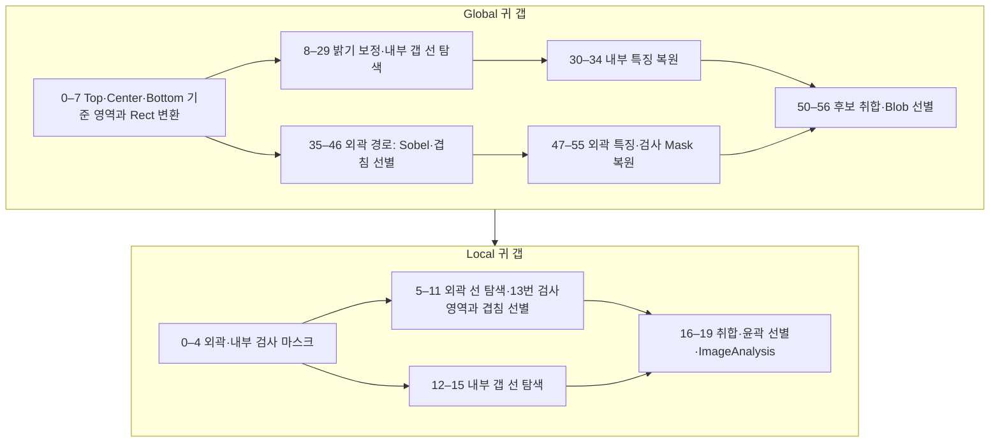

| 단계 | JSON상 근거와 해석 |
|---|---|
| Global 0–7 | 고정 [MakeMask](영상처리기법.md#makemask) 3개와 겹침 조건으로 대상 Mask를 고름 |
| Global 8–34 | 일반 갭과 유사한 Rect 밝기 보정·SingleBPF·90° 중심 선 탐색 |
| Global 35–56 | Bilateral → Sobel → Mask/겹침 조건 → 선 탐색 → 복원. `외각 검사 Mask 영역`도 별도 저장 |
| Local 0–19 | 외곽·내부 마스크를 구분. 외곽 후보는 13번 입력과 겹침 선별하고, 내부 후보와 합친 뒤 결과 분석 |

**전달 특징:** Local 입력 10–13은 `REF 밝기 펴기`, `갭 찾기 전`, `외각 찾기 전`, `외각 검사 Mask 영역`. 일반 갭과 달리 마지막 영역 입력이 추가됩니다.

Global 귀 갭.json — 전체 57개 노드와 원문 설정

원본 SHA-256 앞 16자리: `c0d59a68a106c942`. 입력 17개. JSON 기록 시각: `2025.09.09 10:19`.

| 순번·도구 | 이미지 참조 1 / 2 / 3 / 4 | 선택 옵션 1 / 2 | I1 / I2; P1 / P2 / P3 | 결과명 · SaveUse |
|---|---|---|---|---|
| [MakeMask_0](영상처리기법.md#makemask) | 0 / 0 / 0 / 0 | 0:옵션 없음 / 0:옵션 없음 | 1286 / 220; 20 / 20 / 0.5 | Top 확인 · `false` |
| [MakeMask_1](영상처리기법.md#makemask) | 0 / 0 / 0 / 0 | 0:옵션 없음 / 0:옵션 없음 | 1286 / 1014; 20 / 20 / 0.5 | Center 확인 · `false` |
| [MakeMask_2](영상처리기법.md#makemask) | 0 / 0 / 0 / 0 | 0:옵션 없음 / 0:옵션 없음 | 1286 / 1820; 20 / 20 / 0.5 | Bottom 확인 · `false` |
| [AllArithmetic_3](영상처리기법.md#allarithmetic) | 17 / 19 / 19 / 0 | 1:Max / 0:Manual | 0 / 0; 1 / 0 / 0.5 | 이름 없음 · `false` |
| [OverlapBlobCriteria2_4](영상처리기법.md#overlapblobcriteria2) | 8 / 20 / 0 / 0 | 0:And / 1:옵션 없음 | 0 / 0; 5 / 0.5 / 0.5 | 검사 Mask · `false` |
| [Maske2RectResizer3_5](영상처리기법.md#maske2rectresizer3) | 0 / 10 / 0 / 0 | 0:UnWrap / 0:옵션 없음 | 11 / 700; 5 / 0.5 / 0.5 | 패턴 제거 REF Rect · `false` |
| [Maske2RectResizer3_6](영상처리기법.md#maske2rectresizer3) | 11 / 10 / 0 / 0 | 0:UnWrap / 0:옵션 없음 | 11 / 700; 5 / 0.5 / 0.5 | REF Rect · `false` |
| [Maske2RectResizer3_7](영상처리기법.md#maske2rectresizer3) | 21 / 10 / 0 / 0 | 0:UnWrap / 0:옵션 없음 | 11 / 700; 5 / 0.5 / 0.5 | Mask Rect · `false` |
| [Bilateral_8](영상처리기법.md#bilateral) | 22 / 0 / 0 / 0 | 0:옵션 없음 / 0:옵션 없음 | -1 / 3; 100 / 5 / 0 | 패턴 제거 REF Bilateral · `false` |
| [Arithmetic_9](영상처리기법.md#arithmetic) | 22 / 25 / 0 / 0 | 3:Divide / 1:Multi First | 0 / 0; 0.5 / 0 / 0.5 | 패턴 제거 REF 펴기 · `false` |
| [Bilateral_10](영상처리기법.md#bilateral) | 26 / 0 / 0 / 0 | 0:옵션 없음 / 0:옵션 없음 | -1 / 3; 15 / 15 / 0 | 이름 없음 · `false` |
| [MakeMask_11](영상처리기법.md#makemask) | 23 / 0 / 0 / 0 | 0:옵션 없음 / 0:옵션 없음 | 0 / 0; 2000 / 2048 / 0.5 | Rect 내부 Mask · `false` |
| [Threshold_12](영상처리기법.md#threshold) | 27 / 0 / 0 / 0 | 2:InRange / 0:Manual | 50 / 50; 1 / 0 / 0 | 이름 없음 · `false` |
| [Morphology_13](영상처리기법.md#morphology) | 29 / 0 / 0 / 0 | 0:Rect / 1:Dilate | 1 / 21; 3 / 0 / 0 | 이름 없음 · `false` |
| [Arithmetic_14](영상처리기법.md#arithmetic) | 28 / 30 / 0 / 0 | 1:Sub / 0:Not Use | 0 / 0; 1 / 0 / 0.5 | 이름 없음 · `false` |
| [RegionFilling_15](영상처리기법.md#regionfilling) | 27 / 31 / 0 / 0 | 0:Normal / 0:false | 0 / 0; 0.25 / 0.5 / 0.5 | 내부 검사 이미지 · `false` |
| [SingleBPF_16](영상처리기법.md#singlebpf) | 32 / 0 / 0 / 0 | 2:Positive / 1:Vertical | 0 / 0; 5 / 0.3 / 0.7 | 노이즈 제거용 Positive · `false` |
| [SingleBPF_17](영상처리기법.md#singlebpf) | 32 / 0 / 0 / 0 | 3:Negative / 1:Vertical | 0 / 0; 5 / 0.5 / 0.7 | 노이즈 제거용 Negative · `false` |
| [SingleBPF_18](영상처리기법.md#singlebpf) | 32 / 0 / 0 / 0 | 3:Negative / 1:Vertical | 0 / 0; 5 / 0.55 / 0.7 | 노이즈 제거용 Negative2 · `false` |
| [SingleArithmetic_19](영상처리기법.md#singlearithmetic) | 33 / 0 / 0 / 0 | 0:Multi First / 0:none | 0 / 0; 1.2 / 0 / 0.5 | Single 노이즈 제거용 Positive · `false` |
| [SingleArithmetic_20](영상처리기법.md#singlearithmetic) | 34 / 0 / 0 / 0 | 0:Multi First / 0:none | 0 / 0; 1.2 / 0 / 0.5 | Single 노이즈 제거용 Negative · `false` |
| [Arithmetic_21](영상처리기법.md#arithmetic) | 32 / 36 / 0 / 0 | 1:Sub / 0:Not Use | 0 / 0; 1 / 0 / 0.5 | 이름 없음 · `false` |
| [Arithmetic_22](영상처리기법.md#arithmetic) | 38 / 35 / 0 / 0 | 0:Add / 0:Not Use | 0 / 0; 1 / 0 / 0.5 | 이름 없음 · `false` |
| [Arithmetic_23](영상처리기법.md#arithmetic) | 39 / 34 / 0 / 0 | 0:Add / 0:Not Use | 0 / 0; 1 / 0 / 0.5 | 노이즈 제거 이미지 · `false` |
| [Threshold_24](영상처리기법.md#threshold) | 24 / 0 / 0 / 0 | 0:Normal / 0:Manual | 50 / 50; 50 / 0 / 0 | Mask Rect · `false` |
| [RegionFilling_25](영상처리기법.md#regionfilling) | 40 / 41 / 0 / 0 | 0:Normal / 0:false | 0 / 0; 1 / 0.5 / 0.5 | 이름 없음 · `false` |
| [SingleBPF_26](영상처리기법.md#singlebpf) | 42 / 0 / 0 / 0 | 3:Negative / 0:Horizontal | 0 / 0; 5 / 0.45 / 0.8 | 갭 찾기 전 · `false` |
| [LineSearching_27](영상처리기법.md#linesearching) | 43 / 0 / 0 / 0 | 1:옵션 없음 / 0:옵션 없음 | 201 / 0; 1 / 90 / 10 | 이름 없음 · `false` |
| [Threshold_28](영상처리기법.md#threshold) | 44 / 0 / 0 / 0 | 0:Normal / 0:Manual | 50 / 50; 50 / 0 / 0 | 이름 없음 · `false` |
| [ContourCriteria_29](영상처리기법.md#contourcriteria) | 45 / 0 / 0 / 0 | 0:And / 0:Lable Image | 0 / 0; 5 / 0.5 / 0.5 | 이름 없음 · `false` |
| [Maske2RectResizer3_30](영상처리기법.md#maske2rectresizer3) | 27 / 10 / 0 / 0 | 1:ReWrap / 0:옵션 없음 | 11 / 700; 5 / 0.5 / 0.5 | REF 밝기 펴기 · `true` |
| [Maske2RectResizer3_31](영상처리기법.md#maske2rectresizer3) | 43 / 10 / 0 / 0 | 1:ReWrap / 0:옵션 없음 | 11 / 700; 5 / 0.5 / 0.5 | 갭 찾기 전 · `true` |
| [Maske2RectResizer3_32](영상처리기법.md#maske2rectresizer3) | 46 / 10 / 0 / 0 | 1:ReWrap / 0:옵션 없음 | 11 / 700; 5 / 0.5 / 0.5 | 이름 없음 · `false` |
| [Threshold_33](영상처리기법.md#threshold) | 49 / 0 / 0 / 0 | 0:Normal / 0:Manual | 50 / 50; 50 / 0 / 0 | 이름 없음 · `false` |
| [Arithmetic_34](영상처리기법.md#arithmetic) | 50 / 21 / 0 / 0 | 4:And / 0:Not Use | 0 / 0; 1 / 0 / 0.5 | 내부갭결과 · `false` |
| [Morphology_35](영상처리기법.md#morphology) | 24 / 0 / 0 / 0 | 0:Rect / 1:Dilate | 2001 / 1; 3 / 0 / 0 | 이름 없음 · `false` |
| [Arithmetic_36](영상처리기법.md#arithmetic) | 23 / 52 / 0 / 0 | 4:And / 0:Not Use | 0 / 0; 1 / 0 / 0.5 | 이름 없음 · `false` |
| [MakeCropImage_37](영상처리기법.md#makecropimage) | 53 / 53 / 0 / 0 | 1:Manual / 0:옵션 없음 | 0 / 0; 1 / 1 / 2 | 이름 없음 · `false` |
| [Bilateral_38](영상처리기법.md#bilateral) | 54 / 0 / 0 / 0 | 0:옵션 없음 / 0:옵션 없음 | -1 / 3; 25 / 3 / 0 | 이름 없음 · `false` |
| [Sobel_39](영상처리기법.md#sobel) | 55 / 0 / 0 / 0 | 0:X / 0:Use | 3 / 50; 3 / 0 / 0 | 이름 없음 · `false` |
| [MakeCropImage_40](영상처리기법.md#makecropimage) | 41 / 41 / 0 / 0 | 1:Manual / 0:옵션 없음 | 0 / 0; 1 / 1 / 2 | 이름 없음 · `false` |
| [Morphology_41](영상처리기법.md#morphology) | 57 / 0 / 0 / 0 | 0:Rect / 1:Dilate | 9 / 3; 3 / 0 / 0 | 이름 없음 · `false` |
| [Arithmetic_42](영상처리기법.md#arithmetic) | 56 / 58 / 0 / 0 | 1:Sub / 0:Not Use | 0 / 0; 1 / 0 / 0.5 | 이름 없음 · `false` |
| [Morphology_43](영상처리기법.md#morphology) | 57 / 0 / 0 / 0 | 0:Rect / 1:Dilate | 155 / 1; 3 / 0 / 0 | 이름 없음 · `false` |
| [OverlapBlobCriteria2_44](영상처리기법.md#overlapblobcriteria2) | 59 / 60 / 0 / 0 | 0:And / 1:옵션 없음 | 0 / 0; 5 / 0.5 / 0.5 | 이름 없음 · `false` |
| [BlobContourCriteria_45](영상처리기법.md#blobcontourcriteria) | 61 / 0 / 0 / 0 | 0:And / 0:Lable Image | 0 / 0; 5 / 0.5 / 0.5 | 이름 없음 · `false` |
| [LineSearching_46](영상처리기법.md#linesearching) | 62 / 0 / 0 / 0 | 1:옵션 없음 / 0:옵션 없음 | 101 / 0; 1 / 90 / 3 | 이름 없음 · `false` |
| [CropImageOverlay_47](영상처리기법.md#cropimageoverlay) | 63 / 63 / 0 / 0 | 0:옵션 없음 / 0:옵션 없음 | 0 / 0; 5 / 0.5 / 0.5 | 외곽 · `false` |
| [Maske2RectResizer3_48](영상처리기법.md#maske2rectresizer3) | 64 / 10 / 0 / 0 | 1:ReWrap / 0:옵션 없음 | 11 / 700; 5 / 0.5 / 0.5 | 이름 없음 · `false` |
| [Arithmetic_49](영상처리기법.md#arithmetic) | 65 / 52 / 0 / 0 | 4:And / 0:Not Use | 0 / 0; 1 / 0 / 0.5 | 이름 없음 · `false` |
| [Arithmetic_50](영상처리기법.md#arithmetic) | 51 / 66 / 0 / 0 | 0:Add / 0:Not Use | 0 / 0; 1 / 0 / 0.5 | 이름 없음 · `false` |
| [Threshold_51](영상처리기법.md#threshold) | 67 / 0 / 0 / 0 | 0:Normal / 0:Manual | 50 / 50; 50 / 0 / 0 | 이름 없음 · `false` |
| [CropImageOverlay_52](영상처리기법.md#cropimageoverlay) | 55 / 55 / 0 / 0 | 0:옵션 없음 / 0:옵션 없음 | 0 / 0; 5 / 0.5 / 0.5 | 이름 없음 · `false` |
| [CropImageOverlay_53](영상처리기법.md#cropimageoverlay) | 60 / 60 / 0 / 0 | 0:옵션 없음 / 0:옵션 없음 | 0 / 0; 5 / 0.5 / 0.5 | 이름 없음 · `false` |
| [Maske2RectResizer3_54](영상처리기법.md#maske2rectresizer3) | 69 / 10 / 0 / 0 | 1:ReWrap / 0:옵션 없음 | 11 / 700; 5 / 0.5 / 0.5 | 외각 찾기 전 · `true` |
| [Maske2RectResizer3_55](영상처리기법.md#maske2rectresizer3) | 70 / 10 / 0 / 0 | 1:ReWrap / 0:옵션 없음 | 11 / 700; 5 / 0.5 / 0.5 | 외각 검사 Mask 영역 · `true` |
| [BlobContourCriteria_56](영상처리기법.md#blobcontourcriteria) | 68 / 0 / 0 / 0 | 0:And / 1:Blob Grop | 30 / 0; 5 / 0.5 / 0.5 | 이름 없음 · `true` |

Local 귀 갭.json — 전체 20개 노드와 원문 설정

원본 SHA-256 앞 16자리: `b31ee880e73a54a3`. 입력 17개. JSON 기록 시각: `2025.09.09 10:42`.

| 순번·도구 | 이미지 참조 1 / 2 / 3 / 4 | 선택 옵션 1 / 2 | I1 / I2; P1 / P2 / P3 | 결과명 · SaveUse |
|---|---|---|---|---|
| [Morphology_0](영상처리기법.md#morphology) | 8 / 0 / 0 / 0 | 0:Rect / 1:Dilate | 11 / 1; 3 / 0 / 0 | 이름 없음 · `false` |
| [MakeCenterMask_1](영상처리기법.md#makecentermask) | 0 / 0 / 0 / 0 | 1:Outline / 0:옵션 없음 | 7 / 11; 50 / 1 / 0.5 | 이름 없음 · `false` |
| [Morphology_2](영상처리기법.md#morphology) | 8 / 0 / 0 / 0 | 0:Rect / 0:Erode | 7 / 1; 3 / 0 / 0 | 이름 없음 · `false` |
| [Arithmetic_3](영상처리기법.md#arithmetic) | 17 / 18 / 0 / 0 | 4:And / 0:Not Use | 0 / 0; 1 / 0 / 0.5 | 외곽 Mask · `false` |
| [Arithmetic_4](영상처리기법.md#arithmetic) | 19 / 18 / 0 / 0 | 4:And / 0:Not Use | 0 / 0; 1 / 0 / 0.5 | 내부 Mask · `false` |
| [Bilateral_5](영상처리기법.md#bilateral) | 12 / 0 / 0 / 0 | 0:옵션 없음 / 0:옵션 없음 | -1 / 3; 5 / 15 / 0 | 이름 없음 · `false` |
| [Sobel_6](영상처리기법.md#sobel) | 22 / 0 / 0 / 0 | 2:AbsX / 1:UnUse | 3 / 80; 3 / 0 / 0 | 이름 없음 · `false` |
| [Arithmetic_7](영상처리기법.md#arithmetic) | 23 / 17 / 0 / 0 | 1:Sub / 0:Not Use | 0 / 0; 1 / 0 / 0.5 | 이름 없음 · `false` |
| [LineSearching_8](영상처리기법.md#linesearching) | 24 / 0 / 0 / 0 | 1:옵션 없음 / 0:옵션 없음 | 51 / 0; 1 / 90 / 3 | 이름 없음 · `false` |
| [Threshold_9](영상처리기법.md#threshold) | 25 / 0 / 0 / 0 | 0:Normal / 0:Manual | 50 / 50; 100 / 0 / 0 | 이름 없음 · `false` |
| [OverlapBlobCriteria_10](영상처리기법.md#overlapblobcriteria) | 26 / 13 / 0 / 0 | 0:And / 1:옵션 없음 | 0 / 0; 5 / 0.5 / 0.5 | 이름 없음 · `false` |
| [BlobContourCriteria2_11](영상처리기법.md#blobcontourcriteria2) | 27 / 0 / 0 / 0 | 0:And / 0:Lable Image | 0 / 0; 5 / 0.5 / 0.5 | 상면 갭 · `false` |
| [Arithmetic_12](영상처리기법.md#arithmetic) | 11 / 9 / 0 / 0 | 1:Sub / 0:Not Use | 0 / 0; 1 / 0 / 0.5 | 내부 갭 찾기 전 · `false` |
| [LineSearching_13](영상처리기법.md#linesearching) | 29 / 0 / 0 / 0 | 1:옵션 없음 / 0:옵션 없음 | 51 / 0; 1 / 90 / 10 | 이름 없음 · `false` |
| [Threshold_14](영상처리기법.md#threshold) | 30 / 0 / 0 / 0 | 0:Normal / 0:Manual | 50 / 50; 100 / 0 / 0 | 이름 없음 · `false` |
| [OverlapBlobCriteria_15](영상처리기법.md#overlapblobcriteria) | 31 / 21 / 0 / 0 | 0:And / 1:옵션 없음 | 0 / 0; 5 / 0.5 / 0.5 | 내부 갭 · `false` |
| [Arithmetic_16](영상처리기법.md#arithmetic) | 28 / 32 / 0 / 0 | 0:Add / 0:Not Use | 0 / 0; 1 / 0 / 0.5 | 최종 갭 · `false` |
| [BlobContourCriteria_17](영상처리기법.md#blobcontourcriteria) | 33 / 0 / 0 / 0 | 0:And / 0:Lable Image | 0 / 0; 5 / 0.5 / 0.5 | 이름 없음 · `false` |
| [Arithmetic_18](영상처리기법.md#arithmetic) | 25 / 30 / 0 / 0 | 8:Max / 0:Not Use | 0 / 0; 1 / 0 / 0.5 | 이름 없음 · `false` |
| [ImageAnalysis_19](영상처리기법.md#imageanalysis) | 34 / 35 / 10 / 0 | 0:Src 0 / 0:옵션 없음 | 11 / 100; 15 / 15 / 1.1 | 이름 없음 · `true` |

## 녹

**의도 추정:** RGB 상대 명암에서 색상 특징을 만들고 특정 위치를 제외해 녹 후보를 찾습니다. Global 26개, Local 9개 노드입니다.

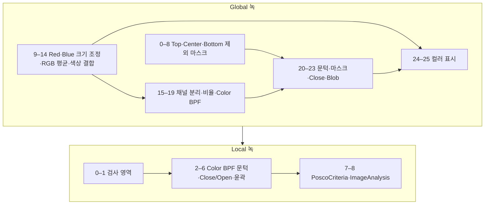

| 단계 | JSON상 근거와 해석 |
|---|---|
| Global 0–8 | `Top 제외`, `Center 제외`, `Bottom 제외` 결과명. 영역 취합에는 [AllArithmetic Max](영상처리기법.md#allarithmetic) 사용 |
| Global 9–19 | [ImageResize](영상처리기법.md#imageresize), Average, [MakeColorImage](영상처리기법.md#makecolorimage), [ColorSplit](영상처리기법.md#colorsplit), Arithmetic2/Arithmetic Divide, Positive BPF로 색상 대비 구성 |
| Global 20–25 | 문턱 처리와 Close 후 BlobLabelCriteria. 컬러 결과와 오버레이 구성 |
| Local 0–8 | `Color BPF` 입력(10) 문턱 처리 → Mask → Close/Open → 윤곽 선별 → [PoscoCriteria](영상처리기법.md#poscocriteria) → ImageAnalysis |

**전달 특징:** `Color BPF` ↔ Local 10. Local 11번 입력명은 `REF`입니다. Global의 Mask·Hole Mask 샘플 경로 예외는 문서 끝을 참고하세요.

Global 녹.json — 전체 26개 노드와 원문 설정

원본 SHA-256 앞 16자리: `50c6315f0aeb59dc`. 입력 17개. JSON 기록 시각: `2025.08.28 17:27`.

| 순번·도구 | 이미지 참조 1 / 2 / 3 / 4 | 선택 옵션 1 / 2 | I1 / I2; P1 / P2 / P3 | 결과명 · SaveUse |
|---|---|---|---|---|
| [Morphology_0](영상처리기법.md#morphology) | 8 / 0 / 0 / 0 | 0:Rect / 0:Erode | 31 / 31; 3 / 0 / 0 | 이름 없음 · `false` |
| [MakeMask_1](영상처리기법.md#makemask) | 0 / 0 / 0 / 0 | 0:옵션 없음 / 0:옵션 없음 | 1286 / 220; 20 / 20 / 0.5 | Top Check Mask · `false` |
| [MakeMask_2](영상처리기법.md#makemask) | 0 / 0 / 0 / 0 | 0:옵션 없음 / 0:옵션 없음 | 1286 / 1014; 20 / 20 / 0.5 | Center Check Mask · `false` |
| [MakeMask_3](영상처리기법.md#makemask) | 0 / 0 / 0 / 0 | 0:옵션 없음 / 0:옵션 없음 | 1286 / 1820; 20 / 20 / 0.5 | Bottom Check Mask · `false` |
| [OverlapBlobCriteria2_4](영상처리기법.md#overlapblobcriteria2) | 17 / 18 / 0 / 0 | 0:And / 1:옵션 없음 | 0 / 0; 5 / 0.5 / 0.5 | Top 제외 · `false` |
| [OverlapBlobCriteria2_5](영상처리기법.md#overlapblobcriteria2) | 17 / 19 / 0 / 0 | 0:And / 1:옵션 없음 | 0 / 0; 5 / 0.5 / 0.5 | Center 제외 · `false` |
| [OverlapBlobCriteria2_6](영상처리기법.md#overlapblobcriteria2) | 17 / 20 / 0 / 0 | 0:And / 1:옵션 없음 | 0 / 0; 5 / 0.5 / 0.5 | Bottom 제외 · `false` |
| [AllArithmetic_7](영상처리기법.md#allarithmetic) | 21 / 23 / 23 / 0 | 1:Max / 0:Manual | 0 / 0; 1 / 0 / 0.5 | 제외 영역 · `false` |
| [Arithmetic_8](영상처리기법.md#arithmetic) | 17 / 24 / 0 / 0 | 1:Sub / 0:Not Use | 0 / 0; 1 / 0 / 0.5 | 최종 Mask · `false` |
| [ImageResize_9](영상처리기법.md#imageresize) | 5 / 0 / 0 / 0 | 4:Center / 0:Crop | -2 / 1; 1 / 0.5 / 0.5 | Resize Red · `false` |
| [ImageResize_10](영상처리기법.md#imageresize) | 7 / 0 / 0 / 0 | 4:Center / 0:Crop | 0 / 1; 1 / 0.5 / 0.5 | Resize Blue · `false` |
| [Average_11](영상처리기법.md#average) | 26 / 0 / 0 / 0 | -1:옵션 없음 / -1:옵션 없음 | 9 / 9; 3 / 0 / 0 | R · `false` |
| [Average_12](영상처리기법.md#average) | 6 / 0 / 0 / 0 | -1:옵션 없음 / -1:옵션 없음 | 9 / 9; 3 / 0 / 0 | G · `false` |
| [Average_13](영상처리기법.md#average) | 27 / 0 / 0 / 0 | -1:옵션 없음 / -1:옵션 없음 | 9 / 9; 3 / 0 / 0 | B · `false` |
| [MakeColorImage_14](영상처리기법.md#makecolorimage) | 28 / 29 / 30 / 0 | 2:ColorCal / 0:옵션 없음 | 1 / 0; 50 / 50 / 50 | 이름 없음 · `false` |
| [ColorSplit_15](영상처리기법.md#colorsplit) | 31 / 0 / 0 / 0 | 0:Red / 0:옵션 없음 | 0 / 0; 50 / 50 / 50 | 이름 없음 · `false` |
| [ColorSplit_16](영상처리기법.md#colorsplit) | 31 / 0 / 0 / 0 | 2:Blue / 0:옵션 없음 | 0 / 0; 50 / 50 / 50 | 이름 없음 · `false` |
| [Arithmetic2_17](영상처리기법.md#arithmetic2) | 0 / 33 / 0 / 0 | 2:Multi / 1:Multi First | 0 / 0; 1 / 0 / 0.5 | 이름 없음 · `false` |
| [Arithmetic_18](영상처리기법.md#arithmetic) | 32 / 34 / 0 / 0 | 3:Divide / 1:Multi First | 0 / 0; 0.3 / 0 / 0.5 | 이름 없음 · `false` |
| [BPF_19](영상처리기법.md#bpf) | 35 / 0 / 0 / 0 | 2:Positive / -1:옵션 없음 | 0 / 0; 5 / 0.35 / 0.55 | Color BPF · `true` |
| [Threshold_20](영상처리기법.md#threshold) | 36 / 0 / 0 / 0 | 0:Normal / 0:Manual | 50 / 50; 15 / 0 / 0 | 이름 없음 · `false` |
| [Arithmetic_21](영상처리기법.md#arithmetic) | 37 / 25 / 0 / 0 | 4:And / 0:Not Use | 0 / 0; 1 / 0 / 0.5 | 이름 없음 · `false` |
| [Morphology_22](영상처리기법.md#morphology) | 38 / 0 / 0 / 0 | 2:Ellipse / 3:Close(Dilate->Eroce) | 21 / 21; 3 / 0 / 0 | 이름 없음 · `false` |
| [BlobLabelCriteria_23](영상처리기법.md#bloblabelcriteria) | 39 / 0 / 0 / 0 | 0:And / 1:옵션 없음 | 0 / 0; 5 / 0.5 / 0.5 | 이름 없음 · `true` |
| [MakeColorImage_24](영상처리기법.md#makecolorimage) | 28 / 29 / 30 / 0 | 1:AutoValue / 0:옵션 없음 | 3 / 0; 50 / 50 / 50 | 이름 없음 · `false` |
| [MaskColorOverlay_25](영상처리기법.md#maskcoloroverlay) | 41 / 40 / 0 / 0 | 0:Fill / 0:옵션 없음 | 0 / 0; 255 / 0 / 0 | 이름 없음 · `false` |

Local 녹.json — 전체 9개 노드와 원문 설정

원본 SHA-256 앞 16자리: `f00149c3a2287e7c`. 입력 17개. JSON 기록 시각: `2025.08.28 17:28`.

| 순번·도구 | 이미지 참조 1 / 2 / 3 / 4 | 선택 옵션 1 / 2 | I1 / I2; P1 / P2 / P3 | 결과명 · SaveUse |
|---|---|---|---|---|
| [MakeCenterMask_0](영상처리기법.md#makecentermask) | 0 / 0 / 0 / 0 | 1:Outline / 0:옵션 없음 | 3 / 3; 50 / 1 / 0.5 | 이름 없음 · `false` |
| [Arithmetic_1](영상처리기법.md#arithmetic) | 8 / 17 / 0 / 0 | 4:And / 0:Not Use | 0 / 0; 1 / 0 / 0.5 | 이름 없음 · `false` |
| [Threshold_2](영상처리기법.md#threshold) | 10 / 0 / 0 / 0 | 0:Normal / 0:Manual | 50 / 50; 10 / 0 / 0 | 이름 없음 · `false` |
| [Arithmetic_3](영상처리기법.md#arithmetic) | 19 / 18 / 0 / 0 | 4:And / 0:Not Use | 0 / 0; 1 / 0 / 0.5 | 이름 없음 · `false` |
| [Morphology_4](영상처리기법.md#morphology) | 20 / 0 / 0 / 0 | 2:Ellipse / 3:Close(Dilate->Eroce) | 11 / 11; 3 / 0 / 0 | 이름 없음 · `false` |
| [Morphology_5](영상처리기법.md#morphology) | 21 / 0 / 0 / 0 | 2:Ellipse / 2:Open(Erode->Dilate) | 7 / 7; 3 / 0 / 0 | 이름 없음 · `false` |
| [BlobContourCriteria_6](영상처리기법.md#blobcontourcriteria) | 22 / 0 / 0 / 0 | 0:And / 0:Lable Image | 0 / 0; 5 / 0.5 / 0.5 | 이름 없음 · `false` |
| [PoscoCriteria_7](영상처리기법.md#poscocriteria) | 23 / 10 / 0 / 0 | 0:And / 0:Src 0 | 0 / 0; 1.1 / 1.1 / 0.5 | 이름 없음 · `false` |
| [ImageAnalysis_8](영상처리기법.md#imageanalysis) | 24 / 10 / 10 / 10 | 0:Src 0 / 0:옵션 없음 | 11 / 100; 15 / 15 / 1.1 | 이름 없음 · `true` |

## 바니시

**의도 추정:** 반사율 변화로 영역 후보를 만들고 기울기 기반 3D 계열 특징으로 추가 검토합니다. Global 20개, Local 3개 노드입니다.

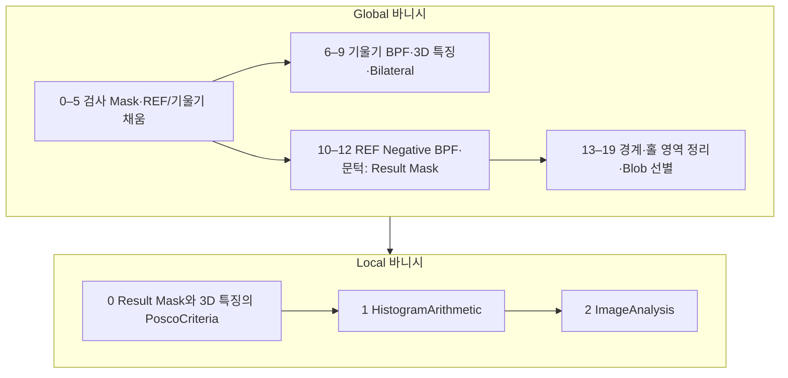

| 단계 | JSON상 근거와 해석 |
|---|---|
| Global 0–9 | 기울기에서 거칠기 성분을 Sub로 결합한 뒤 BPF → [Make3DImage](영상처리기법.md#make3dimage) → Bilateral. `3D Check 용` 저장 |
| Global 10–19 | REF Negative BPF·Threshold·Mask로 `Result Mask` 생성. 방향 형태학·겹침·Hole Mask로 경계성 후보 정리 |
| Local 0–2 | PoscoCriteria → [HistogramArithmetic Over](영상처리기법.md#histogramarithmetic) → ImageAnalysis. Local이 별도 이진 후보를 처음부터 재검출하지 않는 간결한 구성 |

**전달 특징:** `3D Check 용`, `Result Mask` ↔ Local 10·11. 물리적 도막 두께 측정으로 단정할 수 없습니다.

Global 바니시.json — 전체 20개 노드와 원문 설정

원본 SHA-256 앞 16자리: `79228b32f1ad9c6e`. 입력 17개. JSON 기록 시각: `2025.08.28 17:27`.

| 순번·도구 | 이미지 참조 1 / 2 / 3 / 4 | 선택 옵션 1 / 2 | I1 / I2; P1 / P2 / P3 | 결과명 · SaveUse |
|---|---|---|---|---|
| [Morphology_0](영상처리기법.md#morphology) | 8 / 0 / 0 / 0 | 0:Rect / 0:Erode | 31 / 31; 3 / 0 / 0 | 최종 Mask · `false` |
| [RegionFilling_1](영상처리기법.md#regionfilling) | 0 / 17 / 0 / 0 | 0:Normal / 0:false | 0 / 0; 0.5 / 0.5 / 0.5 | Region REF · `false` |
| [MergeTransformed_2](영상처리기법.md#mergetransformed) | 3 / 1 / 0 / 0 | 1:Sub / 0:옵션 없음 | 0 / 0; 1 / 0.5 / 0.5 | INH · `false` |
| [MergeTransformed_3](영상처리기법.md#mergetransformed) | 4 / 2 / 0 / 0 | 1:Sub / 0:옵션 없음 | 0 / 0; 1 / 0.5 / 0.5 | INV · `false` |
| [RegionFilling_4](영상처리기법.md#regionfilling) | 19 / 17 / 0 / 0 | 0:Normal / 0:false | 0 / 0; 0.5 / 0.5 / 0.5 | INH Region · `false` |
| [RegionFilling_5](영상처리기법.md#regionfilling) | 20 / 17 / 0 / 0 | 0:Normal / 0:false | 0 / 0; 0.5 / 0.5 / 0.5 | INV Region · `false` |
| [BPF_6](영상처리기법.md#bpf) | 21 / 0 / 0 / 0 | 0:Basic / -1:옵션 없음 | 0 / 0; 5 / 0.45 / 0.7 | 이름 없음 · `false` |
| [BPF_7](영상처리기법.md#bpf) | 22 / 0 / 0 / 0 | 0:Basic / -1:옵션 없음 | 0 / 0; 5 / 0.45 / 0.7 | 이름 없음 · `false` |
| [Make3DImage_8](영상처리기법.md#make3dimage) | 23 / 24 / 0 / 0 | 0:Basic / 1:InvertH | 0 / 0; 5 / 0.55 / 1 | 이름 없음 · `false` |
| [Bilateral_9](영상처리기법.md#bilateral) | 25 / 0 / 0 / 0 | 0:옵션 없음 / 0:옵션 없음 | -1 / 3; 25 / 15 / 0 | 3D Check 용 · `true` |
| [BPF_10](영상처리기법.md#bpf) | 18 / 0 / 0 / 0 | 3:Negative / -1:옵션 없음 | 0 / 0; 5 / 0.25 / 0.45 | 이름 없음 · `false` |
| [Threshold_11](영상처리기법.md#threshold) | 27 / 0 / 0 / 0 | 0:Normal / 0:Manual | 50 / 50; 50 / 0 / 0 | 이름 없음 · `false` |
| [Arithmetic_12](영상처리기법.md#arithmetic) | 28 / 17 / 0 / 0 | 4:And / 0:Not Use | 0 / 0; 1 / 0 / 0.5 | Result Mask · `true` |
| [DirectionalMorphology_13](영상처리기법.md#directionalmorphology) | 17 / 0 / 0 / 0 | 0:Left / 0:Erode | 51 / 10; 50 / 0 / 0 | 이름 없음 · `false` |
| [Arithmetic_14](영상처리기법.md#arithmetic) | 17 / 30 / 0 / 0 | 1:Sub / 0:Not Use | 0 / 0; 1 / 0 / 0.5 | 이름 없음 · `false` |
| [Morphology_15](영상처리기법.md#morphology) | 31 / 0 / 0 / 0 | 0:Rect / 2:Open(Erode->Dilate) | 5 / 5; 3 / 0 / 0 | 이름 없음 · `false` |
| [OverlapBlobCriteria2_16](영상처리기법.md#overlapblobcriteria2) | 29 / 32 / 0 / 0 | 0:And / 1:옵션 없음 | 0 / 0; 5 / 0.5 / 0.5 | 이름 없음 · `false` |
| [Morphology_17](영상처리기법.md#morphology) | 9 / 0 / 0 / 0 | 0:Rect / 1:Dilate | 11 / 11; 3 / 0 / 0 | 이름 없음 · `false` |
| [Arithmetic_18](영상처리기법.md#arithmetic) | 33 / 34 / 0 / 0 | 1:Sub / 0:Not Use | 0 / 0; 1 / 0 / 0.5 | 이름 없음 · `false` |
| [BlobContourCriteria2_19](영상처리기법.md#blobcontourcriteria2) | 35 / 0 / 0 / 0 | 0:And / 1:Blob Grop | 20 / 0; 5 / 0.5 / 0.5 | 이름 없음 · `true` |

Local 바니시.json — 전체 3개 노드와 원문 설정

원본 SHA-256 앞 16자리: `d708ba4df4fc9bac`. 입력 17개. JSON 기록 시각: `2025.08.28 17:28`.

| 순번·도구 | 이미지 참조 1 / 2 / 3 / 4 | 선택 옵션 1 / 2 | I1 / I2; P1 / P2 / P3 | 결과명 · SaveUse |
|---|---|---|---|---|
| [PoscoCriteria_0](영상처리기법.md#poscocriteria) | 11 / 10 / 0 / 0 | 0:And / 0:Src 0 | 0 / 0; 1.1 / 1.1 / 0.5 | 이름 없음 · `false` |
| [HistogramArithmetic_1](영상처리기법.md#histogramarithmetic) | 10 / 17 / 17 / 0 | 1:Over / 0:옵션 없음 | 160 / 0; 10 / 0 / 0 | 이름 없음 · `false` |
| [ImageAnalysis_2](영상처리기법.md#imageanalysis) | 18 / 10 / 0 / 0 | 0:Src 0 / 0:옵션 없음 | 11 / 100; 15 / 15 / 1.1 | 이름 없음 · `true` |

## 스크래치

**의도 추정:** 거칠기·기울기·반사율의 여러 선형 응답을 취합하되 수평/수직 패턴 잡음을 제외합니다. Global 75개, Local 74개로 측면 검사 중 가장 긴 구성입니다.

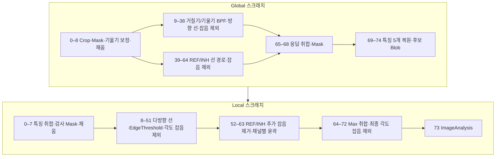

| 단계 | JSON상 근거와 해석 |
|---|---|
| Global 0–14 | Crop·Mask와 보정 INH/INV → BPF. `RG STD`, `IN STD`의 실제 Arithmetic 모드는 **9 Avg** |
| Global 15–38 | RG·IN 선 탐색의 중심 각도 45°/135°, 범위 ±40°. [EdgeThreshold2](영상처리기법.md#edgethreshold2) 후 [AngleThresholdFilter](영상처리기법.md#anglethresholdfilter) 응답을 취합·차감 |
| Global 39–68 | REF에 Bilateral·SelfReference·Positive BPF 적용. REF와 INH 선 경로를 추가하고 앞선 응답과 취합 |
| Global 69–74 | [CropImageOverlay](영상처리기법.md#cropimageoverlay)로 특징 5개 복원·저장, 최종 Blob 후보 저장 |
| Local 0–51 | RG·IN·REF·INH 특징에서 다시 선 검출. EdgeThreshold·각도 잡음 응답을 채널별로 정리 |
| Local 52–73 | 원 REF/INH의 추가 BPF 잡음 조건 → 채널별 윤곽 → AllArithmetic Max → 최종 각도 잡음 차감·윤곽 → ImageAnalysis |

**전달 특징:** Local 10–14는 `BPF RGH`, `BPF RGV`, `BPF INH`, `BPF INV`, `BPF REF`.

**설정 주의:** `Local LineSearching_11`의 결과명은 `IN 2,4선찾기`이지만 실제 중심 각도는 **45°**로 `_10`과 같습니다. 여러 `수평/수직 노이즈` 노드도 주요 각도 값이 동일하므로 이름만으로 다른 방향이라고 해석하지 않았습니다.

Global 스크래치.json — 전체 75개 노드와 원문 설정

원본 SHA-256 앞 16자리: `0a78a94e5790e99f`. 입력 17개. JSON 기록 시각: `2025.09.25 14:28`.

| 순번·도구 | 이미지 참조 1 / 2 / 3 / 4 | 선택 옵션 1 / 2 | I1 / I2; P1 / P2 / P3 | 결과명 · SaveUse |
|---|---|---|---|---|
| [MakeCropImage_0](영상처리기법.md#makecropimage) | 0 / 9 / 0 / 0 | 1:Manual / 0:옵션 없음 | 0 / 0; 1 / 1 / 2 | 이름 없음 · `false` |
| [Arithmetic_1](영상처리기법.md#arithmetic) | 25 / 26 / 0 / 0 | 1:Sub / 0:Not Use | 0 / 0; 1 / 0 / 0.5 | 이름 없음 · `false` |
| [Morphology_2](영상처리기법.md#morphology) | 27 / 0 / 0 / 0 | 0:Rect / 0:Erode | 51 / 3; 3 / 0 / 0 | 최종 Mask · `false` |
| [MergeTransformed_3](영상처리기법.md#mergetransformed) | 20 / 18 / 0 / 0 | 1:Sub / 0:옵션 없음 | 0 / 0; 1 / 0.5 / 0.5 | 보정 INH · `false` |
| [MergeTransformed_4](영상처리기법.md#mergetransformed) | 21 / 19 / 0 / 0 | 1:Sub / 0:옵션 없음 | 0 / 0; 1 / 0.5 / 0.5 | 보정 INV · `false` |
| [RegionFilling_5](영상처리기법.md#regionfilling) | 18 / 28 / 0 / 0 | 0:Normal / 0:false | 0 / 0; 0.25 / 0.5 / 0.5 | Region RGH · `false` |
| [RegionFilling_6](영상처리기법.md#regionfilling) | 19 / 28 / 0 / 0 | 0:Normal / 0:false | 0 / 0; 0.25 / 0.5 / 0.5 | Region RGV · `false` |
| [RegionFilling_7](영상처리기법.md#regionfilling) | 29 / 28 / 0 / 0 | 0:Normal / 0:false | 0 / 0; 0.25 / 0.5 / 0.5 | Region INH · `false` |
| [RegionFilling_8](영상처리기법.md#regionfilling) | 30 / 28 / 0 / 0 | 0:Normal / 0:false | 0 / 0; 0.25 / 0.5 / 0.5 | Region INV · `false` |
| [BPF_9](영상처리기법.md#bpf) | 31 / 0 / 0 / 0 | 1:ABS / -1:옵션 없음 | 0 / 0; 5 / 0.35 / 0.7 | BPF RGH · `false` |
| [BPF_10](영상처리기법.md#bpf) | 32 / 0 / 0 / 0 | 1:ABS / -1:옵션 없음 | 0 / 0; 5 / 0.35 / 0.7 | BPF RGV · `false` |
| [BPF_11](영상처리기법.md#bpf) | 33 / 0 / 0 / 0 | 1:ABS / -1:옵션 없음 | 0 / 0; 5 / 0.55 / 0.7 | BPF INH · `false` |
| [BPF_12](영상처리기법.md#bpf) | 34 / 0 / 0 / 0 | 1:ABS / -1:옵션 없음 | 0 / 0; 5 / 0.55 / 0.7 | BPF INV · `false` |
| [Arithmetic_13](영상처리기법.md#arithmetic) | 35 / 36 / 0 / 0 | 9:Avg / 0:Not Use | 0 / 0; 3 / 0 / 0.5 | RG STD · `false` |
| [Arithmetic_14](영상처리기법.md#arithmetic) | 37 / 38 / 0 / 0 | 9:Avg / 0:Not Use | 0 / 0; 3 / 0 / 0.5 | IN STD · `false` |
| [Morphology_15](영상처리기법.md#morphology) | 28 / 0 / 0 / 0 | 0:Rect / 0:Erode | 1 / 21; 3 / 0 / 0 | 선찾기 후 Mask · `false` |
| [AllArithmetic_16](영상처리기법.md#allarithmetic) | 39 / 40 / 41 / 0 | 4:Mask / 0:Manual | 0 / 0; 1 / 0 / 0.5 | 이름 없음 · `false` |
| [LineSearching_17](영상처리기법.md#linesearching) | 42 / 0 / 0 / 0 | 1:옵션 없음 / 0:옵션 없음 | 51 / 0; 1 / 45 / 40 | RG 선찾기 1,3 · `false` |
| [LineSearching_18](영상처리기법.md#linesearching) | 42 / 0 / 0 / 0 | 1:옵션 없음 / 0:옵션 없음 | 51 / 0; 1 / 135 / 40 | RG 선찾기 2,4 · `false` |
| [LineSearching_19](영상처리기법.md#linesearching) | 43 / 0 / 0 / 0 | 1:옵션 없음 / 0:옵션 없음 | 51 / 0; 1 / 45 / 40 | IN 선찾기 1,3 · `false` |
| [LineSearching_20](영상처리기법.md#linesearching) | 43 / 0 / 0 / 0 | 1:옵션 없음 / 0:옵션 없음 | 51 / 0; 1 / 135 / 40 | IN 선찾기 2,4 · `false` |
| [EdgeThreshold2_21](영상처리기법.md#edgethreshold2) | 44 / 0 / 0 / 0 | 0:Rect / 0:옵션 없음 | 5 / 5; 10 / 0 / 0 | RG 1,3 Threshold · `false` |
| [EdgeThreshold2_22](영상처리기법.md#edgethreshold2) | 45 / 0 / 0 / 0 | 0:Rect / 0:옵션 없음 | 5 / 5; 10 / 0 / 0 | RG 2,4 Threshold · `false` |
| [EdgeThreshold2_23](영상처리기법.md#edgethreshold2) | 46 / 0 / 0 / 0 | 0:Rect / 0:옵션 없음 | 5 / 5; 10 / 0 / 0 | IN 1,3 Threshold · `false` |
| [EdgeThreshold2_24](영상처리기법.md#edgethreshold2) | 47 / 0 / 0 / 0 | 0:Rect / 0:옵션 없음 | 5 / 5; 10 / 0 / 0 | IN 2,4 Threshold · `false` |
| [AngleThresholdFilter_25](영상처리기법.md#anglethresholdfilter) | 48 / 17 / 0 / 0 | 0:UnUse / 0:기존 검사 결과 Image | 3 / 0; 1 / 90 / 90 | RG 1,3 수직 노이즈 · `false` |
| [AngleThresholdFilter_26](영상처리기법.md#anglethresholdfilter) | 49 / 17 / 0 / 0 | 0:UnUse / 0:기존 검사 결과 Image | 3 / 0; 1 / 90 / 90 | RG 2,4 수직 노이즈 · `false` |
| [AngleThresholdFilter_27](영상처리기법.md#anglethresholdfilter) | 48 / 17 / 0 / 0 | 0:UnUse / 0:기존 검사 결과 Image | 3 / 0; 1 / 90 / 90 | RG 1,3 수평 노이즈 · `false` |
| [AngleThresholdFilter_28](영상처리기법.md#anglethresholdfilter) | 49 / 17 / 0 / 0 | 0:UnUse / 0:기존 검사 결과 Image | 3 / 0; 1 / 90 / 90 | RG 2,4 수평 노이즈 · `false` |
| [AngleThresholdFilter_29](영상처리기법.md#anglethresholdfilter) | 50 / 17 / 0 / 0 | 0:UnUse / 0:기존 검사 결과 Image | 3 / 0; 1 / 90 / 90 | IN 1,3 수직 노이즈 · `false` |
| [AngleThresholdFilter_30](영상처리기법.md#anglethresholdfilter) | 51 / 17 / 0 / 0 | 0:UnUse / 0:기존 검사 결과 Image | 3 / 0; 1 / 90 / 90 | IN 2,4 수직 노이즈 · `false` |
| [AngleThresholdFilter_31](영상처리기법.md#anglethresholdfilter) | 50 / 17 / 0 / 0 | 0:UnUse / 0:기존 검사 결과 Image | 3 / 0; 1 / 90 / 90 | IN 1,3 수평 노이즈 · `false` |
| [AngleThresholdFilter_32](영상처리기법.md#anglethresholdfilter) | 51 / 17 / 0 / 0 | 0:UnUse / 0:기존 검사 결과 Image | 3 / 0; 1 / 90 / 90 | IN 2,4 수평 노이즈 · `false` |
| [AllArithmetic_33](영상처리기법.md#allarithmetic) | 52 / 55 / 55 / 0 | 1:Max / 0:Manual | 0 / 0; 1 / 0 / 0.5 | RG 노이즈 · `false` |
| [AllArithmetic_34](영상처리기법.md#allarithmetic) | 56 / 59 / 59 / 0 | 1:Max / 0:Manual | 0 / 0; 1 / 0 / 0.5 | IN 노이즈 · `false` |
| [Arithmetic_35](영상처리기법.md#arithmetic) | 48 / 49 / 0 / 0 | 0:Add / 0:Not Use | 0 / 0; 1 / 0 / 0.5 | RG · `false` |
| [Arithmetic_36](영상처리기법.md#arithmetic) | 50 / 51 / 0 / 0 | 0:Add / 0:Not Use | 0 / 0; 1 / 0 / 0.5 | IN · `false` |
| [Arithmetic_37](영상처리기법.md#arithmetic) | 62 / 60 / 0 / 0 | 1:Sub / 0:Not Use | 0 / 0; 1 / 0 / 0.5 | RG 결과 · `false` |
| [Arithmetic_38](영상처리기법.md#arithmetic) | 63 / 61 / 0 / 0 | 1:Sub / 0:Not Use | 0 / 0; 1 / 0 / 0.5 | IN 결과 · `false` |
| [RegionFilling_39](영상처리기법.md#regionfilling) | 17 / 28 / 0 / 0 | 0:Normal / 0:false | 0 / 0; 0.25 / 0.5 / 0.5 | Region REF · `false` |
| [Bilateral_40](영상처리기법.md#bilateral) | 66 / 0 / 0 / 0 | 0:옵션 없음 / 0:옵션 없음 | -1 / 3; 25 / 5 / 0 | 이름 없음 · `false` |
| [SelfReference_41](영상처리기법.md#selfreference) | 67 / 0 / 0 / 0 | 0:옵션 없음 / 0:옵션 없음 | 51 / 51; 3 / 0 / 0 | 이름 없음 · `false` |
| [BPF_42](영상처리기법.md#bpf) | 68 / 0 / 0 / 0 | 2:Positive / -1:옵션 없음 | 0 / 0; 5 / 0.45 / 0.7 | BPF REF · `false` |
| [LineSearching_43](영상처리기법.md#linesearching) | 69 / 0 / 0 / 0 | 1:옵션 없음 / 0:옵션 없음 | 31 / 0; 1 / 45 / 40 | REF 선찾기 1,3 · `false` |
| [LineSearching_44](영상처리기법.md#linesearching) | 69 / 0 / 0 / 0 | 1:옵션 없음 / 0:옵션 없음 | 31 / 0; 1 / 135 / 40 | REF 선찾기 2,4 · `false` |
| [LineSearching_45](영상처리기법.md#linesearching) | 37 / 0 / 0 / 0 | 1:옵션 없음 / 0:옵션 없음 | 31 / 0; 1 / 45 / 40 | INH 선찾기 1,3 · `false` |
| [LineSearching_46](영상처리기법.md#linesearching) | 37 / 0 / 0 / 0 | 1:옵션 없음 / 0:옵션 없음 | 31 / 0; 1 / 135 / 40 | INH 선찾기 2,4 · `false` |
| [EdgeThreshold2_47](영상처리기법.md#edgethreshold2) | 70 / 0 / 0 / 0 | 0:Rect / 0:옵션 없음 | 5 / 5; 10 / 0 / 0 | REF 1,3 Threshold · `false` |
| [EdgeThreshold2_48](영상처리기법.md#edgethreshold2) | 71 / 0 / 0 / 0 | 0:Rect / 0:옵션 없음 | 5 / 5; 10 / 0 / 0 | REF 2,4 Threshold · `false` |
| [EdgeThreshold2_49](영상처리기법.md#edgethreshold2) | 72 / 0 / 0 / 0 | 0:Rect / 0:옵션 없음 | 5 / 5; 10 / 0 / 0 | INH 1,3 Threshold · `false` |
| [EdgeThreshold2_50](영상처리기법.md#edgethreshold2) | 73 / 0 / 0 / 0 | 0:Rect / 0:옵션 없음 | 5 / 5; 10 / 0 / 0 | INH 2,4 Threshold · `false` |
| [AngleThresholdFilter_51](영상처리기법.md#anglethresholdfilter) | 74 / 17 / 0 / 0 | 0:UnUse / 0:기존 검사 결과 Image | 3 / 0; 1 / 90 / 90 | REF 1,3 수직 노이즈 · `false` |
| [AngleThresholdFilter_52](영상처리기법.md#anglethresholdfilter) | 75 / 17 / 0 / 0 | 0:UnUse / 0:기존 검사 결과 Image | 3 / 0; 1 / 90 / 90 | REF 2,4 수직 노이즈 · `false` |
| [AngleThresholdFilter_53](영상처리기법.md#anglethresholdfilter) | 74 / 17 / 0 / 0 | 0:UnUse / 0:기존 검사 결과 Image | 3 / 0; 1 / 90 / 90 | REF 1,3 수평 노이즈 · `false` |
| [AngleThresholdFilter_54](영상처리기법.md#anglethresholdfilter) | 75 / 17 / 0 / 0 | 0:UnUse / 0:기존 검사 결과 Image | 3 / 0; 1 / 90 / 90 | REF 2,4 수평 노이즈 · `false` |
| [AngleThresholdFilter_55](영상처리기법.md#anglethresholdfilter) | 76 / 17 / 0 / 0 | 0:UnUse / 0:기존 검사 결과 Image | 3 / 0; 1 / 90 / 90 | INH 1,3 수직 노이즈 · `false` |
| [AngleThresholdFilter_56](영상처리기법.md#anglethresholdfilter) | 77 / 17 / 0 / 0 | 0:UnUse / 0:기존 검사 결과 Image | 3 / 0; 1 / 90 / 90 | INH 2,4 수직 노이즈 · `false` |
| [AngleThresholdFilter_57](영상처리기법.md#anglethresholdfilter) | 76 / 17 / 0 / 0 | 0:UnUse / 0:기존 검사 결과 Image | 3 / 0; 1 / 90 / 90 | INH 1,3 수평 노이즈 · `false` |
| [AngleThresholdFilter_58](영상처리기법.md#anglethresholdfilter) | 77 / 17 / 0 / 0 | 0:UnUse / 0:기존 검사 결과 Image | 3 / 0; 1 / 90 / 90 | INH 2,4 수평 노이즈 · `false` |
| [AllArithmetic_59](영상처리기법.md#allarithmetic) | 78 / 81 / 79 / 0 | 1:Max / 0:Manual | 0 / 0; 1 / 0 / 0.5 | REF 노이즈 · `false` |
| [AllArithmetic_60](영상처리기법.md#allarithmetic) | 82 / 85 / 83 / 0 | 1:Max / 0:Manual | 0 / 0; 1 / 0 / 0.5 | INH 노이즈 · `false` |
| [Arithmetic_61](영상처리기법.md#arithmetic) | 74 / 75 / 0 / 0 | 0:Add / 0:Not Use | 0 / 0; 1 / 0 / 0.5 | REF · `false` |
| [Arithmetic_62](영상처리기법.md#arithmetic) | 76 / 77 / 0 / 0 | 0:Add / 0:Not Use | 0 / 0; 1 / 0 / 0.5 | INH · `false` |
| [Arithmetic_63](영상처리기법.md#arithmetic) | 88 / 86 / 0 / 0 | 1:Sub / 0:Not Use | 0 / 0; 1 / 0 / 0.5 | REF 결과 · `false` |
| [Arithmetic_64](영상처리기법.md#arithmetic) | 89 / 87 / 0 / 0 | 1:Sub / 0:Not Use | 0 / 0; 1 / 0 / 0.5 | INH 결과 · `false` |
| [Arithmetic_65](영상처리기법.md#arithmetic) | 64 / 65 / 0 / 0 | 0:Add / 0:Not Use | 0 / 0; 1 / 0 / 0.5 | RG+IN · `false` |
| [Arithmetic_66](영상처리기법.md#arithmetic) | 90 / 91 / 0 / 0 | 0:Add / 0:Not Use | 0 / 0; 1 / 0 / 0.5 | REF+INH · `false` |
| [Arithmetic_67](영상처리기법.md#arithmetic) | 92 / 93 / 0 / 0 | 0:Add / 0:Not Use | 0 / 0; 1 / 0 / 0.5 | RG+IN+REF+INH · `false` |
| [Arithmetic_68](영상처리기법.md#arithmetic) | 94 / 28 / 0 / 0 | 4:And / 0:Not Use | 0 / 0; 1 / 0 / 0.5 | 이름 없음 · `false` |
| [CropImageOverlay_69](영상처리기법.md#cropimageoverlay) | 0 / 35 / 0 / 0 | 0:옵션 없음 / 0:옵션 없음 | 0 / 0; 5 / 0.5 / 0.5 | BPF RGH · `true` |
| [CropImageOverlay_70](영상처리기법.md#cropimageoverlay) | 0 / 36 / 0 / 0 | 0:옵션 없음 / 0:옵션 없음 | 0 / 0; 5 / 0.5 / 0.5 | BPF RGV · `true` |
| [CropImageOverlay_71](영상처리기법.md#cropimageoverlay) | 0 / 37 / 0 / 0 | 0:옵션 없음 / 0:옵션 없음 | 0 / 0; 5 / 0.5 / 0.5 | BPF INH · `true` |
| [CropImageOverlay_72](영상처리기법.md#cropimageoverlay) | 0 / 38 / 0 / 0 | 0:옵션 없음 / 0:옵션 없음 | 0 / 0; 5 / 0.5 / 0.5 | BPF INV · `true` |
| [CropImageOverlay_73](영상처리기법.md#cropimageoverlay) | 0 / 69 / 0 / 0 | 0:옵션 없음 / 0:옵션 없음 | 0 / 0; 5 / 0.5 / 0.5 | BPF REF · `true` |
| [BlobContourCriteria_74](영상처리기법.md#blobcontourcriteria) | 95 / 0 / 0 / 0 | 0:And / 1:Blob Grop | 50 / 0; 5 / 0.5 / 0.5 | 이름 없음 · `true` |

Local 스크래치.json — 전체 74개 노드와 원문 설정

원본 SHA-256 앞 16자리: `febbf30205efd5ca`. 입력 17개. JSON 기록 시각: `2025.09.25 16:03`.

| 순번·도구 | 이미지 참조 1 / 2 / 3 / 4 | 선택 옵션 1 / 2 | I1 / I2; P1 / P2 / P3 | 결과명 · SaveUse |
|---|---|---|---|---|
| [Arithmetic_0](영상처리기법.md#arithmetic) | 10 / 11 / 0 / 0 | 9:Avg / 0:Not Use | 0 / 0; 3 / 0 / 0.5 | RG STD · `false` |
| [Arithmetic_1](영상처리기법.md#arithmetic) | 12 / 13 / 0 / 0 | 9:Avg / 0:Not Use | 0 / 0; 3 / 0 / 0.5 | IN STD · `false` |
| [MakeCenterMask_2](영상처리기법.md#makecentermask) | 0 / 0 / 0 / 0 | 1:Outline / 0:옵션 없음 | 20 / 20; 50 / 1 / 0.5 | 이름 없음 · `false` |
| [Arithmetic_3](영상처리기법.md#arithmetic) | 19 / 8 / 0 / 0 | 4:And / 0:Not Use | 0 / 0; 1 / 0 / 0.5 | 검출 영역 · `false` |
| [RegionFilling_4](영상처리기법.md#regionfilling) | 17 / 20 / 0 / 0 | 0:Normal / 0:false | 0 / 0; 1 / 0.5 / 0.5 | RG · `false` |
| [RegionFilling_5](영상처리기법.md#regionfilling) | 18 / 20 / 0 / 0 | 0:Normal / 0:false | 0 / 0; 1 / 0.5 / 0.5 | IN · `false` |
| [RegionFilling_6](영상처리기법.md#regionfilling) | 14 / 20 / 0 / 0 | 0:Normal / 0:false | 0 / 0; 1 / 0.5 / 0.5 | REF · `false` |
| [RegionFilling_7](영상처리기법.md#regionfilling) | 12 / 20 / 0 / 0 | 0:Normal / 0:false | 0 / 0; 1 / 0.5 / 0.5 | INH · `false` |
| [LineSearching_8](영상처리기법.md#linesearching) | 21 / 0 / 0 / 0 | 1:옵션 없음 / 0:옵션 없음 | 51 / 0; 1 / 45 / 40 | RG 1,3선찾기 · `false` |
| [LineSearching_9](영상처리기법.md#linesearching) | 21 / 0 / 0 / 0 | 1:옵션 없음 / 0:옵션 없음 | 51 / 0; 1 / 135 / 40 | RG 2,4선찾기 · `false` |
| [LineSearching_10](영상처리기법.md#linesearching) | 22 / 0 / 0 / 0 | 1:옵션 없음 / 0:옵션 없음 | 51 / 0; 1 / 45 / 40 | IN 1,3선찾기 · `false` |
| [LineSearching_11](영상처리기법.md#linesearching) | 22 / 0 / 0 / 0 | 1:옵션 없음 / 0:옵션 없음 | 51 / 0; 1 / 45 / 40 | IN 2,4선찾기 · `false` |
| [LineSearching_12](영상처리기법.md#linesearching) | 23 / 0 / 0 / 0 | 1:옵션 없음 / 0:옵션 없음 | 51 / 0; 1 / 45 / 40 | REF 1,3선찾기 · `false` |
| [LineSearching_13](영상처리기법.md#linesearching) | 23 / 0 / 0 / 0 | 1:옵션 없음 / 0:옵션 없음 | 51 / 0; 1 / 135 / 40 | REF 2,4선찾기 · `false` |
| [LineSearching_14](영상처리기법.md#linesearching) | 24 / 0 / 0 / 0 | 1:옵션 없음 / 0:옵션 없음 | 51 / 0; 1 / 45 / 40 | INH 1,3선찾기 · `false` |
| [LineSearching_15](영상처리기법.md#linesearching) | 24 / 0 / 0 / 0 | 1:옵션 없음 / 0:옵션 없음 | 51 / 0; 1 / 135 / 40 | INH 2,4선찾기 · `false` |
| [EdgeThreshold2_16](영상처리기법.md#edgethreshold2) | 25 / 0 / 0 / 0 | 0:Rect / 0:옵션 없음 | 5 / 10; 15 / 0 / 0 | RG 1,3Threshold · `false` |
| [EdgeThreshold2_17](영상처리기법.md#edgethreshold2) | 26 / 0 / 0 / 0 | 0:Rect / 0:옵션 없음 | 5 / 10; 15 / 0 / 0 | RG 2,4Threshold · `false` |
| [EdgeThreshold2_18](영상처리기법.md#edgethreshold2) | 27 / 0 / 0 / 0 | 0:Rect / 0:옵션 없음 | 5 / 10; 15 / 0 / 0 | IN 1,3Threshold · `false` |
| [EdgeThreshold2_19](영상처리기법.md#edgethreshold2) | 28 / 0 / 0 / 0 | 0:Rect / 0:옵션 없음 | 5 / 10; 15 / 0 / 0 | IN 2,4Threshold · `false` |
| [EdgeThreshold2_20](영상처리기법.md#edgethreshold2) | 29 / 0 / 0 / 0 | 0:Rect / 0:옵션 없음 | 5 / 10; 15 / 0 / 0 | REF 1,3Threshold · `false` |
| [EdgeThreshold2_21](영상처리기법.md#edgethreshold2) | 30 / 0 / 0 / 0 | 0:Rect / 0:옵션 없음 | 5 / 10; 15 / 0 / 0 | REF 2,4Threshold · `false` |
| [EdgeThreshold2_22](영상처리기법.md#edgethreshold2) | 31 / 0 / 0 / 0 | 0:Rect / 0:옵션 없음 | 5 / 10; 15 / 0 / 0 | INH 1,3Threshold · `false` |
| [EdgeThreshold2_23](영상처리기법.md#edgethreshold2) | 32 / 0 / 0 / 0 | 0:Rect / 0:옵션 없음 | 5 / 10; 15 / 0 / 0 | INH 2,4Threshold · `false` |
| [AngleThresholdFilter_24](영상처리기법.md#anglethresholdfilter) | 33 / 33 / 0 / 0 | 0:UnUse / 0:기존 검사 결과 Image | 3 / 0; 1 / 90 / 90 | RG 1,3수직 노이즈 · `false` |
| [AngleThresholdFilter_25](영상처리기법.md#anglethresholdfilter) | 34 / 34 / 0 / 0 | 0:UnUse / 0:기존 검사 결과 Image | 3 / 0; 1 / 90 / 90 | RG 2,4수직 노이즈 · `false` |
| [AngleThresholdFilter_26](영상처리기법.md#anglethresholdfilter) | 33 / 33 / 0 / 0 | 0:UnUse / 0:기존 검사 결과 Image | 3 / 0; 1 / 90 / 90 | RG 1,3 수평 노이즈 · `false` |
| [AngleThresholdFilter_27](영상처리기법.md#anglethresholdfilter) | 34 / 34 / 0 / 0 | 0:UnUse / 0:기존 검사 결과 Image | 3 / 0; 1 / 90 / 90 | RG 2,4 수평 노이즈 · `false` |
| [AngleThresholdFilter_28](영상처리기법.md#anglethresholdfilter) | 35 / 35 / 0 / 0 | 0:UnUse / 0:기존 검사 결과 Image | 3 / 0; 1 / 90 / 90 | IN 1,3 수직 노이즈 · `false` |
| [AngleThresholdFilter_29](영상처리기법.md#anglethresholdfilter) | 36 / 36 / 0 / 0 | 0:UnUse / 0:기존 검사 결과 Image | 3 / 0; 1 / 90 / 90 | IN 2,4 수직 노이즈 · `false` |
| [AngleThresholdFilter_30](영상처리기법.md#anglethresholdfilter) | 35 / 35 / 0 / 0 | 0:UnUse / 0:기존 검사 결과 Image | 3 / 0; 1 / 90 / 90 | IN 1,3 수평 노이즈 · `false` |
| [AngleThresholdFilter_31](영상처리기법.md#anglethresholdfilter) | 36 / 36 / 0 / 0 | 0:UnUse / 0:기존 검사 결과 Image | 3 / 0; 1 / 90 / 90 | IN 2,4 수평 노이즈 · `false` |
| [AngleThresholdFilter_32](영상처리기법.md#anglethresholdfilter) | 37 / 37 / 0 / 0 | 0:UnUse / 0:기존 검사 결과 Image | 3 / 0; 1 / 90 / 90 | REF 1,3 수직 노이즈 · `false` |
| [AngleThresholdFilter_33](영상처리기법.md#anglethresholdfilter) | 38 / 38 / 0 / 0 | 0:UnUse / 0:기존 검사 결과 Image | 3 / 0; 1 / 90 / 90 | REF 2,4 수직 노이즈 · `false` |
| [AngleThresholdFilter_34](영상처리기법.md#anglethresholdfilter) | 37 / 37 / 0 / 0 | 0:UnUse / 0:기존 검사 결과 Image | 3 / 0; 1 / 90 / 90 | REF 1,3 수평 노이즈 · `false` |
| [AngleThresholdFilter_35](영상처리기법.md#anglethresholdfilter) | 38 / 38 / 0 / 0 | 0:UnUse / 0:기존 검사 결과 Image | 3 / 0; 1 / 90 / 90 | REF 2,4 수평 노이즈 · `false` |
| [AngleThresholdFilter_36](영상처리기법.md#anglethresholdfilter) | 39 / 39 / 0 / 0 | 0:UnUse / 0:기존 검사 결과 Image | 3 / 0; 1 / 90 / 90 | INH 1,3 수직 노이즈 · `false` |
| [AngleThresholdFilter_37](영상처리기법.md#anglethresholdfilter) | 40 / 40 / 0 / 0 | 0:UnUse / 0:기존 검사 결과 Image | 3 / 0; 1 / 90 / 90 | INH 2,4 수직 노이즈 · `false` |
| [AngleThresholdFilter_38](영상처리기법.md#anglethresholdfilter) | 39 / 39 / 0 / 0 | 0:UnUse / 0:기존 검사 결과 Image | 3 / 0; 1 / 90 / 90 | INH 1,3 수평 노이즈 · `false` |
| [AngleThresholdFilter_39](영상처리기법.md#anglethresholdfilter) | 40 / 40 / 0 / 0 | 0:UnUse / 0:기존 검사 결과 Image | 3 / 0; 1 / 90 / 90 | INH 2,4 수평 노이즈 · `false` |
| [AllArithmetic_40](영상처리기법.md#allarithmetic) | 41 / 44 / 44 / 0 | 1:Max / 0:Manual | 0 / 0; 1 / 0 / 0.5 | RG 노이즈 · `false` |
| [AllArithmetic_41](영상처리기법.md#allarithmetic) | 45 / 48 / 48 / 0 | 1:Max / 0:Manual | 0 / 0; 1 / 0 / 0.5 | IN 노이즈 · `false` |
| [AllArithmetic_42](영상처리기법.md#allarithmetic) | 49 / 52 / 52 / 0 | 1:Max / 0:Manual | 0 / 0; 1 / 0 / 0.5 | REF 노이즈 · `false` |
| [AllArithmetic_43](영상처리기법.md#allarithmetic) | 53 / 56 / 56 / 0 | 1:Max / 0:Manual | 0 / 0; 1 / 0 / 0.5 | INH 노이즈 · `false` |
| [Arithmetic_44](영상처리기법.md#arithmetic) | 33 / 34 / 0 / 0 | 0:Add / 0:Not Use | 0 / 0; 1 / 0 / 0.5 | RG Threshold · `false` |
| [Arithmetic_45](영상처리기법.md#arithmetic) | 61 / 57 / 0 / 0 | 1:Sub / 0:Not Use | 0 / 0; 1 / 0 / 0.5 | RG 노이즈 제거 · `false` |
| [Arithmetic_46](영상처리기법.md#arithmetic) | 35 / 36 / 0 / 0 | 0:Add / 0:Not Use | 0 / 0; 1 / 0 / 0.5 | IN Threshold · `false` |
| [Arithmetic_47](영상처리기법.md#arithmetic) | 63 / 58 / 0 / 0 | 1:Sub / 0:Not Use | 0 / 0; 1 / 0 / 0.5 | IN 노이즈 제거 · `false` |
| [Arithmetic_48](영상처리기법.md#arithmetic) | 37 / 38 / 0 / 0 | 0:Add / 0:Not Use | 0 / 0; 1 / 0 / 0.5 | REF Threshold · `false` |
| [Arithmetic_49](영상처리기법.md#arithmetic) | 65 / 59 / 0 / 0 | 1:Sub / 0:Not Use | 0 / 0; 1 / 0 / 0.5 | REF 노이즈 제거 · `false` |
| [Arithmetic_50](영상처리기법.md#arithmetic) | 39 / 40 / 0 / 0 | 0:Add / 0:Not Use | 0 / 0; 1 / 0 / 0.5 | INH Threshold · `false` |
| [Arithmetic_51](영상처리기법.md#arithmetic) | 67 / 60 / 0 / 0 | 1:Sub / 0:Not Use | 0 / 0; 1 / 0 / 0.5 | INH 노이즈 제거 · `false` |
| [BPF_52](영상처리기법.md#bpf) | 0 / 0 / 0 / 0 | 3:Negative / -1:옵션 없음 | 0 / 0; 5 / 0.25 / 0.7 | 이름 없음 · `false` |
| [Threshold_53](영상처리기법.md#threshold) | 69 / 0 / 0 / 0 | 0:Normal / 0:Manual | 50 / 50; 30 / 0 / 0 | 이름 없음 · `false` |
| [Arithmetic_54](영상처리기법.md#arithmetic) | 66 / 70 / 0 / 0 | 1:Sub / 0:Not Use | 0 / 0; 1 / 0 / 0.5 | REF 노이즈 제거 · `false` |
| [BPF_55](영상처리기법.md#bpf) | 3 / 0 / 0 / 0 | 3:Negative / -1:옵션 없음 | 0 / 0; 5 / 0.25 / 0.7 | 이름 없음 · `false` |
| [Threshold_56](영상처리기법.md#threshold) | 72 / 0 / 0 / 0 | 0:Normal / 0:Manual | 50 / 50; 30 / 0 / 0 | 이름 없음 · `false` |
| [Morphology_57](영상처리기법.md#morphology) | 73 / 0 / 0 / 0 | 0:Rect / 2:Open(Erode->Dilate) | 3 / 3; 3 / 0 / 0 | 이름 없음 · `false` |
| [BlobContourCriteria2_58](영상처리기법.md#blobcontourcriteria2) | 74 / 0 / 0 / 0 | 0:And / 0:Lable Image | 0 / 0; 5 / 0.5 / 0.5 | 이름 없음 · `false` |
| [OverlapBlobCriteria_59](영상처리기법.md#overlapblobcriteria) | 68 / 75 / 0 / 0 | 0:And / 1:옵션 없음 | 0 / 0; 5 / 0.5 / 0.5 | INH 노이즈 제거 · `false` |
| [BlobContourCriteria2_60](영상처리기법.md#blobcontourcriteria2) | 62 / 0 / 0 / 0 | 0:And / 0:Lable Image | 0 / 0; 5 / 0.5 / 0.5 | RG SC · `false` |
| [BlobContourCriteria2_61](영상처리기법.md#blobcontourcriteria2) | 64 / 0 / 0 / 0 | 0:And / 0:Lable Image | 0 / 0; 5 / 0.5 / 0.5 | IN SC · `false` |
| [BlobContourCriteria2_62](영상처리기법.md#blobcontourcriteria2) | 71 / 0 / 0 / 0 | 0:And / 0:Lable Image | 0 / 0; 5 / 0.5 / 0.5 | REF SC · `false` |
| [BlobContourCriteria2_63](영상처리기법.md#blobcontourcriteria2) | 76 / 0 / 0 / 0 | 0:And / 0:Lable Image | 0 / 0; 5 / 0.5 / 0.5 | INH SC · `false` |
| [AllArithmetic_64](영상처리기법.md#allarithmetic) | 77 / 80 / 80 / 0 | 1:Max / 0:Manual | 0 / 0; 1 / 0 / 0.5 | 최종 SC · `false` |
| [AngleThresholdFilter_65](영상처리기법.md#anglethresholdfilter) | 81 / 81 / 0 / 0 | 0:UnUse / 0:기존 검사 결과 Image | 3 / 0; 1 / 90 / 90 | 최종 수직노이즈 · `false` |
| [AngleThresholdFilter_66](영상처리기법.md#anglethresholdfilter) | 81 / 81 / 0 / 0 | 0:UnUse / 0:기존 검사 결과 Image | 3 / 0; 1 / 90 / 90 | 최종 수평노이즈 · `false` |
| [Arithmetic_67](영상처리기법.md#arithmetic) | 82 / 83 / 0 / 0 | 0:Add / 0:Not Use | 0 / 0; 1 / 0 / 0.5 | 최종 노이즈 · `false` |
| [Arithmetic_68](영상처리기법.md#arithmetic) | 81 / 84 / 0 / 0 | 1:Sub / 0:Not Use | 0 / 0; 1 / 0 / 0.5 | 최종 SC · `false` |
| [AllArithmetic_69](영상처리기법.md#allarithmetic) | 25 / 32 / 32 / 0 | 1:Max / 0:Manual | 0 / 0; 1 / 0 / 0.5 | Line Max · `false` |
| [AllArithmetic_70](영상처리기법.md#allarithmetic) | 25 / 32 / 32 / 0 | 2:Avg / 0:Manual | 0 / 0; 1 / 0 / 0.5 | Line Avg · `false` |
| [AllArithmetic_71](영상처리기법.md#allarithmetic) | 10 / 14 / 14 / 0 | 2:Avg / 0:Manual | 0 / 0; 1 / 0 / 0.5 | 선 찾기 전 AVG · `false` |
| [BlobContourCriteria2_72](영상처리기법.md#blobcontourcriteria2) | 85 / 0 / 0 / 0 | 0:And / 0:Lable Image | 0 / 0; 5 / 0.5 / 0.5 | 최종 SC · `false` |
| [ImageAnalysis_73](영상처리기법.md#imageanalysis) | 89 / 86 / 87 / 88 | 0:Src 0 / 0:옵션 없음 | 11 / 100; 15 / 15 / 1.1 | 이름 없음 · `true` |

## 에폭시

**의도 추정:** REF와 거칠기의 비율 변화로 에폭시 후보를 강조합니다. Global 25개, Local 5개 노드입니다.

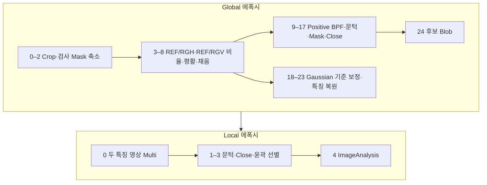

| 단계 | JSON상 근거와 해석 |
|---|---|
| Global 0–17 | [Arithmetic Divide](영상처리기법.md#arithmetic)로 `ref/rgh`, `ref/rgV` 생성 → Bilateral·RegionFilling → Positive BPF·Threshold → 후보 취합·Mask·Close |
| Global 18–24 | 평활한 기준과 Divide 보정한 두 특징을 원좌표로 저장. 최종 후보는 BlobContourCriteria |
| Local 0–4 | 입력 10·11을 **Multi**로 결합한 후 Threshold·Close·BlobContourCriteria·ImageAnalysis |

`EdgeThreshold2_11/12`는 실행 목록에 있지만 이후 Threshold는 BPF 결과 슬롯을 참조합니다. 따라서 EdgeThreshold 출력이 주 후보 경로에 반드시 반영된다고 단정하지 않습니다.

**전달 특징:** `REF 2 RGH`, `REF 2 RGV` ↔ Local 10·11.

Global 에폭시.json — 전체 25개 노드와 원문 설정

원본 SHA-256 앞 16자리: `1a1a2c6254a25bc4`. 입력 17개. JSON 기록 시각: `2025.08.11 20:13`.

| 순번·도구 | 이미지 참조 1 / 2 / 3 / 4 | 선택 옵션 1 / 2 | I1 / I2; P1 / P2 / P3 | 결과명 · SaveUse |
|---|---|---|---|---|
| [MakeCropImage_0](영상처리기법.md#makecropimage) | 0 / 9 / 0 / 0 | 1:Manual / 0:옵션 없음 | 0 / 0; 1 / 1 / 2 | 이름 없음 · `false` |
| [Arithmetic_1](영상처리기법.md#arithmetic) | 25 / 26 / 0 / 0 | 3:Divide / 0:Not Use | 0 / 0; 1 / 0 / 0.5 | 마스크 · `false` |
| [Morphology_2](영상처리기법.md#morphology) | 27 / 0 / 0 / 0 | 0:Rect / 0:Erode | 21 / 11; 3 / 0 / 0 | 마스크축소 · `false` |
| [Arithmetic_3](영상처리기법.md#arithmetic) | 17 / 18 / 0 / 0 | 3:Divide / 1:Multi First | 0 / 0; 0.5 / 0 / 0.5 | ref/rgh · `false` |
| [Arithmetic_4](영상처리기법.md#arithmetic) | 17 / 19 / 0 / 0 | 3:Divide / 1:Multi First | 0 / 0; 0.5 / 0 / 0.5 | ref/rgV · `false` |
| [Bilateral_5](영상처리기법.md#bilateral) | 29 / 0 / 0 / 0 | 0:옵션 없음 / 0:옵션 없음 | -1 / 3; 35 / 15 / 0 | 이름 없음 · `false` |
| [Bilateral_6](영상처리기법.md#bilateral) | 30 / 0 / 0 / 0 | 0:옵션 없음 / 0:옵션 없음 | -1 / 3; 35 / 15 / 0 | 이름 없음 · `false` |
| [RegionFilling_7](영상처리기법.md#regionfilling) | 31 / 28 / 0 / 0 | 0:Normal / 0:false | 0 / 0; 0.25 / 0.5 / 0.5 | 이름 없음 · `false` |
| [RegionFilling_8](영상처리기법.md#regionfilling) | 32 / 28 / 0 / 0 | 0:Normal / 0:false | 0 / 0; 0.25 / 0.5 / 0.5 | 이름 없음 · `false` |
| [BPF_9](영상처리기법.md#bpf) | 33 / 0 / 0 / 0 | 2:Positive / -1:옵션 없음 | 0 / 0; 5 / 0.35 / 0.8 | 이름 없음 · `false` |
| [BPF_10](영상처리기법.md#bpf) | 34 / 0 / 0 / 0 | 2:Positive / -1:옵션 없음 | 0 / 0; 5 / 0.35 / 0.8 | 이름 없음 · `false` |
| [EdgeThreshold2_11](영상처리기법.md#edgethreshold2) | 31 / 0 / 0 / 0 | 0:Rect / 0:옵션 없음 | 11 / 50; 180 / 0 / 0 | 이름 없음 · `false` |
| [EdgeThreshold2_12](영상처리기법.md#edgethreshold2) | 32 / 0 / 0 / 0 | 0:Rect / 0:옵션 없음 | 11 / 50; 180 / 0 / 0 | 이름 없음 · `false` |
| [Threshold_13](영상처리기법.md#threshold) | 35 / 0 / 0 / 0 | 0:Normal / 0:Manual | 50 / 50; 80 / 0 / 0 | 이름 없음 · `false` |
| [Threshold_14](영상처리기법.md#threshold) | 36 / 0 / 0 / 0 | 0:Normal / 0:Manual | 50 / 50; 80 / 0 / 0 | 이름 없음 · `false` |
| [Arithmetic_15](영상처리기법.md#arithmetic) | 39 / 40 / 0 / 0 | 0:Add / 0:Not Use | 0 / 0; 1 / 0 / 0.5 | 이름 없음 · `false` |
| [Arithmetic_16](영상처리기법.md#arithmetic) | 41 / 28 / 0 / 0 | 4:And / 0:Not Use | 0 / 0; 1 / 0 / 0.5 | 이름 없음 · `false` |
| [Morphology_17](영상처리기법.md#morphology) | 42 / 0 / 0 / 0 | 2:Ellipse / 3:Close(Dilate->Eroce) | 11 / 11; 3 / 0 / 0 | 이름 없음 · `false` |
| [Gaussian_18](영상처리기법.md#gaussian) | 31 / 0 / 0 / 0 | 0:옵션 없음 / 0:옵션 없음 | 91 / 91; 3 / 0 / 0 | 이름 없음 · `false` |
| [Arithmetic_19](영상처리기법.md#arithmetic) | 31 / 44 / 0 / 0 | 3:Divide / 1:Multi First | 0 / 0; 0.5 / 0 / 0.5 | 이름 없음 · `false` |
| [Gaussian_20](영상처리기법.md#gaussian) | 32 / 0 / 0 / 0 | 0:옵션 없음 / 0:옵션 없음 | 91 / 91; 3 / 0 / 0 | 이름 없음 · `false` |
| [Arithmetic_21](영상처리기법.md#arithmetic) | 32 / 46 / 0 / 0 | 3:Divide / 1:Multi First | 0 / 0; 0.5 / 0 / 0.5 | 이름 없음 · `false` |
| [CropImageOverlay_22](영상처리기법.md#cropimageoverlay) | 0 / 45 / 0 / 0 | 0:옵션 없음 / 0:옵션 없음 | 0 / 0; 5 / 0.5 / 0.5 | REF 2 RGH · `true` |
| [CropImageOverlay_23](영상처리기법.md#cropimageoverlay) | 0 / 47 / 0 / 0 | 0:옵션 없음 / 0:옵션 없음 | 0 / 0; 5 / 0.5 / 0.5 | REF 2 RGV · `true` |
| [BlobContourCriteria_24](영상처리기법.md#blobcontourcriteria) | 43 / 0 / 0 / 0 | 0:And / 0:Lable Image | 10 / 0; 5 / 0.5 / 0.5 | 이름 없음 · `true` |

Local 에폭시.json — 전체 5개 노드와 원문 설정

원본 SHA-256 앞 16자리: `f3859a3f203382a5`. 입력 17개. JSON 기록 시각: `2025.08.11 20:06`.

| 순번·도구 | 이미지 참조 1 / 2 / 3 / 4 | 선택 옵션 1 / 2 | I1 / I2; P1 / P2 / P3 | 결과명 · SaveUse |
|---|---|---|---|---|
| [Arithmetic_0](영상처리기법.md#arithmetic) | 10 / 11 / 0 / 0 | 2:Multi / 0:Not Use | 0 / 0; 1 / 0 / 0.5 | 에폭시 · `false` |
| [Threshold_1](영상처리기법.md#threshold) | 17 / 0 / 0 / 0 | 0:Normal / 0:Manual | 50 / 50; 80 / 0 / 0 | 이름 없음 · `false` |
| [Morphology_2](영상처리기법.md#morphology) | 18 / 0 / 0 / 0 | 2:Ellipse / 3:Close(Dilate->Eroce) | 11 / 11; 3 / 0 / 0 | 이름 없음 · `false` |
| [BlobContourCriteria_3](영상처리기법.md#blobcontourcriteria) | 19 / 0 / 0 / 0 | 0:And / 0:Lable Image | 0 / 0; 5 / 0.5 / 0.5 | 이름 없음 · `false` |
| [ImageAnalysis_4](영상처리기법.md#imageanalysis) | 20 / 17 / 10 / 11 | 0:Src 0 / 0:옵션 없음 | 11 / 100; 15 / 15 / 1.1 | 이름 없음 · `true` |

## 찍힘

**의도 추정:** 두 기울기 방향의 국소 변화를 취합해 후보를 만들고 추가 특징으로 선별합니다. Global 22개, Local 16개 노드입니다.

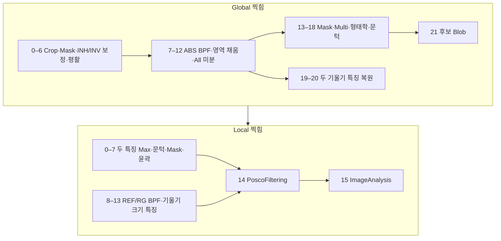

| 단계 | JSON상 근거와 해석 |
|---|---|
| Global 0–12 | [MergeTransformed Sub](영상처리기법.md#mergetransformed) → Bilateral → ABS BPF → RegionFilling → Differential All |
| Global 13–21 | Mask 조건·Multi 연산 후 Close/Open·Threshold로 후보 정리. 기울기 특징 2개를 따로 저장 |
| Local 0–7 | 두 특징의 [Max](영상처리기법.md#arithmetic) → Close·Threshold·검사 Mask 제한·윤곽 |
| Local 8–15 | REF/RGH/RGV의 BPF, 거칠기 Std, [EuclideanDistance](영상처리기법.md#euclideandistance) 경로 구성 후 PoscoFiltering·ImageAnalysis |

**전달 특징:** Global의 `_19`, `_20`은 **둘 다 `BPF INH`라는 결과명**입니다. 하지만 참조값은 각각 35·36으로 다릅니다. Local 10·11도 같은 이름이므로 문자열만으로 같은 영상이라고 보면 안 됩니다. 결과명 오타 가능성은 있으나 문서에서 INV로 바꾸지 않았습니다.

Global 찍힘.json — 전체 22개 노드와 원문 설정

원본 SHA-256 앞 16자리: `da29e681b703e08a`. 입력 17개. JSON 기록 시각: `2025.08.21 20:54`.

| 순번·도구 | 이미지 참조 1 / 2 / 3 / 4 | 선택 옵션 1 / 2 | I1 / I2; P1 / P2 / P3 | 결과명 · SaveUse |
|---|---|---|---|---|
| [MakeCropImage_0](영상처리기법.md#makecropimage) | 0 / 9 / 0 / 0 | 1:Manual / 0:옵션 없음 | 0 / 0; 1 / 1 / 2 | 이름 없음 · `false` |
| [Arithmetic_1](영상처리기법.md#arithmetic) | 25 / 26 / 0 / 0 | 1:Sub / 0:Not Use | 0 / 0; 1 / 0 / 0.5 | 이름 없음 · `false` |
| [Morphology_2](영상처리기법.md#morphology) | 27 / 0 / 0 / 0 | 0:Rect / 0:Erode | 51 / 21; 3 / 0 / 0 | 검출 Mask · `false` |
| [MergeTransformed_3](영상처리기법.md#mergetransformed) | 20 / 18 / 0 / 0 | 1:Sub / 0:옵션 없음 | 0 / 0; 1 / 0.5 / 0.5 | 보정 INH · `false` |
| [MergeTransformed_4](영상처리기법.md#mergetransformed) | 21 / 19 / 0 / 0 | 1:Sub / 0:옵션 없음 | 0 / 0; 1 / 0.5 / 0.5 | 보정 INV · `false` |
| [Bilateral_5](영상처리기법.md#bilateral) | 29 / 0 / 0 / 0 | 0:옵션 없음 / 0:옵션 없음 | -1 / 3; 15 / 5 / 0 | INH 노이즈 제거 · `false` |
| [Bilateral_6](영상처리기법.md#bilateral) | 30 / 0 / 0 / 0 | 0:옵션 없음 / 0:옵션 없음 | -1 / 3; 15 / 5 / 0 | INV 노이즈 제거 · `false` |
| [BPF_7](영상처리기법.md#bpf) | 31 / 0 / 0 / 0 | 1:ABS / -1:옵션 없음 | 0 / 0; 5 / 0.5 / 0.7 | BPF INH · `false` |
| [BPF_8](영상처리기법.md#bpf) | 32 / 0 / 0 / 0 | 1:ABS / -1:옵션 없음 | 0 / 0; 5 / 0.5 / 0.7 | BPF INV · `false` |
| [RegionFilling_9](영상처리기법.md#regionfilling) | 33 / 28 / 0 / 0 | 0:Normal / 0:false | 0 / 0; 1 / 0.5 / 0.5 | Region INH · `false` |
| [RegionFilling_10](영상처리기법.md#regionfilling) | 34 / 28 / 0 / 0 | 0:Normal / 0:false | 0 / 0; 1 / 0.5 / 0.5 | Region INV · `false` |
| [Differential_11](영상처리기법.md#differential) | 35 / 0 / 0 / 0 | 6:All / 0:Normal | 7 / 3; 0 / 0 / 0 | BPF INH 미분 · `false` |
| [Differential_12](영상처리기법.md#differential) | 36 / 0 / 0 / 0 | 6:All / 0:Normal | 7 / 3; 0 / 0 / 0 | BPF INV 미분 · `false` |
| [AllArithmetic_13](영상처리기법.md#allarithmetic) | 37 / 38 / 28 / 0 | 4:Mask / 0:Manual | 0 / 0; 1 / 0 / 0.5 | Mask 처리 · `false` |
| [Arithmetic_14](영상처리기법.md#arithmetic) | 39 / 40 / 0 / 0 | 2:Multi / 1:Multi First | 0 / 0; 255 / 0 / 0.5 | 이름 없음 · `false` |
| [Morphology_15](영상처리기법.md#morphology) | 41 / 0 / 0 / 0 | 2:Ellipse / 2:Open(Erode->Dilate) | 3 / 3; 3 / 0 / 0 | 이름 없음 · `false` |
| [Threshold_16](영상처리기법.md#threshold) | 42 / 0 / 0 / 0 | 0:Normal / 0:Manual | 50 / 50; 50 / 0 / 0 | 이름 없음 · `false` |
| [Morphology_17](영상처리기법.md#morphology) | 43 / 0 / 0 / 0 | 2:Ellipse / 3:Close(Dilate->Eroce) | 7 / 7; 3 / 0 / 0 | 이름 없음 · `false` |
| [Morphology_18](영상처리기법.md#morphology) | 44 / 0 / 0 / 0 | 2:Ellipse / 2:Open(Erode->Dilate) | 7 / 7; 3 / 0 / 0 | 이름 없음 · `false` |
| [CropImageOverlay_19](영상처리기법.md#cropimageoverlay) | 0 / 35 / 0 / 0 | 0:옵션 없음 / 0:옵션 없음 | 0 / 0; 5 / 0.5 / 0.5 | BPF INH · `true` |
| [CropImageOverlay_20](영상처리기법.md#cropimageoverlay) | 0 / 36 / 0 / 0 | 0:옵션 없음 / 0:옵션 없음 | 0 / 0; 5 / 0.5 / 0.5 | BPF INH · `true` |
| [BlobContourCriteria_21](영상처리기법.md#blobcontourcriteria) | 45 / 0 / 0 / 0 | 0:And / 1:Blob Grop | 10 / 0; 5 / 0.5 / 0.5 | 이름 없음 · `true` |

Local 찍힘.json — 전체 16개 노드와 원문 설정

원본 SHA-256 앞 16자리: `b0b925f20b15ec18`. 입력 17개. JSON 기록 시각: `2025.07.25 09:08`.

| 순번·도구 | 이미지 참조 1 / 2 / 3 / 4 | 선택 옵션 1 / 2 | I1 / I2; P1 / P2 / P3 | 결과명 · SaveUse |
|---|---|---|---|---|
| [Arithmetic_0](영상처리기법.md#arithmetic) | 10 / 11 / 0 / 0 | 8:Max / 0:Not Use | 0 / 0; 1 / 0 / 0.5 | 이름 없음 · `false` |
| [Morphology_1](영상처리기법.md#morphology) | 17 / 0 / 0 / 0 | 2:Ellipse / 3:Close(Dilate->Eroce) | 11 / 11; 3 / 0 / 0 | 이름 없음 · `false` |
| [Threshold_2](영상처리기법.md#threshold) | 18 / 0 / 0 / 0 | 0:Normal / 0:Manual | 50 / 50; 25 / 0 / 0 | 이름 없음 · `false` |
| [Morphology_3](영상처리기법.md#morphology) | 19 / 0 / 0 / 0 | 2:Ellipse / 3:Close(Dilate->Eroce) | 3 / 3; 3 / 0 / 0 | 이름 없음 · `false` |
| [Arithmetic_4](영상처리기법.md#arithmetic) | 20 / 8 / 0 / 0 | 4:And / 0:Not Use | 0 / 0; 1 / 0 / 0.5 | 이름 없음 · `false` |
| [MakeCenterMask_5](영상처리기법.md#makecentermask) | 8 / 0 / 0 / 0 | 1:Outline / 0:옵션 없음 | 5 / 5; 50 / 1 / 0.5 | 이름 없음 · `false` |
| [Arithmetic_6](영상처리기법.md#arithmetic) | 21 / 22 / 0 / 0 | 4:And / 0:Not Use | 0 / 0; 1 / 0 / 0.5 | 이름 없음 · `false` |
| [BlobContourCriteria_7](영상처리기법.md#blobcontourcriteria) | 23 / 0 / 0 / 0 | 0:And / 0:Lable Image | 0 / 0; 5 / 0.5 / 0.5 | 이름 없음 · `false` |
| [BPF_8](영상처리기법.md#bpf) | 0 / 0 / 0 / 0 | 0:Basic / -1:옵션 없음 | 0 / 0; 5 / 0.15 / 1 | 이름 없음 · `false` |
| [BPF_9](영상처리기법.md#bpf) | 1 / 0 / 0 / 0 | 0:Basic / -1:옵션 없음 | 0 / 0; 5 / 0.15 / 1 | 이름 없음 · `false` |
| [BPF_10](영상처리기법.md#bpf) | 2 / 0 / 0 / 0 | 0:Basic / -1:옵션 없음 | 0 / 0; 5 / 0.15 / 1 | 이름 없음 · `false` |
| [AllArithmetic_11](영상처리기법.md#allarithmetic) | 26 / 27 / 0 / 0 | 3:Std / 0:Manual | 0 / 0; 1 / 0 / 0.5 | 이름 없음 · `false` |
| [EuclideanDistance_12](영상처리기법.md#euclideandistance) | 3 / 4 / 0 / 0 | 0:옵션 없음 / 0:옵션 없음 | 0 / 0; 5 / 0.5 / 0.5 | 이름 없음 · `false` |
| [BPF_13](영상처리기법.md#bpf) | 29 / 0 / 0 / 0 | 0:Basic / -1:옵션 없음 | 0 / 0; 5 / 0.15 / 1 | 이름 없음 · `false` |
| [PoscoFiltering_14](영상처리기법.md#poscofiltering) | 24 / 25 / 28 / 30 | 0:And / 0:옵션 없음 | 5 / 0; 1.1 / 0.5 / 0.5 | 이름 없음 · `false` |
| [ImageAnalysis_15](영상처리기법.md#imageanalysis) | 31 / 17 / 18 / 17 | 0:Src 0 / 0:옵션 없음 | 11 / 100; 15 / 15 / 1.1 | 이름 없음 · `true` |

## Edge찍힘

**의도 추정:** 일반 찍힘과 유사한 기울기 후보에 방향성 마스크·3D 계열 특징을 추가합니다. Global 30개, Local 9개 노드입니다.

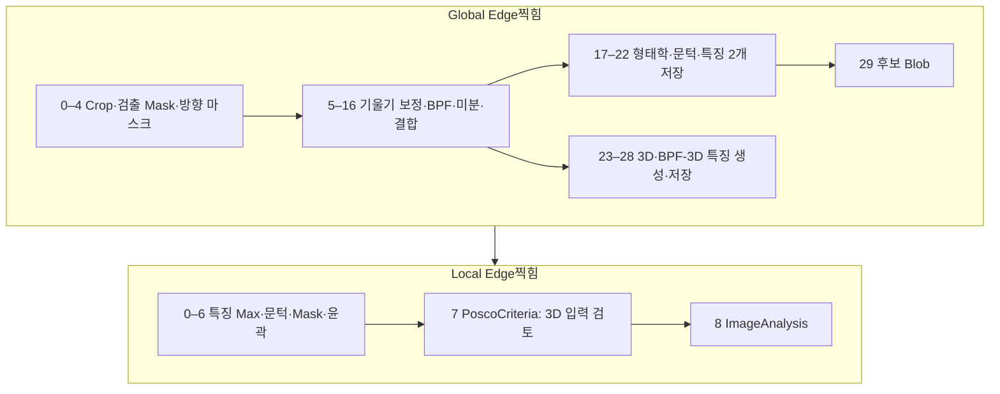

| 단계 | JSON상 근거와 해석 |
|---|---|
| Global 0–22 | [DirectionalMorphology](영상처리기법.md#directionalmorphology)로 `최종 검출 Mask` 경로 추가. 이후 기울기 보정·BPF·미분·형태학은 일반 찍힘과 유사 |
| Global 23–29 | Basic BPF 기반 `3D`와 기존 BPF 특징 기반 `BPF-3D`를 [Make3DImage](영상처리기법.md#make3dimage)로 만들고 복원·저장 |
| Local 0–8 | 입력 10·11의 Max(배율 P1=255) → Close·Threshold·Mask·윤곽 → PoscoCriteria가 입력 12 `3D` 사용 → ImageAnalysis |

**전달 특징:** Local 10–13은 `BPF INH`, `BPF INH`, `3D`, `BPF-3D`. **13번 BPF-3D는 이 Local JSON의 네 이미지 참조 필드 어디에도 나타나지 않습니다.** 특징을 생성한다고 모두 판정에 사용하는 것은 아닙니다.

Global Edge찍힘.json — 전체 30개 노드와 원문 설정

원본 SHA-256 앞 16자리: `30042a47a4347390`. 입력 17개. JSON 기록 시각: `2025.09.12 09:11`.

| 순번·도구 | 이미지 참조 1 / 2 / 3 / 4 | 선택 옵션 1 / 2 | I1 / I2; P1 / P2 / P3 | 결과명 · SaveUse |
|---|---|---|---|---|
| [MakeCropImage_0](영상처리기법.md#makecropimage) | 0 / 9 / 0 / 0 | 1:Manual / 0:옵션 없음 | 0 / 0; 1 / 1 / 2 | 이름 없음 · `false` |
| [Arithmetic_1](영상처리기법.md#arithmetic) | 25 / 26 / 0 / 0 | 1:Sub / 0:Not Use | 0 / 0; 1 / 0 / 0.5 | 이름 없음 · `false` |
| [Morphology_2](영상처리기법.md#morphology) | 27 / 0 / 0 / 0 | 0:Rect / 0:Erode | 11 / 21; 3 / 0 / 0 | 검출 Mask · `false` |
| [DirectionalMorphology_3](영상처리기법.md#directionalmorphology) | 28 / 0 / 0 / 0 | 0:Left / 0:Erode | 51 / 10; 50 / 0 / 0 | 이름 없음 · `false` |
| [Arithmetic_4](영상처리기법.md#arithmetic) | 28 / 29 / 0 / 0 | 1:Sub / 0:Not Use | 0 / 0; 1 / 0 / 0.5 | 최종 검출 Mask · `false` |
| [MergeTransformed_5](영상처리기법.md#mergetransformed) | 20 / 18 / 0 / 0 | 1:Sub / 0:옵션 없음 | 0 / 0; 1 / 0.5 / 0.5 | 보정 INH · `false` |
| [MergeTransformed_6](영상처리기법.md#mergetransformed) | 21 / 19 / 0 / 0 | 1:Sub / 0:옵션 없음 | 0 / 0; 1 / 0.5 / 0.5 | 보정 INV · `false` |
| [Bilateral_7](영상처리기법.md#bilateral) | 31 / 0 / 0 / 0 | 0:옵션 없음 / 0:옵션 없음 | -1 / 3; 15 / 5 / 0 | INH 노이즈 제거 · `false` |
| [Bilateral_8](영상처리기법.md#bilateral) | 32 / 0 / 0 / 0 | 0:옵션 없음 / 0:옵션 없음 | -1 / 3; 15 / 5 / 0 | INV 노이즈 제거 · `false` |
| [BPF_9](영상처리기법.md#bpf) | 33 / 0 / 0 / 0 | 1:ABS / -1:옵션 없음 | 0 / 0; 5 / 0.5 / 0.7 | BPF INH · `false` |
| [BPF_10](영상처리기법.md#bpf) | 34 / 0 / 0 / 0 | 1:ABS / -1:옵션 없음 | 0 / 0; 5 / 0.5 / 0.7 | BPF INV · `false` |
| [RegionFilling_11](영상처리기법.md#regionfilling) | 35 / 30 / 0 / 0 | 0:Normal / 0:false | 0 / 0; 1 / 0.5 / 0.5 | Region INH · `false` |
| [RegionFilling_12](영상처리기법.md#regionfilling) | 36 / 30 / 0 / 0 | 0:Normal / 0:false | 0 / 0; 1 / 0.5 / 0.5 | Region INV · `false` |
| [Differential_13](영상처리기법.md#differential) | 37 / 0 / 0 / 0 | 6:All / 0:Normal | 7 / 3; 0 / 0 / 0 | 이름 없음 · `false` |
| [Differential_14](영상처리기법.md#differential) | 38 / 0 / 0 / 0 | 6:All / 0:Normal | 7 / 3; 0 / 0 / 0 | 이름 없음 · `false` |
| [AllArithmetic_15](영상처리기법.md#allarithmetic) | 39 / 40 / 28 / 0 | 4:Mask / 0:Manual | 0 / 0; 1 / 0 / 0.5 | Mask 처리 · `false` |
| [Arithmetic_16](영상처리기법.md#arithmetic) | 41 / 42 / 0 / 0 | 2:Multi / 1:Multi First | 0 / 0; 255 / 0 / 0.5 | 이름 없음 · `false` |
| [Morphology_17](영상처리기법.md#morphology) | 43 / 0 / 0 / 0 | 2:Ellipse / 2:Open(Erode->Dilate) | 3 / 3; 3 / 0 / 0 | 이름 없음 · `false` |
| [Threshold_18](영상처리기법.md#threshold) | 44 / 0 / 0 / 0 | 0:Normal / 0:Manual | 50 / 50; 50 / 0 / 0 | 이름 없음 · `false` |
| [Morphology_19](영상처리기법.md#morphology) | 45 / 0 / 0 / 0 | 2:Ellipse / 3:Close(Dilate->Eroce) | 7 / 7; 3 / 0 / 0 | 이름 없음 · `false` |
| [Morphology_20](영상처리기법.md#morphology) | 46 / 0 / 0 / 0 | 2:Ellipse / 2:Open(Erode->Dilate) | 7 / 7; 3 / 0 / 0 | 이름 없음 · `false` |
| [CropImageOverlay_21](영상처리기법.md#cropimageoverlay) | 0 / 37 / 0 / 0 | 0:옵션 없음 / 0:옵션 없음 | 0 / 0; 5 / 0.5 / 0.5 | BPF INH · `true` |
| [CropImageOverlay_22](영상처리기법.md#cropimageoverlay) | 0 / 38 / 0 / 0 | 0:옵션 없음 / 0:옵션 없음 | 0 / 0; 5 / 0.5 / 0.5 | BPF INH · `true` |
| [BPF_23](영상처리기법.md#bpf) | 33 / 0 / 0 / 0 | 0:Basic / -1:옵션 없음 | 0 / 0; 5 / 0.5 / 0.7 | 이름 없음 · `false` |
| [BPF_24](영상처리기법.md#bpf) | 34 / 0 / 0 / 0 | 0:Basic / -1:옵션 없음 | 0 / 0; 5 / 0.5 / 0.7 | 이름 없음 · `false` |
| [Make3DImage_25](영상처리기법.md#make3dimage) | 50 / 51 / 0 / 0 | 0:Basic / 2:InvertV | 0 / 0; 5 / 0.55 / 1 | 3D · `false` |
| [Make3DImage_26](영상처리기법.md#make3dimage) | 37 / 38 / 0 / 0 | 0:Basic / 3:InvertAll | 0 / 0; 5 / 0.45 / 1 | BPF-3D · `false` |
| [CropImageOverlay_27](영상처리기법.md#cropimageoverlay) | 0 / 52 / 0 / 0 | 0:옵션 없음 / 0:옵션 없음 | 0 / 0; 5 / 0.5 / 0.5 | 3D · `true` |
| [CropImageOverlay_28](영상처리기법.md#cropimageoverlay) | 0 / 53 / 0 / 0 | 0:옵션 없음 / 0:옵션 없음 | 0 / 0; 5 / 0.5 / 0.5 | BPF-3D · `true` |
| [BlobContourCriteria_29](영상처리기법.md#blobcontourcriteria) | 47 / 0 / 0 / 0 | 0:And / 1:Blob Grop | 10 / 0; 5 / 0.5 / 0.5 | 이름 없음 · `true` |

Local Edge찍힘.json — 전체 9개 노드와 원문 설정

원본 SHA-256 앞 16자리: `8ab045950a0a703b`. 입력 17개. JSON 기록 시각: `2025.09.12 09:13`.

| 순번·도구 | 이미지 참조 1 / 2 / 3 / 4 | 선택 옵션 1 / 2 | I1 / I2; P1 / P2 / P3 | 결과명 · SaveUse |
|---|---|---|---|---|
| [Arithmetic_0](영상처리기법.md#arithmetic) | 10 / 11 / 0 / 0 | 8:Max / 0:Not Use | 0 / 0; 255 / 0 / 0.5 | 이름 없음 · `false` |
| [Morphology_1](영상처리기법.md#morphology) | 17 / 0 / 0 / 0 | 2:Ellipse / 3:Close(Dilate->Eroce) | 11 / 11; 3 / 0 / 0 | 이름 없음 · `false` |
| [Threshold_2](영상처리기법.md#threshold) | 18 / 0 / 0 / 0 | 0:Normal / 0:Manual | 50 / 50; 25 / 0 / 0 | 이름 없음 · `false` |
| [Morphology_3](영상처리기법.md#morphology) | 19 / 0 / 0 / 0 | 2:Ellipse / 3:Close(Dilate->Eroce) | 3 / 3; 3 / 0 / 0 | 이름 없음 · `false` |
| [Arithmetic_4](영상처리기법.md#arithmetic) | 20 / 8 / 0 / 0 | 4:And / 0:Not Use | 0 / 0; 1 / 0 / 0.5 | 이름 없음 · `false` |
| [Arithmetic_5](영상처리기법.md#arithmetic) | 21 / 8 / 0 / 0 | 4:And / 0:Not Use | 0 / 0; 1 / 0 / 0.5 | 이름 없음 · `false` |
| [BlobContourCriteria_6](영상처리기법.md#blobcontourcriteria) | 22 / 0 / 0 / 0 | 0:And / 0:Lable Image | 0 / 0; 5 / 0.5 / 0.5 | 이름 없음 · `false` |
| [PoscoCriteria_7](영상처리기법.md#poscocriteria) | 23 / 12 / 0 / 0 | 0:And / 0:Src 0 | 0 / 0; 1.1 / 1.1 / 0.5 | 이름 없음 · `false` |
| [ImageAnalysis_8](영상처리기법.md#imageanalysis) | 24 / 17 / 18 / 17 | 0:Src 0 / 0:옵션 없음 | 11 / 100; 15 / 15 / 1.1 | 이름 없음 · `true` |

## Empty 템플릿

`Global Empty.json`은 입력 이름이 `Empty0`–`Empty16`이고 처리 노드가 없습니다. 실제 결함 검사나 일반 Global과 같은 알고리즘으로 취급하지 않습니다.

Global Empty.json — 전체 0개 노드와 원문 설정

원본 SHA-256 앞 16자리: `525ea78f39dc0e02`. 입력 17개. JSON 기록 시각: `2026.07.10 09:59`.

| 순번·도구 | 이미지 참조 1 / 2 / 3 / 4 | 선택 옵션 1 / 2 | I1 / I2; P1 / P2 / P3 | 결과명 · SaveUse |
|---|---|---|---|---|
| — | — | — | — | 처리 노드 없음 |

## 확인 필요 사항

| 항목 | 확인 내용 |
|---|---|
| 실행 연결 | 현재 앱의 Mask/Hole/Global 입력 연결과 JSON의 입력 계약이 다름. 문서의 추정 전처리 경로를 실제 실행 검증으로 오해하면 안 됨 |
| Global 녹·바니시의 샘플 경로 | 입력 8 `Mask`, 9 `Hole Mask`가 모두 `D:\#개발\현대 코어\20250825\250825 03 sfzos8s0009\측면\3\0REF.bmp`를 가리킴. 런타임 SetImage와 파일 경로 중 무엇이 우선되는지는 미확인 |
| 중복 결과명 | 찍힘·Edge찍힘의 두 기울기 저장 결과가 모두 `BPF INH`. 서로 다른 참조이므로 문서에서는 원문 그대로 보존 |
| 이름과 옵션의 불일치 | `STD` 이름의 Avg, `2,4` 이름의 45° 선 탐색, 수평·수직 이름의 동일 각도 설정 등이 있음. 실제 설정값 우선 |
| 물리량·성능 | 3D 특징은 실측 깊이, 문턱값은 실제 결함 크기로 환산하지 않음. 이미지 실행·튜닝·검출률 평가는 수행하지 않음 |
